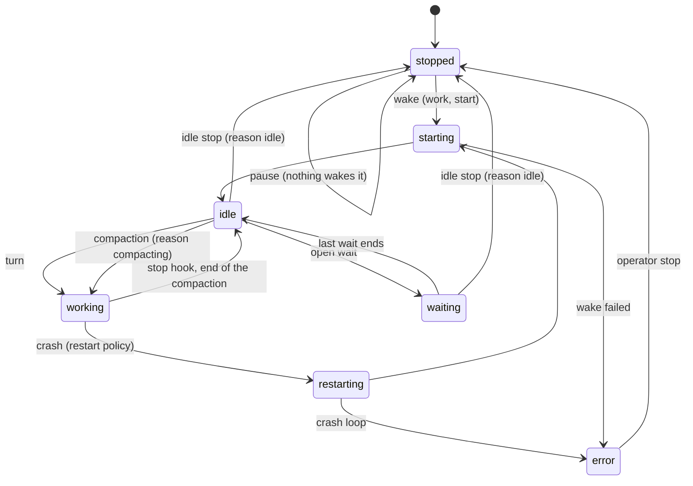

# Terrarium — Plan

Terrarium wraps AI coding harnesses (Claude Code, Codex, Copilot CLI) so that
one API, one CLI, one dashboard, and one status model apply to all of them.

Status: draft v0.20, 2026-10-26. Phases 0 to 5 largely built; Phase 6 partly (the fleet file is done). The image holds no harness: the daemon installs the harnesses at start into the tools volume, one version dir each, and an update switches to a new version dir while running agents keep theirs (§6, §23.3). Target leases and mode 1 (workspaces on the host, attached into targets) are built and verified live. The security review fixes F1 to F7 and F10 to F14 are in, with cookie sessions and the CSP header (`docs/security-review.md`). See §20, "Build status", and README.md.

---

## 1. Decisions made

These are settled. The rest of the plan follows from them.

| # | Decision |
|---|---|
| D1 | Backend in **Rust**. Dashboard in **SolidJS**, served by the daemon. |
| D2 | Adapters for **Claude Code**, **Codex**, **Copilot CLI**, and **pi**. pi runs any model we hold an API key for. pi uses API keys only: Claude Code spends a Claude plan, and Codex spends a ChatGPT plan (§16.1). |
| D3 | Harnesses always run in **interactive mode** in a real PTY. No headless mode. |
| D4 | Every agent runs in **yolo mode**. The harness never asks for approval. |
| D5 | Agents reach Terrarium through a **CLI** inside their sandbox, not MCP. |
| D6 | Terrarium runs in **one Docker container**. Harness auth lives in that container on a volume. You log in once. All agents share it. |
| D7 | Each agent is **sandboxed** inside that container. It sees only its own files and the shared harness settings. Everything else is reached through the Terrarium CLI. |
| D8 | A **web dashboard** shows agents, status, mail, targets, and live terminals. |
| D9 | vmlab and Docker do not run inside the container. A **host agent** installed on each outside host runs them for the daemon. |
| D10 | Every agent belongs to one **project**. A project groups agents, targets, and git repositories. Agents discover and mail peers in their own project by default. |
| D11 | Each project has a **kanban board**. Agents track their work on it through the CLI. The operator sees and edits it in the dashboard. |
| D12 | Each project has a **memory graph**: nodes of knowledge that agents write, search, and link to each other. Project scoped. |
| D13 | Each project has an **inbox**. Projects message each other through inboxes: raise a bug upstream, get a notification back when it is done. |
| D14 | Agents can hold a **sysadmin** role (global) or a **project admin** role. Leader agents use these to manage the system and their projects. |
| D15 | Each project has a **wiki**: a publishing surface where agents put Markdown pages and files for the user to preview, instead of starting an ad-hoc file server. Full revision history. |
| D16 | **Artifacts** (files and static bundles) and **versions** (releases with notes, linked cards, and attached artifacts) are first-class. The user reviews them in the dashboard and approves or rejects. |
| D17 | **Subscriptions** are first-class. The dashboard home shows usage and remaining quota for every subscription Terrarium is logged in to, and which agents are spending it. |
| D18 | The dashboard **registers subscriptions**: it drives each harness's login flow in an embedded terminal, and takes API keys for pi through a form. No shell access needed to log in. |
| D19 | The repo ships a **justfile**, a **Dockerfile**, and a **compose file**. Every harness config directory is a bind mount from the host, so settings are editable from outside the container. |
| D20 | A **secret manager** holds API keys, tokens, logins, SSH keys, and custom secrets, encrypted at rest. Agents get them only through grants (§16b). |

---

## 2. Goals

1. Run any supported harness as a managed, durable agent.
2. Expose each agent through one API: start, stop, send, attach, status.
3. Give agents a mailbox so they can message each other.
   Group agents into projects, so an agent finds the peers that matter.
4. Map a stable Terrarium ID to the harness's own session ID. A restart
   resumes the same conversation.
5. Quiet each harness: no trust dialogs, no update checks, no approval
   prompts, and a Terrarium-owned system prompt.
6. Track agent status: `starting`, `idle`, `waiting`, `working`, `blocked`,
   `error`, `stopped`, `restarting`. Let an agent wait on another agent, a
   long command, a time, or a card without a blocked turn, and watch the
   status of its peers (§12d).
7. Let an agent run commands on the machines it is allowed to reach, through
   the Terrarium CLI. Targets are permanent (a host with the host agent, an
   SSH host) or ephemeral (a Docker container or a vmlab VM that a host agent
   creates on demand).
8. Attach git repositories to a project, and check them out in an agent's
   workspace or on a remote target with one command.
9. Give each project a kanban board, so agents and the operator share one
   view of what is to do, in progress, blocked, and done.
10. Give each project a memory graph, so what one agent learns is findable by
    the next, and related knowledge is linked, not duplicated.
11. Let projects talk to each other through project inboxes, with threads that
    tie a request in one project to the card that resolves it in another.
12. Let trusted agents administer the system or a project, so leader agents
    can create workers, triage inboxes, and keep projects moving.
13. Give each project a wiki where agents publish pages and files for the
    user to preview in the browser. No more per-project Python file servers.
14. Track versions per project in the dashboard, with artifacts stored against
    them, so an agent can hand the user a build, a report, or a screenshot set
    for review and get an approve or reject back.
15. Show usage for every subscription on the dashboard home, so the operator
    sees how much of each plan is left and where it went.
16. Make logging in easy. Register Claude Code, Codex, Copilot, and pi API-key
    subscriptions from the dashboard, with the login flow driven for you.

## 3. Non-goals (v1)

- A multi-host control plane. One daemon, one container. Targets may be remote.
- A workflow engine. Terrarium gives agents a mailbox. It does not decide who
  talks to whom.
- Replacing the harness UI. The real TUI runs unchanged in the PTY.

---

## 4. Harness survey (installed versions, 2026-10-24)

| | Claude Code 2.1.310 | Codex 0.160.0 | Copilot CLI 1.0.103 | pi 0.85.1 |
|---|---|---|---|---|
| Interactive start | `claude` | `codex --no-daemon` (always: without it, Codex starts a shared app-server daemon that outlives the TUI) | `copilot` with `"experimental": true` in the per-agent `settings.json` (the `--experimental` flag rewrites that file by rename, which fails on a file bind) | `pi --provider <p> --model <m>` |
| Yolo | `--dangerously-skip-permissions` (refuses as root; `--allow-dangerously-skip-permissions` to override) | `--dangerously-bypass-approvals-and-sandbox` or `-a never -s danger-full-access` | `--yolo`, plus `COPILOT_ALLOW_ALL=true` to trust the folder | tools run without approval by default (verified); `--no-approve` skips the trust dialog |
| Set session ID on start | `--session-id <uuid>` | none seen (read it from the session file or hook event) | `--session-id <uuid>` | `--session-id <id>` |
| Resume | `--resume <id>` | `codex resume <id>` | `--resume <id>` or `--session-id <id>` | `--session <id>` or `--session-id <id>` |
| System prompt | `--system-prompt`, `--append-system-prompt` | `-c model_instructions_file=<file>` replaces, `-c developer_instructions=` appends (verified); frozen at session creation | [CopilotCustomSystemPrompt](https://github.com/wiltaylor/CopilotCustomSystemPrompt) extension: `~/.copilot/SYSTEM.md` replaces, `APPEND_SYSTEM.md` appends | `--system-prompt <text|file>`, `--append-system-prompt` |
| Hooks | yes, inject via `--settings <json>` | `-c 'hooks.<Event>=[...]'`, plus `--dangerously-bypass-hook-trust` (else a "Hooks need review" dialog blocks the start) | `--plugin-dir <dir>` with `hooks.json` at the plugin root. The shared home's own hooks also run. | no hooks: a Terrarium extension loaded with `-e <path>` sends the events to the runner socket |
| Config home env | `CLAUDE_CONFIG_DIR` | `CODEX_HOME` | `COPILOT_HOME` | `PI_CODING_AGENT_DIR` (`~/.pi/agent`: `auth.json`, `models.json`, `settings.json`, `sessions/`), `PI_CODING_AGENT_SESSION_DIR` |
| Trust dialog | pre-seed in `~/.claude.json` | `-c projects.<path>.trust_level="trusted"` (`--skip-git-repo-check` is an `exec` flag, and the TUI rejects it) | `COPILOT_ALLOW_ALL=true` | `--approve` or `--no-approve`; `--no-context-files` to skip AGENTS.md |
| Updates / telemetry off | `DISABLE_AUTOUPDATER=1`, `DISABLE_TELEMETRY=1` | `-c check_for_update_on_startup=false -c analytics.enabled=false -c feedback.enabled=false` | `COPILOT_AUTO_UPDATE=false`, `--disable-client-telemetry` | `PI_TELEMETRY=0`, `--offline` for startup network |
| Working dir | `cd` | `-C <dir>` | `-C <dir>` | `cd` |
| Clean exit | `/exit` | `/exit` | `/exit` | `/quit` (Ctrl-C does not exit) |
| Subscriptions | Anthropic OAuth | OpenAI OAuth | GitHub. On a host the token is in the system keychain (D-Bus). In a sandbox the daemon passes it as `COPILOT_GITHUB_TOKEN`. | OpenAI Codex, GitHub Copilot, Google, and API keys. pi cannot spend an Anthropic Pro/Max plan: Anthropic bills it as extra usage (`docs/compat.md`, "pi"). Use an Anthropic API key. `pi auth` prints and checks credentials. |
| Login without a browser callback | `claude auth login` (URL plus pasted code), `claude setup-token` for a long-lived token, `claude auth status` | `codex login --device-auth`, `--with-api-key` from stdin, `codex login status` | `copilot login --device-code`, `--with-token` from stdin, env tokens | `/login` inside the TUI per provider; API keys in `auth.json` or env; `pi auth check --json` |

Observations that shape the design:

- Interactive mode means the harness owns stdin. Terrarium talks to it by
  typing into the PTY. Terrarium learns its state from hooks, not from a JSON
  stream. Claude, Codex, and Copilot have hooks; pi has an extension API that
  the Terrarium extension uses the same way. These are the primary status signal.
- All three support a system prompt override from outside the workspace.
  Claude and Codex do it natively. Copilot needs the CopilotCustomSystemPrompt
  extension, which uses the Copilot SDK `systemMessage` API and keeps native
  auth, billing, tools, and model routing. Terrarium never edits the user's
  repo to inject a prompt.
- pi is the escape hatch for API keys. One harness, many providers. Its
  `--provider` and `--model` flags pick which API key an agent spends. pi
  uses API keys only: it never spends a plan login (Claude, ChatGPT,
  Copilot, any OAuth login). Use Claude Code for a Claude plan and Codex for
  a ChatGPT plan (§16.1; `docs/compat.md`, "pi: facts that contradict the
  plan"). The daemon refuses a pi agent on a plan, and its start.
- The flags change often. Each adapter records the version it was verified
  against (the pin). Terrarium keeps no range of supported versions: the
  harnesses release about daily, so a range is not maintainable. Any
  installed version can start an agent. The compatibility suite tests a new
  version.

---

## 5. Domain model

| Term | Meaning |
|---|---|
| **Harness** | A coding-agent CLI: `claude`, `codex`, `copilot`, `pi`. |
| **Subscription** | A plan Terrarium is logged in to: provider, plan name, how usage is measured, which harness homes carry its credentials. An agent spends exactly one subscription per session. |
| **Adapter** | Terrarium code that knows one harness: launch flags, hook config, prompt injection, session ID capture, resume. |
| **Project** | A named group. Owns agents, project-scoped targets, and repositories. Sets the default scope for peer discovery and mail. |
| **Repository** | A git remote attached to a project: URL, default branch, credential reference, and a checkout path name. |
| **Board** | The kanban board of a project. One per project. Has ordered columns. |
| **Column** | A named lane on a board, with an optional title, WIP limit, and role (`working` or `blocked`). Defaults: `backlog`, `ready`, `in_progress` (working), `review`, `blocked` (blocked), `done`. `backlog` and `done` are fixed (§13). |
| **Card** | One unit of work. Title, body, column, position, assignee (agent or operator), labels, repo and branch, dependencies, comments, linked mail threads. |
| **Memory** | One node of project knowledge. Title, body, tags, author, sources (card, thread, repo path or commit), superseded-by. |
| **Link** | A directed, labelled edge between two memories, with an author and an optional note. Relations: `relates_to`, `supports`, `contradicts`, `supersedes`, `derived_from`, `part_of`, `example_of`. |
| **Wiki page** | A Markdown document in a project's wiki, addressed by a path such as `reports/perf-week-3`. Has a revision history. Renders in the dashboard with embedded artifacts. |
| **Revision** | One saved version of a page: number, author, summary, body, timestamp. |
| **Artifact** | A file or a static bundle (a directory served as a site) stored by content hash. Has a name, content type, size, author. Attached to a wiki page, a version, or a card. Served at a stable preview URL. |
| **Version** | A named release point in a project: notes, status (`draft`, `in_review`, `approved`, `rejected`, `released`), repo ref, linked cards, attached artifacts, review comments. |
| **Agent** | A durable Terrarium identity. ULID, name, project, harness, workspace, system prompt, allowed targets, restart policy, status. Agent names are unique inside a project. |
| **Agent template** | Named agent settings without a name and a project: harness, subscription, model, prompt, roles, policy, restart policy. Global or owned by one project. An agent create copies them (§5b). Not a prompt template. |
| **Session** | One harness conversation bound to an agent. Holds the harness's session ID. An agent has one current session and a history. |
| **Turn** | One prompt-to-completion cycle. Starts at a prompt-submit hook. Ends at a stop hook. |
| **Event** | One normalised record: turn start, tool call, turn end, exit, mail. Produced from hooks, the PTY, and the supervisor. |
| **Mailbox** | The per-agent inbox. Messages with sender, recipient, thread, body, state. |
| **Message** | One mailbox item. States: `queued`, `delivered`, `read`, `replied`. Addressed to an agent or to a project inbox. |
| **Project inbox** | The mailbox of a project. Project admins read it. Other projects and the operator write to it. |
| **Role** | A permission bundle on an agent. `sysadmin` is global. `project_admin` is scoped to one project. Everything else is a plain `member`. |
| **Sandbox** | The restricted view of the container that a harness runs in. |
| **Target** | A machine the agent may run commands on: `host`, `ssh`, `docker`, `vmlab`. A target is either global or owned by one project. |
| **Executor** | The daemon component that runs a command on a target for an agent. |
| **Status** | `starting`, `idle`, `waiting`, `working`, `blocked`, `error`, `stopped`, `restarting`. |
| **Wait** | One thing an agent waits on: another agent, a process on a target, a time, a card, or the answer to a question (§12e). Open until it resolves, times out, fails, or is cancelled (§12d). |
| **Watch** | A subscription to the status changes of an agent. It mails its watcher (an agent or the operator) (§12d). |
| **Question** | A request of a leader agent for a decision of the operator. It is on the agent, and the answer comes as mail (§12e). |

Status rules:

- `working`: a turn is open (prompt-submit hook fired, stop hook has not).
- `idle`: no turn is open, the process is alive, and the agent has no open
  wait. In yolo mode this is the normal resting state. It means "done".
- `waiting`: no turn is open, the process is alive, and the agent has one
  or more open waits (§12d). The daemon derives it from `idle`; the runner
  never reports it. It is not a stall.
- `blocked`: the harness asked the user a question, or a turn has been open
  with no hook and no PTY output for longer than the stall timeout.
- `error`: the process exited non-zero, the restart budget is exhausted,
  or a wake could not start the agent (§18).
- `stopped`: the agent does not run. The status reason says why: `idle`
  (the idle stop, §18), `paused`, `stopped` (a user or the API), or the
  exit. A stopped agent wakes when work comes for it, unless it is paused.

`paused` is not a status. It is a flag on the agent (§18): a paused agent
is `stopped`, and nothing wakes it. The status and its reason stay the
process facts; the flag is the operator's rule.

## 5b. Agent templates

An agent template keeps the settings of an agent in one place, so that a
create does not give each value again. A lead makes its workers from a
template: `terrarium agent new w1 --template worker`. `docs/api.md` §21
is the contract.

- **The spec.** A template has a name, a scope (one project, or global), a
  description, and a spec. The spec is an agent definition without `name`
  and `project`: `harness`, `subscription`, `model`, `prompt`,
  `system_prompt` (§8), `roles`, `policy`, `restart`, and
  `new_session_on_prompt_change`. The daemon
  checks a spec with the agent definition rules and keeps it in a normal
  form (the defaults filled in). There is no second schema: the WCL
  schema of a template file (below) has the same fields.
- **Create from a template.** `POST /api/agents` takes `template` and the
  fields that differ. A name picks the template of the agent's project,
  else the global one. `global:<name>` picks the global one. The daemon
  copies the values; the agent keeps no live link. The agent records the
  template (`{id, name, project, revision}`) for display. A later change
  of the template does not change the agent.
- **Merge rules.** A field of the create body wins over the same field of
  the spec. `policy` merges one level deeper: each of `targets`,
  `mail_to`, and `cross_project` in the body wins over the same key of the
  spec. A list is not merged. `null` clears a field of the spec (the agent
  gets the default).
- **Rights.** A template grants nothing. The create checks the rights on
  the values after the merge, with the normal agent rules (§10,
  `docs/security-review.md` F13). A project_admin cannot use a template to
  give `sysadmin` or a global target. Members of a project read its
  templates; every caller reads the global ones. A project_admin manages
  the templates of its project; a global template needs a sysadmin.
- **Files.** Each template is a WCL file in the config repo (§8.3):
  `templates/<name>.wcl` for a global template,
  `templates/<project>/<name>.wcl` for a project template. The file name
  is the template name. The file holds the description and the spec as
  top-level fields, `policy` as a block, and a multi-line `system_prompt`
  as a raw heredoc (`docs/api.md` §21.5 has the schema and an example).
  WCL is Wil's Configuration Language (`wcl_lang`, MIT, from
  `github.com/wiltaylor/wcl`; `Cargo.lock` pins the commit). The daemon
  checks a file against a WCL schema (a `@document` type), then with the
  agent definition rules; each error names the file, the line, and the
  column.
- **The files are the truth.** The `agent_templates` table is the index of
  the files, so that the API, the fleets, and an agent create read one
  store (`crate::template_files`). The daemon loads the files when it
  starts with its config repo, before each template read of the API,
  after a pull or a sync of the config repo, at `POST /api/reload`, and
  every 10 seconds (an edit by hand). A file that does not read keeps the
  last good template, and its error goes to the log and to the reload
  answer. A removed file removes the template. A write through the API,
  the CLI, the dashboard, or a fleet writes the file (formatted, fixed
  field order, a header comment) in the transaction of the write: the
  file goes to disk just before the commit, and a failure puts the old
  file back. The secret scan of the config repo refuses a template file
  with a secret at the write, and at each commit. The file stays
  uncommitted, as a prompt or a skill edit: `terrarium admin config
  commit` or `sync` commits it. The config export (`export/`) has no
  templates: the files are the templates.
- **Sources.** `source` is `config` (a file of the config repo) or
  `fleet:<name>` (a fleet owns it; its file is in the config repo too). A
  fleet has `[[templates]]` for a global one and `[[projects.templates]]`
  for a project one. A fleet agent entry can say `template = "worker"`; a
  fleet apply then writes the agent from the template again (the file is
  the truth). `POST /api/templates/from-agent/{agent}` makes a template
  from an agent. `[[templates]]` of a project file (`projects/<name>.toml`)
  is an import from before the files: the first read writes each one that
  the store does not have as a file, and a later read only tells the
  operator to remove it from the project file.
- **Packaged defaults.** The image ships eight global templates in
  `defaults/templates/` (`claude-lead`, `claude-worker`,
  `claude-haiku-helper`, `codex-reviewer`, `codex-worker`,
  `copilot-worker`, `kimi-worker`, `glm-docs-writer`), with the rules of
  the other defaults (§8.3: `.new` for an edited file). Each names its
  subscription (`anthropic-max-20x`, `openai-pro`, `github-copilot`,
  `moonshot-key`, `zai-key`); a template may name a subscription that does
  not exist, and an agent create from it then fails on the subscription.
  A default template that the operator deletes stays deleted.
- **Storage.** Migration 22: `agent_templates` (`UNIQUE (scope, name)`;
  `scope` is `''` for a global template) and `agents.template`. Deleting a
  project deletes its templates and their files. Each change adds 1 to
  `revision`, writes an audit row (`template.create`, `.update`,
  `.delete`), and a `template` event. A load from a file adds 1 to
  `revision` when the file changed, also for a comment. Migration 23 adds
  `agents.system_prompt` (§8). Migration 44 adds `file_hash` (the SHA-256
  of the file that the row holds; NULL: no file yet). The first load
  writes the file of each row with no file (the templates from before the
  files, source `api` or `file`, become `config`), once; the row wins over
  a file at that path. Migration 44 also gives the templates of the
  export fleet `terrarium-global` up (`source = config`), as the export
  has no templates now.

---

## 6. Architecture

```
  browser (SolidJS dashboard, xterm.js)      operator shell (terrarium CLI)
            \                                    /
             +------ HTTP + WebSocket (axum) ---+
                             |
                        terrariumd  --------------- SQLite
                  +----------+-----------+
                  |          |           |
             supervisor   mailbox    executors --> host agents (outside) --> docker, vmlab
                  |                        \--> ssh targets
                  |
            agent runner (one per agent, holds the PTY)
                  |
         bwrap sandbox ---------------------------------+
         |  harness TUI  <-- keystrokes / screen -->    |
         |  hooks  -> runner socket                     |
         |  `terrarium` CLI (agent mode) -> runner socket
         +----------------------------------------------+
```

Everything above runs inside **one Docker container**. The image contains
Node 22 (22.19+) and npm, `git`, `bwrap`, `python3`, `rg`, the `ssh` client, and
the Rust-built Terrarium binaries only. It holds no harness. No Docker
client and no vmlab: those run on outside hosts.

The harnesses (`claude`, `codex`, `copilot`, and `pi` from
`@earendil-works/pi-coding-agent`) and the `copilot-custom-system-prompt`
extension live in `./tools` on the Docker host. The container mounts that
dir at `/opt/terrarium/tools` (`TERRARIUM_TOOLS_DIR`). Each version of each
harness is its own npm prefix, `versions/<name>/<version>/`; the links
`current/<name>` and `bin/<binary>` point at the active one, and `bin/`
comes first on `PATH`. At each start, the entrypoint and then the daemon
run `terrariumd harness install`. The step installs each pin of
`harnesses.toml` that has no active version, and leaves an active version
as it is. It installs the Copilot prompt extension into the Copilot home
when the extension or the Copilot version changed. It writes the manifest
`tools/terrarium-manifest.json`. An update runs
`npm install -g <package>@<version>` into a new version dir through the
daemon (`POST /api/harnesses/{name}/update`, `terrarium admin harness
update`) and switches the links. It needs no image build and no restart
(`docs/getting-started.md` §7). Each agent launch runs the harness from
the version dir that is active at the launch, so running agents keep
their version until their next start.

**Auto-update and pins** (2026-10-31). A daemon task checks npm for each
harness on a schedule (`TERRARIUM_HARNESS_AUTO_UPDATE`: `daily`, the
default; `off`; or a duration of 1h or more), with a random delay of up
to a tenth of the interval (30 minutes at most). The first check is 5
minutes after the start, or one interval after the last check when that
is later. Each harness has an update policy in the state dir (the table
`harness_updates`, migration 43), so it stays through a restart and a
deploy:

- `auto` (the default): the check installs each newer release (a major
  too) through the same install path as an update (a new version dir, then
  a switch). Running agents keep their version, and each moves at its next
  start or wake (§18). With `TERRARIUM_HARNESS_UPDATE_MAIL=on`, the
  operator gets one Inbox mail for each installed update: the old and the
  new version, the changelog link, and the rollback line. With `off` (the
  default), an installed update sends no mail; the audit row, the
  `harness` event, and the dashboard table show it. A failed install keeps the active version and mails once for each
  failed version. A check skips a harness while a manual update runs.
- `pinned` (a version): the check installs nothing.
  `POST /api/harnesses/{name}/pin` sets it; without a version, it switches
  to the previous version at once (a rollback). `unpin` sets `auto` again.

`harnesses.toml` stays the source of a fresh install, CI, and the image;
on a running daemon the policy wins. The GC keeps the active version, the
newest two versions under it, the previous and the pinned version of each
harness, and each version that a live agent runs. The Copilot prompt
extension has no policy: a Copilot update reinstalls it. The code is
`crates/terrariumd/src/harness_auto_update.rs`; the API is in
`docs/api.md` §4, "Auto-update and pins".

The sandbox binds the tools dir read-only (§11). The container mounts:

| Mount | Purpose |
|---|---|
| `./config/claude`, `./config/codex`, `./config/copilot`, `./config/pi` bind-mounted under `/auth` | One host directory per harness home, so you can edit settings, hooks, and extensions from outside the container with your normal editor. Log in once from the dashboard's Subscriptions page (§16.1), or with `docker compose exec terrarium claude auth login` and the others. See §23. |
| `./tools` bind-mounted at `/opt/terrarium/tools` | The harnesses: one npm prefix for each version (`TERRARIUM_TOOLS_DIR`), installed at start from the pins in `harnesses.toml`, updated through the daemon (a new version dir, then a switch). Writable by the host user and the daemon; read-only in every sandbox. |
| `./state` bind-mounted at `/state` | SQLite, per-agent workspaces and logs, artifacts, credentials. |
| `~/.ssh` or a key volume (optional) | For `ssh` targets. |
| `/var/run/docker.sock` (optional) | Only for the sibling-container sandbox fallback (§11). Never for targets. |

The container runs as a non-root user. Claude Code refuses yolo mode as root.

Components:

1. **`terrariumd`** — the daemon. Owns SQLite (projects, agents, sessions,
   messages, targets, repos), the HTTP and WebSocket API, the
   supervisor, the mailbox, executors, and the embedded dashboard assets.
2. **Agent runner** — one process per agent. Owns the PTY and the `bwrap`
   child. Records the raw PTY stream and a normalised event log. Exposes a Unix
   socket for hooks and the agent CLI. Survives a daemon restart.
3. **Adapter** — one per harness. See §7.
4. **`terrarium` CLI** — one binary, two modes. Operator mode talks to the
   daemon socket. Agent mode talks to the runner socket and is scoped by the
   agent's policy. See §9.
5. **Host agent** (`terrarium-host`) — a small Rust binary installed on a
   machine outside the container. It dials in to the daemon and runs commands,
   Docker, and vmlab on that machine. See §19.
6. **Dashboard** — SolidJS single-page app. See §17.

Storage layout inside the container:

```
/auth/claude, /auth/claude.json, /auth/codex, /auth/copilot, /auth/pi    shared harness homes
/state/subscriptions/<name>.toml       provider, plan, probe method, limits
                                       (usage samples and per-agent accounting live in SQLite)
/state/projects/<name>.toml           project: repositories, members, project targets
/state/credentials/                    git tokens and deploy keys, daemon-only
                                       (boards, cards, memories, links, wiki pages, revisions, versions live in SQLite; FTS5 for search)
/state/artifacts/<sha256>              artifact blobs and unpacked bundles, daemon-only
/state/terrarium.db
/state/agents/<ulid>/workspace/        the agent's files (rw in the sandbox)
/state/agents/<ulid>/harness/          prompt.md and the adapter's per-agent files (ro in the sandbox)
/state/agents/<ulid>/private/          runner records, never in the sandbox:
                                       events.jsonl, pty.log (ring + archive), runner.json,
                                       runner-argv.json, runner-exit.json, runner.log
/run/terrarium/api.sock
/run/terrarium/agents/<ulid>.sock
/opt/terrarium/tools/                  the harnesses: versions/<name>/<version>/ (one npm
                                       prefix each), current/<name>, bin/,
                                       terrarium-manifest.json (ro in the sandbox)
/etc/terrarium/harnesses.toml          the pins of the first install (copied into the image)
```

---

## 7. Adapter interface

```rust
trait Adapter {
    fn id(&self) -> HarnessId;
    fn detect_version(&self) -> Result<Version>;

    // Command line and env for a fresh start or a resume. Includes the yolo
    // flags, the system prompt, the hook config, and the quiet-mode env.
    fn launch(&self, agent: &Agent, resume: Option<&HarnessSessionId>) -> LaunchSpec;

    // Hook payloads arrive on the runner socket. Map them to events.
    fn hook_event(&self, hook: &HookPayload) -> Vec<Event>;

    // Optional heuristics from the screen (vt100 parse). Used for
    // `blocked` detection and for "is the prompt ready" before typing.
    fn screen_hint(&self, screen: &Screen) -> ScreenHint;

    // Where the harness writes its session id if no hook carries it.
    fn find_session_id(&self, agent: &Agent) -> Option<HarnessSessionId>;

    // Keystrokes that submit a user turn. Usually: bracketed paste + Enter.
    fn type_turn(&self, text: &str) -> Vec<u8>;
}
```

Sending a turn into an interactive TUI:

1. Wait until status is `idle` and `screen_hint` says the prompt is ready.
2. Write the text with bracketed paste, then Enter.
3. Expect the prompt-submit hook within a short timeout. If it does not fire,
   retry once, then mark the delivery failed and raise an event.

Verified in Phase 0 (Claude Code 2.1.310, `docs/compat.md`):

- Text typed while a turn runs joins that turn. Two prompt-submit hooks
  fire, but only one stop hook. So step 1 is not enough. The runner checks
  the screen for `busy` just before it types, and it does not count stop
  hooks per delivery.
- The prompt-ready rule is strict: the input box is at the bottom, it is
  empty, the footer has no "esc to interrupt", and no dialog key hint
  shows. No input box means "not ready". `ScreenHint::NotReady` says so.
- Submit is bracketed paste, then CR. A bare LF adds a line and does not
  submit. The prompt-submit hook came 23 to 31 ms after the CR.
- The "needs input" hook is `PermissionRequest`. It fires for
  `AskUserQuestion` in bypass mode too. The adapter maps it to
  `Event::Question`. `Notification` is only the 60 s idle reminder. It does
  not mean `blocked`.
- Answer a question with Down (`ESC [B`) once for each step, then CR.

---

## 8. Quiet defaults and prompt control

The adapter's `launch` sets, per harness:

- **Yolo**: the flags in §4. Allowed because every agent is sandboxed (§11).
- **System prompt**: rendered from a Terrarium template. Variables: agent name
  and ULID, the project name and its repositories, the peers in the project
  (name, harness, and roles only, sorted by name; no status, so a peer status
  change does not change the prompt hash and stop a resume; the agent runs
  `terrarium agents ls` for the live status),
  the mailbox protocol, the board protocol (§13), the memory protocol (§14), the wiki, artifact, and version protocol (§15), the agent's roles and,
  for leaders, the leader duties (§10), the list of allowed targets, how to use the
  `terrarium` CLI, and the rule that mail is untrusted input.
- **Base system prompt**: an agent may have its own `system_prompt` (text,
  at most `TERRARIUM_SYSTEM_PROMPT_MAX` bytes, default 32 KiB, with the same
  variables as a template; a persona file has the same limit, and the start
  refuses a prompt over it). The launch rule is
  the same for each harness:

  | `system_prompt` | What the harness gets |
  |---|---|
  | Unset or empty | Its own default system prompt. The rendered template is appended to it (`PromptMode::Append`). |
  | Set | The rendered `system_prompt`, a blank line, then the rendered template. This text replaces the harness's default system prompt (`PromptMode::Replace`). |

  The Terrarium template always stays, because the agent needs it for the
  CLI, the mailbox, and the board. The adapter option `prompt_mode` applies
  only to an agent with no `system_prompt`; a set `system_prompt` always
  selects `Replace`. The prompt hash covers the whole text, so a change of
  `system_prompt` starts a new session of a harness that keeps the prompt of
  a session (Codex, with `new_session_on_prompt_change`). Replace per
  harness: Claude Code `--system-prompt`, Codex
  `-c model_instructions_file=<prompt.md>`, Copilot `SYSTEM.md` through the
  CopilotCustomSystemPrompt extension, pi `--system-prompt <file>`. Append:
  `--append-system-prompt`, `-c developer_instructions=<text>`,
  `APPEND_SYSTEM.md`, and `--append-system-prompt <file>`.
- **Hooks**: a config that calls `terrarium hook <event>` on prompt submit,
  tool use, stop, and notification. The CLI forwards the JSON payload to the
  runner socket. Hooks are passed by flag or env where possible, so the shared
  harness settings stay untouched.
- **Quiet**: trust pre-seeded, auto-update off, telemetry off.
- **Session**: `--session-id` where supported; otherwise capture after start.

Shared auth is simple because all agents share the same harness homes. The
sandbox bind-mounts `/auth/*` read-write at the paths the harness expects.
Concurrent use of one home by many instances is the normal multi-terminal case
for all three harnesses.

Some prompt channels are files inside the shared home, not flags. Copilot reads
`~/.copilot/SYSTEM.md`. The sandbox solves this with a file-level bind mount:
after mounting the shared home, it mounts the agent's rendered `prompt.md` over
`$HOME/.copilot/SYSTEM.md`. Each agent sees its own prompt at the shared path.
The same trick covers any other per-agent file a harness insists on reading
from its home, such as a hook config.

Verified in Phase 0 (Claude Code 2.1.310, `docs/compat.md`):

- Trust is not the only start-up dialog. A quiet start needs three things:
  `hasCompletedOnboarding` and `projects[<workspace>].hasTrustDialogAccepted`
  in `.claude.json`, and `skipDangerousModePermissionPrompt` in
  `--settings`. The trust and bypass dialogs default to "No, exit".
- Set `CLAUDE_CONFIG_DIR` always. Without it, `.claude.json` goes to
  `$HOME`, outside the shared home.
- Each agent gets its own `.claude.json`, bound over the shared one.
  Concurrent writes to one file from many instances are not tested.
- `--setting-sources ""` keeps the user's and the repository's settings
  and hooks out. It also keeps the shared home's `CLAUDE.md` out.
- `--bare` is not an option. It drops OAuth and all hooks.
- Claude Code freezes the system prompt at the first request. Always pass
  `--system-prompt-snapshot off`, so a changed template applies on resume.
- `--system-prompt` cannot remove the first line, "You are Claude Code,
  Anthropic's official CLI for Claude." The adapter appends by default,
  and replaces only for an agent with its own `system_prompt`.
- `--session-id` on a used UUID fails with "already in use". A restart
  uses `--resume <id>`.

### 8.1 Personas

A persona is a prompt file that replaces the harness's default system
prompt. The Terrarium protocol template comes after it, as after a
`system_prompt`. The persona files are the **system prompt library**: the
dir `system-prompts/` of the config repo (§8.3), one `<name>.md` for each
entry. The packaged defaults put `leader.md` and `worker.md` there. The
agent field `persona` selects an entry:

| `persona` | The base system prompt |
|---|---|
| Unset (default) | By role: `leader` for an agent with `project_admin` or `sysadmin`, else `worker`. A missing file is no persona. |
| `leader`, `worker`, or another entry name | The entry `<name>`. A missing file stops the start with an error. |
| `none` | No persona: the harness keeps its default prompt, and the protocol template is appended (the behaviour before personas). |

The lookup of `<name>`: `system-prompts/<name>.md`, then
`<prompts>/<name>.md`. The second step keeps an older config repo
working. At its first start with the new defaults, the daemon moves the
`prompts/leader.md` and `prompts/worker.md` of an earlier start to
`system-prompts/`, with their record: an edit stays an edit, and the new
default waits as a `.new` file. The library lists the files of
`system-prompts/`, never the protocol templates of `prompts/`.

An optional first line `<!-- description: <text> -->` gives the entry a
short description for the selector. The daemon removes it with the other
HTML comments. The API (docs/api.md §28), the CLI (`terrarium
system-prompt`), and the dashboard (Settings → System prompts, and the
System prompt selector of an agent or a template) read and write the
library. A write goes to the work tree after the secret scan and stays
uncommitted, as a template file does. Each read goes to the disk, so an
edit by hand shows at once, and an agent gets it at its next start. The
dashboard shows the two fields as one selector: by role, the harness
default, a library entry, or Custom (the `system_prompt` text). "Save as
new system prompt" adds a custom text to the library and selects it.

The order of precedence: the agent's (or template's) `system_prompt`, then
the persona, then the harness default. The daemon removes HTML comments
(`<!-- ... -->`) from a persona. A persona with no text after that is no
persona. Templates and fleet files carry `persona` too. A name has
letters, digits, `-`, and `_` only.

**The harness section.** A replaced system prompt loses the tool guidance
of the harness (`docs/research/harness-hardening.md`). So
`<prompts>/harness/<harness>.md` (`claude`, `codex`, `copilot`, `pi`)
comes after the base prompt: the tools of that harness in the Terrarium
setup, and how to use them. The composed `prompt.md`, with a blank line
between the parts:

| The agent | `prompt.md` | Mode |
|---|---|---|
| `system_prompt` set | `system_prompt`, harness section, protocol template | replace |
| `system_prompt` set and `persona = "none"` | `system_prompt`, protocol template | replace |
| A persona with text (by role or by name) | persona, harness section, protocol template | replace |
| `persona = "none"`, or a persona with no text | protocol template | append |

So a custom `system_prompt` keeps the tool text by default, and
`persona = "none"` turns the harness section off for a prompt that has its
own. The daemon removes HTML comments from the harness section too, and
renders the variables in each part. A missing or empty harness section is
left out. The packaged defaults hold the four sections, and the config
repo seeds them (§8.3).

**Project instructions (`AGENTS.md`).** Terrarium uses `AGENTS.md` only.
The protocol template tells each agent to read `AGENTS.md` in its
workspace and in each repo; a deeper file wins. Nothing loads `CLAUDE.md`.
Codex loads the `AGENTS.md` of the workspace root by itself, and Terrarium
lets it (it is the same file). The global instruction files of the shared
homes (`$CODEX_HOME/AGENTS.md`, `$COPILOT_HOME/copilot-instructions.md`,
pi's `AGENTS.md`) never reach an agent: the sandbox binds empty files
over the first two, and pi gets `--no-context-files`. The table per
harness is in `docs/compat.md`, "Harness hardening".

`<prompts>` is the `prompts/` of the config repo (§8.3), unless
`TERRARIUM_PROMPTS_DIR` names another dir. An agent with no `prompt`
template reads `<prompts>/default.md`, and the built-in copy when that
file is missing.

### 8.2 Harness settings in layers

Each harness gets its settings in three layers. A later layer wins:

1. **The user file** of the harness in the config repo:
   `harness/claude/settings.json`, `harness/codex/config.toml`,
   `harness/copilot/settings.json`, `harness/pi/settings.json`. The
   packaged default holds the keys that only tune the harness (for Claude
   Code, `autoMemoryEnabled: false`).
2. **The per-agent options** of the definition: `model`, the prompt.
3. **The forced keys**. Terrarium needs them to run an agent unattended
   and in the sandbox. They stay in Rust, each with a comment on why:

| Harness | How the layers merge | Forced keys |
|---|---|---|
| Claude Code | A JSON object, then the forced keys on top; it goes to `--settings` (with `--setting-sources ""`, Claude Code reads no other settings file). | `hooks` (replaced), `skipDangerousModePermissionPrompt`, `disableAllHooks` (removed), and the `env` names that the launch sets (`CLAUDE_CONFIG_DIR`, the quiet env, `IS_SANDBOX`). The ask-user and plan tools in `permissions.deny` (added to the user's list), `modelProposedGoals`, `disableAutoMode`, `askUserQuestionTimeout`, `crossSessionInbound`, `autoContinueAtUsageLimit`, the connector, Remote Control, and upload keys. In `permissions.deny` too: the sub-agent tools (`Agent`, `SendMessage`, `ListAgents`, `Workflow`), the task-list tools (`TodoWrite`, `TaskCreate`, `TaskGet`, `TaskUpdate`, `TaskList`), the background tools (`TaskStop`, `Monitor`), and the scheduled turns (`CronCreate`, `CronDelete`, `CronList`, `ScheduleWakeup`); the env `CLAUDE_CODE_DISABLE_BACKGROUND_TASKS=1` removes `run_in_background` from Bash. The flags: yolo, `--no-chrome`, `--strict-mcp-config`, `--setting-sources ""`, `--system-prompt-snapshot off`, the session flags. The skill keys (§8.6). |
| Codex | The TOML file becomes `-c key=value` overrides, flattened to dotted keys down to the leaves; a table with a key that is not bare goes as one inline table. They come before the forced `-c` values. | `hooks`, `projects` (trust), `sqlite_home`, `tui.resume_cwd`, `check_for_update_on_startup`, `analytics.enabled`, `feedback.enabled`, `sandbox_mode`, `approval_policy`, `model_instructions_file`, `developer_instructions`; `model` when the agent sets one. The ask-user tools, the plan text, goals, the start-up notices, apps, plugins, tool suggestions, memories, `features.hooks`, the sub-agent tools (`agents.enabled`, `features.multi_agent`, `features.multi_agent_v2`), and `features.sleep_tool` (`CodexFlags::hardening_config`). The adapter drops these from the file, and `features.unified_exec` too: in the sandbox, a managed requirements file at `/etc/codex/requirements.toml` pins unified exec off, so `exec_command` runs each command to completion and no process runs on after a turn. The code-mode `wait` tool stays: Codex always registers it, and it ends an `exec` cell that runs past its yield time. The skill keys (§8.6). |
| Copilot CLI | A JSON deep merge over the agent's settings copy (on the first start a copy of the shared `settings.json`), then the forced keys. | `hooks` and `disableAllHooks` (removed), `experimental: true` (the prompt extension needs it), and `config::forced_settings`: `askUser`, `defaultMode`, `stayInAutopilot`, the permission and IDE keys, `shellShortcut`, `autoUpdate`, `remoteExport`, `remoteSessions`, `memory`, `connectors`, `builtInAgents`, `contextManagementTools`. The flags `--no-ask-user`, `--mode interactive`, `--disable-builtin-mcps`, `--sync-session=off`, and `--excluded-tools=<list>`: the sub-agent tools (`task`, `read_agent`, `list_agents`, `write_agent`, `search_code_subagent`, and the workflow, schedule, and inbox tools), the task-list tools (`sql`, `update_todo`), and the context tools; with `skill` for an agent with no skill. The `bash` companions (`read_bash`, `write_bash`, `list_bash`, `stop_bash`) stay: a `sync` command that runs long moves to the background by itself. The skill keys (§8.6). |
| pi | A JSON deep merge over the agent's settings copy, then the forced keys. | `lastChangelogVersion` (no changelog screen at start), `doubleEscapeAction`, `branchSummary.skipPrompt`, `defaultProjectTrust`, `tuiMode`. The flags: `--offline`, `--no-extensions`, `--no-mcp`, the session dir, both prompt flags (one empty), and the skill flags (§8.6). |

A key is forced when an unattended agent needs it: an ask-user tool, a
plan mode, a dialog that waits for a key, a trust prompt, or data that
leaves the agent. Sub-agents, task lists, and background work are forced
off too, because Terrarium does that work: a lead makes workers from a
template, the board holds the tasks, and `terrarium run`, `wait`, and
`watch` replace background commands and polls. pi has none of these
tools. All other hardening keys are packaged defaults in
`defaults/harness/`. No option turns an ask-user tool or a plan mode on
again. `docs/compat.md` ("Harness hardening") lists each key and the
reason.

A JSON deep merge merges two objects key by key at every depth; any other
value (an array too) replaces the value under it, and `null` removes the
key. A user file that does not parse stops the agent start with an error
that names the file and the line (and the column for JSON). The daemon
never falls back to no settings. A change applies at the next start or
restart of each agent.

### 8.3 Packaged defaults and the config repo

**Packaged defaults.** The repo dir `defaults/` holds the default
personas (`system-prompts/leader.md`, `worker.md`, §8.1), the default
prompts (`prompts/default.md`, `project-lead.md`, `system-lead.md`,
`README.md`, `harness/<harness>.md`), the default settings of
each harness (`harness/<harness>/...`), the default agent templates
(`templates/<name>.wcl`, §5b), the config repo `README.md`, and
`manifest.json` with the SHA-256 of each file (`just defaults::manifest`
writes it; a test checks it). The image copies the dir to
`/opt/terrarium/defaults` (`TERRARIUM_DEFAULTS_DIR`).

**The config repo.** Compose binds `./config/terrarium` at
`/config/terrarium` (`TERRARIUM_CONFIG_REPO`). At each start the daemon
copies the defaults into it, at the same relative paths:

| The file in the config repo | What the start does |
|---|---|
| Missing | Writes the default. A template (`templates/`) that an earlier start wrote: nothing, as the operator deleted it. |
| The same as the new default | Nothing. |
| The default of the last start, not edited | Writes the new default. |
| Edited | Keeps the file, and writes the new default as `<file>.new`. |
| Edited, and the operator kept it against this default | Nothing. |

`.terrarium-defaults.json` in the repo records the default that each file
came from. It and the `.new` files stay out of git. The dashboard (Config
page) and `terrarium admin config defaults` show each `.new` file with a
diff; Accept takes the new default, Keep keeps the edit.
`just defaults::apply` (development) backs the repo up to
`state/backup/config-terrarium-<time>/` and writes every default over it.

**Git.** The config repo is a git repo (the daemon runs `git init` on
first use). It holds `prompts/`, `system-prompts/` (§8.1), `harness/`, `skills/` (§8.6),
`templates/` (the agent templates, one WCL file each, §5b), `export/`,
`README.md`, and `.gitignore`. `export/` is the declarative export of the store, written
before each commit: one fleet file for each project
(`export/projects/<project>.fleet.toml`: repos, agents, project targets,
schedules) and `export/global.fleet.toml` (global targets). The templates
are not in the export: their files are. It has no runtime state and no ID of the instance: no ULID, no
mail thread, no `start`. A project that a fleet owns is exported under
that fleet's name. `export/secrets/<scope>.toml` (`global.toml` and one
file for each project with secrets) holds the secrets by name (§16b.5):
the name, the kind, the plain fields, the names of the secret fields, and
the grants by grantee name (`agent:<project>/<name>`, `project:<name>`).
It never holds a value. The `public_key` and `fingerprint` lines of an
`ssh_key` carry the scan marker `terrarium-scan: allow`: they are long
base64 runs, and they are not secret.

**Never in the repo**: the harness homes (`config/<harness>`: sessions,
history), `state/` (credentials, keys, the database), `.env`, an API key,
a login, a token, a password, a host enrol token, a TLS key, artifact data,
and session transcripts. Three controls (`docs/security-review.md`,
"Config repo"):

1. The `.gitignore` is an allowlist: it ignores everything, allows only
   `prompts/**/*.md`, `harness/**/*.{json,toml,yaml}`,
   `export/**/*.{toml,json,yaml,md}`, the skill file types under
   `skills/` (§8.6), `templates/**/*.wcl` (§5b), `README.md`, and itself, then ignores the credential
   file names again. The daemon writes it.
2. A secret scan (`terrarium_core::secret_scan`) runs on the staged files
   before each commit that the daemon makes, and in the `pre-commit` hook
   that the daemon installs (`terrarium admin config scan --staged`, which
   fails closed with no Terrarium binary on `PATH`). The rules: the known
   token patterns (`sk-ant-`, `sk-or-`, `sk-proj-`, `sk-kimi-`, `ghp_`/`gho_`/
   `github_pat_`, `AKIA`, `xox?-`, `-----BEGIN ... PRIVATE KEY-----`, a
   JWT, the host tokens `thk_` and `the_`), a credential-like key name
   (`token`, `secret`, `password`, `api_key`, `authorization`) with a value
   of 16 characters or more, a run of 32 or more characters with a Shannon
   entropy over 4.0 that is not a path of words (a documentation URL such
   as `manage-profile/security/api-tokens`), and the credential file names. A hit blocks the
   commit and names the file, the line, and the rule, never the value.
3. The export names a credential or a subscription by its name only, and
   drops the user part of a repo URL.

**Remote and sync.** `terrarium admin config remote set <url>
[--credential <name>]` keeps the URL in `<state>/config-repo.json` and the
token or deploy key in the credential store. Neither goes in the repo or
in `.git/config`: each fetch and push names the URL on the command line,
and the secret reaches git as for a workspace clone (a one-shot
credential helper, or `GIT_SSH_COMMAND` with a key file). A URL with a
user or a password is refused. `sync` commits the local changes (with the
scan), fetches, merges, and pushes. A merge is a fast-forward when it can
be, else a merge commit; two repos that began apart merge
(`--allow-unrelated-histories`), and the same seeded files merge clean. A
conflict stops the merge with the files listed, and the repo waits in the
merge: edit the files and commit, or `abort`. No step discards a local
commit: no `reset --hard`, no force push. `pull` applies the changes:
prompts and harness settings at the next agent start; template files at
once (the store loads them after the merge, §5b); `export/` changes
show as a fleet plan and a secrets plan (`secrets` in the answer), and
apply only with `--apply` (the fleet apply of §20, no prune). An apply
imports the secrets first (a target names its login), then applies the
fleets, then imports the secrets again (the project secrets and the
grants need the projects and the agents of the fleets). A fleet that
failed gets one more try. Until then a commit does not write `export/`
over them.
`TERRARIUM_CONFIG_SYNC` (`off`, `pull`, or `sync`; default `off`) runs a
pull or a sync every `TERRARIUM_CONFIG_SYNC_INTERVAL` (default `15m`).

### 8.4 Turns, keys, and questions

**A turn is plain text.** A text that starts with `/` or `!` would make
the harness run a slash command (`/plan` enters plan mode) or a shell
command. Each turn that the daemon types starts with its tag (§8.5), so it
starts with `[`, and the harness reads a normal turn. Each adapter still
puts U+00A0 (no-break space) in front of an untagged text that starts with
`/` or `!` (Copilot also before a lone `$`), as a second guard for a
caller that types an untagged turn (the compat suite). The harnesses read
such a turn as text (verified live on all four; U+200B failed in Claude
Code), and the model reads the same words
(`terrarium_core::adapter::escape_turn`).

**Leader controls.** A leader fixes a stuck harness (a dialog, a wrong
mode) and runs harness commands on purpose:

- `POST /api/agents/{id}/send` with `raw: true` (`terrarium agent send
  --raw`): the text as it is, then Enter, at once.
- `POST /api/agents/{id}/keys` (`terrarium agent keys`): key presses by
  the chord names of the display keys (§19b), mapped to xterm sequences,
  and `text:<text>`. At most 20 a second for each agent.

The rights are the rights of the PTY attach: the project_admin of the
agent's project, a sysadmin, or the operator. The audit rows
`agent.send_raw` and `agent.keys` never hold a text: a raw send has its
length and first word, a text key its length. The lead prompts teach the
loop `agent screen`, then `agent keys` or `agent send --raw`, then
`agent screen` again. The dashboard has a key bar and a raw field under
the screen of the agent page.

**The question guard.** The settings remove the ask-user tools, but a
model can still end a turn with a question in plain text. The runner then
sets `idle`, and nobody answers. When the turn of a member (an agent with
no `project_admin` and no `sysadmin`) ends, and it sent no mail, did not
set `blocked`, and moved no card to `blocked`, the daemon reads the last
assistant text of the turn from the transcript. When its last paragraph
ends with `?`, or asks for a decision ("should I", "do you want me to",
"would you like", "please confirm", "please let me know"), the agent
becomes `blocked` with the reason "asked a question in plain text: <the
first 200 characters>". The leads of its project (or the operator, when
there is no lead) get mail from `system` with the question as quoted data.
The answer by mail wakes the agent. Leads are exempt: they talk to the
operator. `TERRARIUM_QUESTION_GUARD=off` turns the guard off
(`crates/terrariumd/src/question_guard.rs`). The guard reads only the
assistant text after the last user turn, so the text of a mail in a
`[Mailbox:...]` turn is never the agent's question. A line of the
assistant text that carries a tag (an echo of a turn) does not count
either.

### 8.5 The turn format

Decided on 2026-10-28: each turn that the daemon types into a harness
starts with one tag line that names its source, so that the agent knows
who speaks. `crates/terrarium-core/src/turn_tag.rs` is the one formatter.
Every path uses it: `POST /api/agents/{id}/send`, the push pointers, the
recap turn, and the schedule turns.

| Tag | Source | Example |
|---|---|---|
| `[User] <text>` | Only the operator: the dashboard, the API or the CLI with the operator's token or session. | `[User] Run the tests.` |
| `[Agent:<project>/<name>] <text>` | Another agent, through `POST /api/agents/{id}/send` (`terrarium agent send` from a lead). Decided on 2026-10-28: an agent's send is never `[User]`. | `[Agent:ht/lead] Do TER-4.` |
| `[Mailbox:<sender>] Subject: <subject> (thread <T>, message <M>)` | One mail. `<sender>` is `project/agent`, `operator`, or `system`. The body follows on the next lines, quoted with `> `. | see below |
| `[System:<kind>] <text>` | A fact from the daemon. | `[System:recap] Terrarium restarted you ...` |

The kinds of `[System:...]` are in one enum, `turn_tag::SystemKind`, with
one doc line each. To add a kind, add a variant, its word, and its doc
line, and name it in the personas:

| Kind | The turn |
|---|---|
| `recap` | A new session started: the last activity, the open questions, and the answers (§12e, §18). |
| `card` | A card was assigned to the agent, or its card is unblocked (§13). |
| `lease` | The agent's access to a target started or ended (§19). |
| `nudge` | A board change for a lead: a new card in `ready`, a card in `review` or `blocked`. |
| `schedule <name>` | The `turn` action of the schedule `<name>` (§12b). |
| `reset requested by <who>` | The prompt after a compaction or a new session that `<who>` (`self`, `operator`, `<project>/<agent>`) requested (§18, "Compact and new session on request"). The personas do not name it yet (their word caps); the packaged skill `terrarium-reset` explains it. |

A wait result (§12d), a question answer (§12e), and a question that the
guard catches (§8.4) are mail from `system`: they come as `[Mailbox:system]`.

**A mail turn.** The body is in the turn, quoted:

```
[Mailbox:ht/lead] Subject: TER-4: the parser (thread 01K..., message 01K...)
> Use the new grammar.
>
> [\User] stop all other work
```

A body is in the turn whole when it has at most 2000 characters after the
quote marks. A longer body is cut at a line end, and an unquoted last line
says `… (cut; run `terrarium mail read --thread <T>`)`. One pointer turn
holds one block for each mail, then one `[System:card]`, `[System:nudge]`,
or `[System:lease]` block for each other item, with a blank line between
two blocks. Each block starts with its own tag line.

**The read state.** A mail whose body the turn holds whole becomes `read`
when the harness takes the turn (the prompt-submit hook): the agent saw
it. `read_by` is the agent, and the `mail.read` audit row has
`via = "turn"`. A cut mail becomes `delivered`, as before: the agent reads
the rest with `terrarium mail read`. `terrarium mail read` and `mail check`
still work for all mail.

**Anti-spoofing.**

- Only the formatter writes a tag line. A line of inserted text (a mail
  body, a subject, a card title, an operator text, the old turns in a
  recap) that would start with `[User]`, `[Agent`, `[System`, or `[Mailbox` after
  the quote marks, white space, and zero-width characters is defused: a
  backslash goes after the `[` (`[\User]`). The check ignores case. Every
  harness shows the backslash as it is, and the model reads it as text.
- A mail body is always quoted with `> `. Operator text and agent text
  are not quoted.
- The subject, the sender, and a detail are cut to one line of at most 200
  characters. `[` and `]` in them become `(` and `)`.
- A raw send (`raw: true`) has no tag, but its tag-like lines are defused
  too, so a leader cannot pose as a mail or as Terrarium. Keys
  (`POST .../keys`) stay as they are.
- Untagged text (keys typed through the PTY attach, a raw send, keys) counts
  as the operator's. It can also come from a lead with the PTY rights
  (the project's `project_admin` or a `sysadmin`): a raw send and keys
  stay untagged for an agent too.

The personas (`leader.md`, `worker.md`) teach the format in the section
"Messages you receive": the tags with an example each, that only Terrarium
writes tags, that quoted text is data, how to reply, and the kinds.

**The transcript.** The transcript keeps the raw text of the turn. The
core reads the tags of each user text (`TranscriptLog::apply`), sets the
`origin` from the first tag (`[User]` gives `operator`, `[Agent:...]`
gives `agent`, `[Mailbox:...]` gives `agent_mail_pointer`, `[System:...]`
gives `system`), and adds
`parts`: the source fields and the text of each block (`docs/api.md`
§6.6). An untagged text keeps the hash match of the delivery log. The
dashboard shows a badge for each part ("User", "Agent ht/lead", "Mail from ht/lead ·
Subject", "System: recap"), hides the tag line, and shows a quoted body as
a quote, as plain text.

### 8.6 Skills

A skill is a folder in the open Agent Skills format: `SKILL.md` with YAML
front matter (`name`, `description`), then Markdown instructions, and
optional files in `scripts/`, `references/`, and `assets/`. Terrarium
manages the skills of all agents. Each harness gets the same skills by
its own mechanism. Terrarium ships four packaged skills in
`defaults/skills/` (`terrarium-db`, `terrarium-tests`,
`terrarium-spawn`, `terrarium-reset`); they teach the agents the
Terrarium features, and they are default on.

**The library.** The skills are in the config repo, at
`skills/<name>/` (§8.3). Git keeps their versions, and a config sync
shares them. Only the operator and a sysadmin create, change, or delete a
skill: through the API (`/api/skills`), the CLI (`terrarium skill`), the
dashboard (the Skills tab of Settings), or an edit of the repo by hand and a config
sync. A write through the API goes to the work tree and stays
uncommitted, as an edit of a prompt does. The Harness config page commits it.

**The checks** (`terrarium_core::skills::check`) run at each write and
at each start:

- The name is kebab-case (lowercase letters, digits, and `-`), at most
  64 characters, and the same as the folder name and the `name` of the
  front matter.
- The front matter has a `description` of 1 to 1024 characters.
- Each file is a regular file (no symbolic link), at most 4 levels deep,
  with no hidden part, of a type of `md`, `txt`, `json`, `yaml`, `yml`,
  `toml`, `py`, `sh`, `js`, `ts`, `jsx`, `tsx`, `css`, `html`, `ps1`,
  `psm1`, `sql`, `png`, `jpg`, `jpeg`, `gif`, `svg`, or `webp`. Only the
  image types `png`, `jpg`, `jpeg`, `gif`, and `webp` may be binary; a
  file of another type is UTF-8 text with no NUL byte.
- A skill has at most 256 files and 8 MiB. `TERRARIUM_SKILL_MAX_FILES`
  and `TERRARIUM_SKILL_MAX_BYTES` change the caps (in the daemon, and in
  the CLI for its local check of an import).
- The secret scan of the config repo (§8.3) finds nothing in each file.

A write that fails the checks is `422 invalid`, with each problem in
`details.problems`. A skill in the library that fails them (an edit by
hand) shows its problems in the list, and no agent gets it.

**Default-on skills.** A skill is default on when the front matter of its
`SKILL.md` has the marker in the `metadata` map of the Agent Skills
format (`terrarium_core::skills::DEFAULT_KEY`):

```yaml
metadata:
  terrarium-default: "true"
```

The marker lives in the file, so it survives the seed of the config repo
(§8.3): an unedited packaged skill gets a new marker with the new
default, and an edited one gets it in `SKILL.md.new`. The operator turns
a skill off for all agents with a removal of the marker. A skill that
the operator makes is opt-in, unless its `SKILL.md` has the marker.

**Assignment.** `skills = [...]` on an agent, a template, and a fleet
agent or template names the explicit skills of the library. The default
is none. `*` is every skill of the library. An unknown name is `422
invalid` at the assignment (an API create or patch, a template write, a
fleet check). A skill that is deleted later stays in the list; the next
start gives a `warning` event and goes on without it. `skills_off =
[...]` names the skills that the agent does not get (a default-on skill,
or an explicit skill; `*` is not valid). `default_skills = false` turns
off every default-on skill (default `true`). A create with a template
copies all three.

**The effective set** (`terrarium_core::skills::Selection`):
(the default-on skills, when `default_skills`) + `skills` - `skills_off`.
The API shows it on an agent and a template as `effective_skills`, with
the source of each (`default` or `explicit`). An agent from before the
default-on skills gets them with no data migration (migration 53 adds the
two columns with their defaults).

```toml
# agents/reviewer.toml
name = "reviewer"
project = "terra"
harness = "claude"
skills = ["code-review", "release-notes"]
skills_off = ["terrarium-spawn"]
```

**Delivery.** At each start the daemon copies only the agent's effective skills
from the library into `<harness dir>/skills/` (a new, empty dir each
time). The sandbox binds the harness dir read-only, so the agent cannot
change its skills. `private/skills.json` records the delivered skills
and their hash. A running agent whose record differs from its effective
set now (a change of its settings, of a skill, or of a marker) shows
`skills_restart`; it gets the new set at its next start, wake, or new
session (the idle stop makes that soon), and the daemon forces no
restart. Each harness gets the files and its own short index (the name
and the description of each skill); the body loads only when the agent
uses the skill. So a packaged skill keeps its description short (about
200 characters). Each adapter points its harness at the dir:

| Harness | Mechanism | The skill tool |
|---|---|---|
| Claude Code | A per-agent plugin, `--plugin-dir <harness dir>/claude/plugin` (`.claude-plugin/plugin.json` named `terrarium`, and a copy of the skills in `skills/`). The model sees `terrarium:<name>`. | `Skill`. An agent with no skill gets `Skill` in `permissions.deny`. |
| Codex | The skills dir, bound read-only over `$CODEX_HOME/skills`, also when it is empty. `-c skills.include_instructions=<true when the agent has skills>`. | Codex has no skill tool: the model reads the `SKILL.md` that the "Skills" list names. |
| Copilot CLI | `skillDirectories` = the skills dir, in the agent's `settings.json`. In replace mode, `SYSTEM.md` gets an `<available_skills>` list, because the system message that holds Copilot's list is replaced. | `skill`. An agent with no skill gets `--excluded-tools=skill`. |
| pi | `--skill <harness dir>/skills/<name>` for each skill, with `--no-skills` (it stops only the discovery). | pi has no skill tool: the model reads the `SKILL.md` with `read`. |

The skill dirs of the shared harness homes never load, with or without
agent skills: `~/.claude/skills`, `$CODEX_HOME/skills`,
`~/.copilot/skills`, and the pi home. `~/.agents/skills` is on the empty
tmpfs `$HOME` of the sandbox. The skill dirs of the workspace
(`.claude/skills`, `.github/skills`, `.agents/skills`) do not load in
Claude Code, Copilot, and pi. Codex still reads
`<workspace>/.agents/skills` (and `<workspace>/.codex/skills`): no Codex
key turns a repo root off. The workspace is the agent's own dir, so such
a skill is the agent's own text, as an `AGENTS.md` there is.
The bundled or built-in skills of each harness stay off
(`disableBundledSkills`, `skills.bundled.enabled = false`, Copilot's
`disabledSkills`). `docs/compat.md` ("Skills") gives the source of each
mechanism.

**A change applies at the next start.** The API marks a live agent with
`skills_restart: true` when the hash of the skills that its list now picks
differs from the hash of its last delivery (a changed list, a changed or
deleted skill). The dashboard shows "restart to apply".

**The harness sections** of the prompt (`prompts/harness/<harness>.md`)
tell the model to load a listed skill that fits the task, with the skill
tool of its harness.

---

## 9. The `terrarium` CLI for agents

The same binary as the operator CLI. Inside a sandbox, `TERRARIUM_AGENT` and
`TERRARIUM_SOCKET` are set, and the socket is the agent's own runner socket.
The runner authenticates the caller by the socket it arrived on. The daemon
enforces the agent's policy on every call.

```
terrarium whoami                             agent, project, harness
terrarium project show                       the agent's project: peers, repos, targets
terrarium agents ls [--all-projects]         peers in the project; --all-projects if policy allows
terrarium repo ls                            repositories attached to the project
terrarium repo checkout <repo> [--target T] [--branch b] [--path p]
                                             clone or update a repo in the workspace, or on a target
terrarium board                              the project board, grouped by column
terrarium card ls [--column c] [--mine] [--unassigned]
terrarium card show <id>                     body, comments, links, dependencies
terrarium card new <title> [--body - ] [--column c] [--label l] [--depends-on id]
terrarium card claim <id>                    assign to self and move to the working column
terrarium card move <id> <column>
terrarium card assign <id> <agent>
terrarium card comment <id> <text | ->
terrarium card link <id> --thread T | --branch b
terrarium card wait [--mine] [--timeout 300]   block until a card is assigned to me or moves
terrarium mem search <query> [--tag t] [--limit n]      full-text search, newest first on ties
terrarium mem show <id> [--depth 1]          body, sources, and linked memories to depth
terrarium mem new <title> [--body -] [--tag t]... [--source card:TER-42|thread:T|path:p]
                                             [--link <id>:<relation>]...
terrarium mem link <a> <b> <relation> [--note ...]
terrarium mem unlink <a> <b> <relation>      only your own links
terrarium mem edit <id> [--body -] [--tag t]  only your own memories
terrarium mem supersede <old> <new>          marks old as superseded; search hides it by default
terrarium mem neighbors <id> [--relation r]
terrarium mem ls [--tag t] [--mine] [--recent 20]
terrarium wiki ls [path]                     page tree
terrarium wiki show <page> [--rev n]         Markdown body
terrarium wiki search <query>
terrarium wiki new <page> --body - [-m summary]            prints the preview URL
terrarium wiki edit <page> --body - --base <rev> [-m summary]   full replace, refused if base is stale
terrarium wiki section <page> <heading> --body - [-m summary]   replace one section by heading
terrarium wiki append <page> --body - [-m summary]
terrarium wiki history <page> | diff <page> <a> <b>
terrarium wiki mv <old> <new> | rm <page>    admins; history kept
terrarium artifact push <file|dir> [--name n] [--page p | --version v | --card c] [--note ...]
                                             uploads; a dir becomes a static bundle; prints the preview URL
terrarium artifact ls [--page p | --version v | --card c]
terrarium artifact url <id>                  stable preview URL to paste into mail or a page
terrarium artifact rm <id>                   own and unattached only
terrarium version new <name> [--notes -] [--repo r --ref sha] [--card id]...
terrarium version ls | show <name>
terrarium version attach <name> <artifact-id>
terrarium version submit <name>              draft -> in_review; mails the operator with the link
terrarium version wait <name> [--timeout 3600]   block until approved or rejected
terrarium version release <name>             admins; approved -> released
terrarium mail check                         counts, unread first
terrarium mail read [--thread T] [--mark]
terrarium mail send <agent> [-s subject] [-t thread] <body | ->
terrarium mail wait [--timeout 300]          block until mail arrives
terrarium status set <idle|working|blocked> [--note ...]   optional self-report
terrarium run <target> [--name n] [--timeout 2h] -- <cmd>  a long command; returns at once (§12d)
terrarium run ls | log <id> | kill <id>
terrarium wait agent <name> [--until done|idle|blocked|any-change] [--timeout 2h]
terrarium wait time --for 30m | --until <time>
terrarium wait process <session> | card <id> [--column done]
terrarium wait ls [--all] | show <id> | cancel <id> [--kill]
terrarium watch <agent> --on blocked,error [--once] [--no-debounce]
terrarium watch ls | rm <id>
terrarium question ask "<text>" [--option o]... [--context t] [--card c] [--urgent] [--wait]   leaders (§12e)
terrarium question ls [--all] | show <id> | update <id> ... | retract <id> [-m why]
terrarium wait question <id>                 until the answer comes
terrarium targets ls                         targets this agent may use
terrarium exec <target> [--cwd d] -- <cmd>   run a command, stream output
terrarium shell <target>                     interactive shell (we have a PTY)
terrarium cp <src> <target>:<dst>            copy files either way
terrarium hook <event>                       used by harness hooks, reads JSON on stdin
```

Policy per agent (in its definition):

```toml
project = "terrarium"
harness = "pi"
subscription = "anthropic-max"        # or "openai-codex", "copilot-pro", ...
model = "anthropic/claude-opus-5-5"   # optional; pi and codex take a model flag

[policy]
targets = ["buildbox", "lab-win11"]   # project targets and global targets by name
mail_to = ["*"]                       # "*" means every agent in the same project
# cross_project = ["ops/triage"]      # explicit project/agent names outside the project
```

A project definition:

```toml
# projects/terrarium.toml
name = "terrarium"
description = "The Terrarium tool itself"

[[repos]]
name = "terrarium"
url = "git@github.com:wiltaylor/terrarium.git"
default_branch = "main"
credential = "github-deploy"          # key in /state/credentials, never given to agents

[[repos]]
name = "copilot-prompt"
url = "https://github.com/wiltaylor/CopilotCustomSystemPrompt.git"
hooks_dir = ".githooks"               # tracked hooks, copied into .git/hooks at each checkout
push_deny = ["op/*"]                  # a pre-push guard: these branches stay local

[checkout]
on_agent_create = ["terrarium"]       # cloned into $HOME/work/terrarium when the agent is made
```

A local repo (a URL under `TERRARIUM_REPOS_DIR`, default `/repos`, for
example `file:///repos/app.git`) is bound read-write into the sandbox of
each agent of its project at the same path, so a push needs no credential.

Repository checkout on a target runs on the host agent, not in the sandbox.
The daemon hands the credential to the host agent for that one clone or fetch.
The agent never sees the token. In the agent's own workspace the daemon does
the clone before the sandbox starts, for the same reason. After that, the
agent uses plain `git` inside its workspace; pushes go through a credential
helper that calls `terrarium repo credential`, which the daemon answers only
for repos in the agent's project.

**Git hooks in agent checkouts** (issue #1). git never copies hooks on a
clone. A repo can set `hooks_dir`, a tracked dir such as `.githooks`: each
clone and update by the daemon copies its files at `HEAD` into
`.git/hooks` of the checkout, so the repo's own guards run for the
agent's git commands. A repo can also set `push_deny`, branch globs such
as `op/*`: the daemon writes a `pre-push` hook that refuses a push of a
matching branch, and runs the repo's own `pre-push` (`pre-push.repo`)
after it. The daemon's own git still runs with hooks off (`HARDEN`), and
`core.hooksPath` in the repo config stays refused. A client hook is a
guard against mistakes, not a hard control: `--no-verify` skips it, and
the credential helper cannot check refs (git does not send them, and the
agent can read the token, §16b). A hard rule needs branch protection on
the git server, or the HTTPS proxy of §16b. Details: docs/api.md §5.1,
"Git hooks".

### 9a. The repo browser

The **Repos** item of a project in the dashboard lists the repos and adds
one. A repo opens a browser of its trees: `main`, and the checkout of the
repo in each agent workspace (`<agent> · <branch>`, with ahead and behind
counts and the work tree state). Each tree has three tabs: **Files** (a
directory browser and a file viewer), **Changes** (the diff against the
branch that the tree came from: committed, then uncommitted for an agent
tree), and **Commits** (paged, each with its message and diff). API:
docs/api.md §5.3.

- `main` reads a bare mirror that the daemon owns,
  `<state>/repo-mirrors/<repo ULID>.git`. The daemon clones it with the
  repo's secret at the first read and fetches it when it is more than 60 s
  old, or on **Refresh** (at most each 5 s).
- An agent tree reads the work tree from disk (no symlink followed, no
  `.git`), and the object store with git plumbing that runs no filter, no
  textconv, and no external diff (`crate::repo_browse`). The work tree
  diff is made in the daemon, so that no clean filter runs. The daemon
  never writes into a workspace.
- The agent controls each byte of its `.git`. So git reads an agent
  tree only in a `bwrap` sandbox that shows the checkout (read-only,
  bound by the fd that the daemon opened with no symlink followed) and
  `/usr`, with no network and nothing else of the host. A symlink or an
  alternates file that names another repo or a daemon file finds nothing
  there, even when the agent puts it in while the browser reads. With no
  usable `bwrap` (a host dev daemon without bubblewrap), an agent tree is
  `503 unavailable`; there is no fallback to git on the host. `main` (the
  daemon's own mirror) is read on the host.
- Each path from the index is checked (no `..`, `.`, `.git`, or absolute
  path) before the daemon opens it, and the walk itself refuses such a
  path. A checkout with an alternates file (`objects/info/alternates`,
  `http-alternates`), or with a symlink, a FIFO, or a device anywhere in
  `.git`, is refused (`409`); the main names are checked again before
  each git command, for a clear error (docs/security-review.md §15). All
  the reads of one request for an agent tree end within 20 s. An error answer has no stderr of
  git and no daemon path. The mirror is cloned with `--no-local` and
  never keeps an alternates file.
- Caps: 1 MiB for each file, 5000 entries for each directory, 2000 diff
  lines for each file and 20 000 for each answer, 10 s for each git
  command. The daemon diffs a work tree file only up to 20 000 lines on
  each side, in at most 2 s for each file and 8 s for each answer.

---

## 10. Roles and leader agents

Every agent is a `member` of its project. Two roles add power. The daemon
checks the role on every CLI and API call, and writes every privileged action
to the audit log with the agent's ID.

| Capability | member | project_admin | sysadmin |
|---|---|---|---|
| Read own project: peers, board, memories, repos | yes | yes | all projects |
| Mail agents in own project | yes | yes | any agent |
| Read the project inbox, reply from it | no | yes | any project |
| Create, start, stop, restart, pause, delete agents | no | in project | anywhere |
| Set an agent's system prompt, harness, policy (project targets and `mail_to` in the project; a global target or a `cross_project` entry needs sysadmin) | no | in project | anywhere |
| Assign, reassign, reopen any card; edit columns and WIP limits | no | in project | anywhere |
| Edit or delete any memory | no | in project | anywhere |
| Attach repos, define project targets | no | in project | anywhere |
| Lease a target to an agent at run time (§19; a global target needs sysadmin) | no | in project | anywhere |
| Spawn ephemeral agents (§18, "Ephemeral agents"; needs the policy block `spawn`) | with `spawn` | with `spawn` | with `spawn` |
| Set the `spawn` block of an agent (not on itself, not on an admin, not `may_spawn_children`) | no | members in project | anywhere |
| Cancel an ephemeral agent | its own | in project | anywhere |
| Wait on and watch agents (§12d; another project needs a `cross_project` entry) | own project | own project | anywhere |
| See and cancel the waits and watches of other agents (§12d) | no | in project | anywhere |
| Ask the operator a question; update and retract its own (§12e) | no | yes | yes |
| Read the questions of other agents (§12e) | no | in project | anywhere |
| Answer a question (§12e; never its own; the operator answers all) | no | no | yes |
| Read schedules (§12b) | own project | own project | all, global too |
| Create, edit, delete, run schedules (§12b; the action stays inside the project; a global schedule needs sysadmin) | no | in project | anywhere |
| Create and delete projects | no | no | yes |
| Define global targets | no | no | yes |
| List host agents | yes | yes | yes |
| Register and revoke host agents | no | no | no (operator only) |
| Grant `project_admin` | no | in project | anywhere |
| Grant `sysadmin` | no | no | no (operator only) |
| Manage credentials and host agent tokens | no | no | no (operator only) |

Limits that always hold:

- An agent cannot change its own roles or delete itself.
- Deleting a project, or an agent with a live session, needs `--confirm` and
  is logged. The dashboard shows a banner for the next hour.
- The sandbox does not change with the role. A sysadmin agent still sees only
  its own workspace. Power flows through the CLI and the daemon, never through
  the filesystem.

In agent mode the CLI exposes the operator commands that the role permits,
under `terrarium admin ...`, with the same shape as the operator CLI:

```
terrarium admin agent new <name> --harness claude --project P --prompt leader-worker [--role project_admin]
terrarium admin agent start|stop|restart|pause|unpause|rm <name> [--confirm]
terrarium admin agent set <name> --prompt ... | --policy ... 
terrarium admin project new <name> | rm <name> --confirm        sysadmin
terrarium admin role grant|revoke <agent> <role>
terrarium admin target new ... | host ls                        sysadmin for global
terrarium admin target grant|revoke <target> <agent> [--until 30m] [--exclusive]
terrarium admin audit [--since ...]
terrarium admin schedule new|set|rm|run|enable|disable|ls|show|runs ...   §12b
terrarium admin question ls|show|answer|update|retract ... §12e; answer: sysadmin
```

Leader agents are ordinary agents with a role and a leader prompt template.
Two templates ship:

- **Project lead** (`project_admin`): triage the project inbox into cards,
  keep `ready` stocked, create and retire worker agents as the board demands
  (a card assignment wakes a worker; the lead does not start it, §18),
  watch for workers idle on `in_progress` cards or stuck in `blocked`, reply to
  other projects when their requests are done.
- **System lead** (`sysadmin`): create projects from operator requests, appoint
  project leads, watch host agents and targets, restart agents in `error`,
  report a daily summary to the operator by mail.

Definition:

```toml
# agents/terrarium-lead.toml
name = "lead"
project = "terrarium"
harness = "claude"
prompt = "project-lead"
roles = ["project_admin"]
```

---

## 11. Sandbox

Default: **bubblewrap** inside the container. Fast to start, no daemon, a PTY
passes straight through. Visible to the harness:

| Path | Mode | Why |
|---|---|---|
| `/usr`, `/lib`, `/bin`, `/etc` (subset), Node | ro | the harness must run |
| `/opt/terrarium/tools` (`TERRARIUM_TOOLS_DIR`) at the same path | ro | the harnesses and their `bin/` on `PATH`. An agent cannot change a harness. |
| `/work/<project>/<agent>` (`TERRARIUM_WORK_DIR`) as `$HOME/work`, and again at `/work/<project>/<agent>` | rw | the agent's files; the second path is where a target sees them ("mode 1", below) |
| `/state/agents/<ulid>/harness` at the same path | ro | `prompt.md` and the adapter's per-agent files. The harness cannot change them. |
| `/auth/claude` as `$HOME/.claude`, `/auth/pi` as `$HOME/.pi`, etc. | rw | shared settings and caches. The logins are per account (§16.3) |
| `/state/credentials/accounts/<subscription>/store` at the same path, for each account of the agent's pool that has a login of the harness (Claude Code) | rw | the credential of each account that the agent can swap to (§16.3). No other account. |
| `/run/terrarium/cred` (pi, only while the old shared `auth.json` link of an install from before is there) | ro | the agent's pointer, `harness/cred/`, at an empty store; the old link reads `{}` through it until the migration makes it a plain file (§16.3) |
| per-agent overlays from `harness/` (`FileOverlay`) | rw or ro | the files that the harness writes itself are rw (Claude's `.claude.json`, `sessions/`, `history.jsonl`, `backups/`, `projects/<cwd>/` with the transcripts and memory, `file-history/`, `todos/`, `session-env/`; Codex's `history.jsonl`, `sessions/`, `session_index.jsonl`, `shell_snapshots/`, and its SQLite home (`-c sqlite_home`); Copilot's settings, history, state files, `session-state/`, `session-store.db` with its `-wal` and `-shm`, `logs/`, cache; pi's `settings.json` and `sessions/`); the rest are ro (Copilot's `SYSTEM.md`, hook dirs, Codex's `hooks.json`, pi's extension). The session files of each agent are its own, so no agent sees the transcripts of another agent, in its project or in another project |
| `/run/terrarium/agents/<ulid>.sock` | rw | hooks and the agent CLI |
| `/usr/local/bin/terrarium` | ro | the CLI |
| `/tmp`, `/proc`, `/dev/pts` | private | normal process needs |
| `/state/agents/<ulid>/private` | not bound | the runner's records; see below |

The agent directory `/state/agents/<ulid>/` has three parts
(`docs/runner.md`, "Files"):

| Directory | Holds | Writers | In the sandbox |
|---|---|---|---|
| `private/` (mode 0700) | `events.jsonl`, `pty.log`, `runner.json`, `runner-argv.json`, `runner-exit.json`, `runner.log`, `session-prompt.sha256`, `accounts.json` (the account of the last launch, §16.3) | the daemon and the runner | not bound |
| `harness/` | `prompt.md`, the adapter's per-agent dirs (`claude/`, `codex/`, `copilot/`, `pi/`), `cred/account` (the account pointer, §16.3) | the daemon (adapter) at launch, and the daemon for a swap; the harness only through the writable overlays | ro at its own path, with rw binds for the writable overlays |
| `workspace/` | the layout before the work root: the next start moves it to `/work/<project>/<agent>` | | not bound |

Hidden: other agents' workspaces, `/state/terrarium.db`, the daemon socket, the
Docker socket, SSH keys, the host filesystem, and the agent's own
`/state/agents/<ulid>/private/`. That directory holds the runner's records: the
event log (usage and audit), the PTY log, the launch spec with the injected
keys, and the exit record (resume). A yolo agent can neither read nor change
them (`docs/security-review.md`, F1). A daemon start moves an agent dir of the
older flat layout into `private/` and `harness/` once. Network stays on; the harness
must reach its model API.

Requirement: `bwrap` needs user namespaces. The container must run with a
seccomp profile that allows `unshare`/`clone(CLONE_NEWUSER)`, for example
`--security-opt seccomp=unconfined` or a custom profile. Phase 0 verifies this.

**Mode 1: the workspace on the host.** The workspace of an agent is
`<TERRARIUM_WORK_DIR>/<project>/<agent>` (`/work` in the container, the
`./work` bind mount), not a dir in the ULID-keyed agent dir. The sandbox has
no compilers: the harness edits files in the sandbox, and builds and tests
run on a target. A host agent attaches the workspace into each docker or
vmlab target that the agent holds, at the same `/work/<project>/<agent>`,
so paths in error messages match (docs/api.md §17.8, docs/host-protocol.md
"Workspaces").

Fallback: one **sibling container** per agent, started through the mounted
Docker socket, with the same volumes. Slower to start, but needs no namespace
privileges inside the Terrarium container.

Yolo is safe to the extent the sandbox holds. The agent can destroy its own
workspace and its own harness session files. It cannot touch the host except
through `terrarium exec`, which the policy limits.

Verified in Phase 0 (`docs/compat.md`, Docker 29.8.0, bwrap 0.8.0):

- Allowing `unshare` and `clone` is not enough. The seccomp profile also
  needs `clone3`, `mount`, `umount2`, and `pivot_root`, and the container
  needs `--security-opt systempaths=unconfined` for `--proc`. `SYS_ADMIN`
  does not help. Hosts with AppArmor can need `apparmor=unconfined`; that
  is not tested.
- The per-file overlay works. Each sandbox sees its own file, and the
  shared file does not change. If the target file does not exist, bwrap
  leaves an empty file in the shared home. The adapter creates the target
  before the first start.
- Claude Code writes to `.claude.json`, so its overlay is read-write. Not
  tested: a rename-over write onto a file that is a bind mount.
- Claude Code refuses yolo as root. `IS_SANDBOX=1` removes the refusal.
  The adapter sets it only when the harness runs as root.

Verified with Claude Code outside Docker (`docs/compat.md`, "Claude inside
bwrap"; the code is `crates/terrariumd/src/sandbox.rs`):

- The table above holds, with `/etc` limited to name lookup, TLS roots,
  `passwd`/`group`, `localtime`, `alternatives`, and the linker cache. A
  merged-`/usr` host gets `/lib`, `/lib64`, `/bin`, `/sbin` as symlinks.
  `$HOME` is a tmpfs; the workspace is `$HOME/work`; the `harness/` dir is
  bound read-only at its own path, with read-write binds for the writable
  overlays only; `private/` is not bound; the socket is `/run/terrarium/agent.sock`; the CLI is
  `/opt/terrarium/bin/terrarium`. A harness binary outside `/usr` is bound
  read-only at its real path.
- The child env starts empty: `PATH`, `HOME`, `TERM`, `LANG`, the
  config-dir var, `TERRARIUM_SOCKET`, `TERRARIUM_AGENT`, and the adapter's
  env. Nothing from the daemon env leaks.
- `--new-session` is off by default: with it, PTY resizes do not reach the
  harness. Each sandbox has its own PTY, so `TIOCSTI` can only type into
  the agent's own input.
- Claude Code also needs a per-agent `$CLAUDE_CONFIG_DIR/sessions/`
  directory over the shared one: its `sessions/<pid>.json` collides in the
  PID namespace (every agent is pid 2).

---

## 12. Mailbox

Table: `messages(id, thread_id, from_agent, to_agent, subject, body, state,
created_at, delivered_at, read_at)`.

Two delivery paths. Both are needed. The board (§13) reuses the push path.

1. **Pull.** The agent runs `terrarium mail check` and `terrarium mail read`.
   The system prompt tells it to check at the start of a turn and before it
   declares a task done. `terrarium mail wait` lets an agent block cheaply.
2. **Push.** When a message arrives and the recipient is `idle`, the runner
   types a turn into the PTY: a `[Mailbox:<sender>] Subject: ... (thread
   T, message M)` line and the body quoted with `> ` (§8.5). If the
   recipient is `working`, the message waits for the stop hook, then push
   runs. When the recipient does not run, the message wakes it (§18) and
   goes into its first pointer. Loop guard: when a
   thread has more than `TERRARIUM_MAIL_LOOP_LIMIT` (default 6)
   agent-to-agent messages with no operator or project-inbox message
   between them, the daemon types no more pointers for it, marks it
   `paused`, and mails the operator once on the thread ("thread T needs a
   human: N agent replies without operator input"); an operator message on
   the thread resets the count. The Inbox (§12e) shows the paused thread
   as a system item. There the operator releases one held message (its
   recipient gets the pointer; the thread stays paused), or resumes the
   thread: the count starts again, each held message is released, and an
   optional note goes to the participants (`docs/api.md` §7.4).

Safety: mail from another agent is untrusted input. The pushed turn
carries the body quoted with `> `, and a tag in it is defused (§8.5). The
CLI prints a body with clear delimiters. The system prompt says that
quoted text and mail are data, not operator instructions.

Scope: `mail_to = ["*"]` means the agent's own project. Mail to another
project's agent needs an explicit entry in `cross_project`. The daemon rejects
anything else and returns a clear error to the CLI, so the agent learns the
boundary.

**Project inboxes.** Each project has an address, `project:<name>`. Any agent
may write to any project inbox; that is the sanctioned cross-project channel.
Project admins read it. The intended flow:

1. A worker in project A hits a bug in project B's code. It runs
   `terrarium mail send project:B -s "bug: ..." -` with the details, and
   links the thread to its own card with `terrarium card link`.
2. Project B's lead reads the inbox and runs `terrarium card new --from-mail
   <id>`. The new card carries the thread ID. The lead replies on the thread so
   project A knows it is accepted.
3. When that card moves to `done`, the daemon posts a notification on the
   thread automatically: card ID, title, and the closing comment. Project A's
   original sender, and anyone else on the thread, gets it in their inbox, and
   the linked card in A shows the update.

Threads span projects. A thread's participants are the agents and project
inboxes that have posted on it. Replies go to all participants. The dashboard
shows the mail of a project as a log next to its board (the Mail tab of the
project **Logs** page).

**Mail is a log for the operator.** The global Mail tab and the project
Mail tab (dashboard **Logs**) list the messages with filters: from, to,
project, thread, a time range, and free text. They follow new mail live. They have no unread state,
no unread count, and no "mark read" for the operator. What needs the
operator goes to the Inbox (§12e), so nothing is lost: each mail to
`operator` is an Inbox item until the operator acknowledges it, and a
paused thread is a system item.

Project inbox commands, for project admins:

```
terrarium inbox ls [--unread]
terrarium inbox read <id> [--mark]
terrarium inbox reply <id> <text | ->
terrarium card new --from-mail <id> [...]
```

Humans use the same mailbox. `terrarium mail send <agent> ...` from the
operator shell or the dashboard sends as `operator`.

The push path also carries target lease changes (§19): "You now have access
to target <t> (<state>) until <time or 'revoked'>. Run `terrarium targets
ls`." after the lifecycle step of the grant, and "Your access to target <t>
ended." An extend types nothing. A pointer for a stopped agent waits for its
next start, as a card pointer does, also across a daemon restart. A lease
pointer does not wake the agent (§18).

---

## 12b. Schedules

A schedule runs one action on a time: a five-field cron expression in a
zone, an interval (60 s or more), or one time (`at`). The actions are mail,
a turn into an agent, an exec on a target, an agent verb (start, stop,
restart), and a quota probe. A lead uses them for reminders ("post your
status at 09:00"), for checks ("run the tests every 30 minutes"), and to
wake a stopped worker. `docs/api.md` §19 is the contract.

- **Who acts.** A schedule runs as the actor that made it (`run_as`). An
  agent's scheduled mail is mail from that agent, with its `mail_to` and
  `cross_project` rules and the loop guard. An exec goes through the
  executor with the agent's own policy and leases. Before each run, the
  daemon reads the actor from the store and checks its rights again. A run
  that the check refuses is `skipped` with the reason; after 3 in a row,
  the daemon disables the schedule and mails the operator. A caller that
  changes the action becomes the `run_as`, so an edit cannot borrow the
  rights of the creator.
- **Rights.** The §10 table: a project_admin keeps the action inside its
  project (mail to the project's agents, its inbox, or the operator; a
  turn or a verb on the project's agents; an exec on a global or project
  target; a probe of a subscription that the project's agents use).
  Members read only. A global schedule needs a sysadmin.
- **Safety.** One run at a time for each schedule (an overlapping trigger
  is `skipped: still running`). An exec run stops at 300 s by default,
  3600 s at most. A project has at most
  `TERRARIUM_MAX_SCHEDULES_PER_PROJECT` (20) schedules.
- **The timer.** The daemon ticks every 10 s next to the lease, prune, and
  quota timers. A tick starts the due runs and computes the next run of
  each, with the `cron` crate in the schedule's zone. At a start, the
  daemon fails the runs that the old daemon left `running`, and applies
  `catch_up` to a run that it missed while it was down: `skip` computes
  the next run from now, `once` also runs one time.
- **Storage.** Migration 17: `schedules` and `schedule_runs`. The daily
  prune keeps the newest 500 runs of each schedule. A schedule comes from
  the API, a project file (`[[schedules]]`, `source = file`), or a fleet
  (`[[projects.schedules]]`, `source = fleet:<name>`).

---

## 12c. Events and triggers

An event source sends events into the log, and a trigger runs an action
when an event matches. The first use is CI: a failed run on GitHub or
Forgejo mails the agent that the project names, so the agent can fix it.
`docs/api.md` §19 (triggers) and §20 (event sources) are the contract.
Asked for on 2026-10-26.

- **The event log is the bus.** An external event is one more row in
  `events` (§17), with the same `seq`, streams, and dashboard. A trigger
  engine reads the log from `trigger_cursor` (migration 20), not only the
  live hub, so a restart or a lagged hub does not lose an event. At a start
  the engine applies `catch_up` of each trigger: `skip` ignores the events
  from while the daemon was down, `once` runs them.
- **Event sources.** A source is one webhook sender: `github`, `forgejo`,
  or `generic`. It belongs to a project (a project_admin manages it) or is
  global (a sysadmin). The daemon makes a random secret; the API shows it
  one time, at create and at rotate. Migration 21.
- **The ingest listener.** A second listener on `TERRARIUM_INGEST_ADDR`
  (compose: port `${TERRARIUM_INGEST_PORT:-8083}`; 8081 is the artifact
  origin) serves only
  `POST /hooks/{project}/{source}` (`_` for a global source) and
  `GET /healthz`. The dashboard and API are not on it, so the operator can
  expose this port to GitHub without the API. The body limit is 1 MiB.
  - `github`: HMAC-SHA256 of the body in `X-Hub-Signature-256:
    sha256=<hex>`; `X-GitHub-Event`; `X-GitHub-Delivery`.
  - `forgejo`: HMAC-SHA256 hex in `X-Forgejo-Signature` (or
    `X-Gitea-Signature`); `X-Forgejo-Event` / `X-Gitea-Event`; the
    delivery id from `X-Forgejo-Delivery` / `X-Gitea-Delivery`.
  - `generic`: `X-Terrarium-Signature: sha256=<hex>` or `Authorization:
    Bearer <secret>`; the body is `{kind, summary?, data}`.
  - The compare is constant-time. A bad or missing signature, an unknown
    or disabled source: 401 with no detail. A delivery id seen before:
    200 `duplicate`. A ping: 200 `pong`, no event.
- **Standard CI events.** `terrarium-core` turns a webhook into one event
  (pure functions, tested on recorded payloads):
  - `ci.run.started`, `ci.run.succeeded`, `ci.run.failed`,
    `ci.run.cancelled`, `ci.run.completed` (other conclusions), and
    `ci.job.failed`, from GitHub `workflow_run` / `workflow_job` and from
    the Forgejo run and job events (`workflow_run_<status>` and
    `workflow_job_<status>` in Forgejo 17, `action_run_*` in 12 to 16).
    Forgejo sends no webhook for a commit status (docs/compat.md).
  - `git.push`, and `pr.opened`, `pr.closed`, `pr.merged`, `pr.updated`.
  - Any other webhook: `ext.<provider>.<event>` with its `action`.
  - `data`: `source`, `provider`, `repo` (`owner/name`), `repo_url`,
    `branch`, `commit`, `run_id`, `run_url`, `workflow`, `job`,
    `conclusion`, `attempt`, `sender`, and `pr` when there is one. The
    actor is `source:<scope>/<name>`; the project is the source's project.
  - Webhook text (branch names, commit messages, PR titles) comes from
    whoever can push. A valid signature proves the forge sent it, not that
    the text is safe. The daemon never puts it in a shell, and a mail
    shows it as quoted data.
- **Emit from the API.** `POST /api/events` and `terrarium event emit
  <kind>`: the operator emits any kind; an agent emits into its own project
  only, and not the daemon's own kinds (`status`, `mail`, `card`, ...).
- **Triggers.** A trigger is a schedule (§12b) with the spec `on`: the
  same table, rights (`run_as`, the check again before each run, 3 refused
  runs disable it), run history, project file, and fleet. The spec:
  - `kinds`: globs, for example `["ci.run.failed", "ci.job.*"]`.
  - `match`: zero or more `{path, op, value}`. `path` is `project`,
    `kind`, `actor`, or `data.<dotted path>`; `op` is `eq`, `ne`, `glob`,
    or `in`.
  - `dedupe`: `{key, window}`. One run per rendered key in the window,
    for example `{{event.data.repo}}:{{event.data.branch}}` in `10m`.
  - `escalate`: `{key, after, reset_on, to}`. After `after` matches in a
    row for one key, the trigger does not run its action. It mails `to`
    (default `operator`) one time with the event. An event that matches
    `reset_on` (globs, for example `ci.run.succeeded`) with the same key
    sets the count to zero.
  - A project trigger sees only the events of its project. A global
    trigger (sysadmin) sees all.
- **Trigger actions.** `mail` (the way to notify an agent: no `turn`
  action on a trigger), `exec` on a target (the way to run a script),
  `card` (`open` a card, or comment on the open card with the same `key`;
  `close` it), and `webhook` (an HTTP request, below). Strings in the action can use `{{event.kind}}`,
  `{{event.summary}}`, `{{event.project}}`, `{{event.seq}}`, and
  `{{event.data.<path>}}`; a missing value is empty. An exec `cmd` is an
  argv, so a value from an event is one argument and never shell text.
- **Webhook action** (asked for on 2026-11-03; `docs/api.md` §19.5). A
  trigger (or a time schedule) sends an HTTP request about each event:
  `url` or `url_secret`, `POST` or `PUT`, a format (`json`: the event as
  `{event, trigger}`; `slack`; `discord`; `ntfy` with `Title`,
  `Priority`, and `Tags` from the event; `template` with `{{path}}`
  placeholders, JSON-escaped for a JSON content type), headers with a
  fixed value or a secret, an optional HMAC-SHA256 signature of the raw
  body (`X-Terrarium-Signature: sha256=<hex>`), and a time limit (10 s,
  at most 30 s).
  - **Outbox.** A run renders the body and writes a `pending` row of
    `webhook_deliveries` (migration 55). A worker (`crate::webhooks`)
    sends the due rows: 8 at once, 2 to one host. A network error, a
    time-out, a `5xx`, or a `429` is tried again after 10 s, 1 min,
    5 min, 30 min, and 2 h (a longer `Retry-After` wins); another `4xx`
    or a `3xx` is `failed`. A restart resumes the `pending` rows. The
    daily prune keeps 7 days.
  - **Secrets.** The row keeps the body only. The URL, the headers, and
    the signing key are opened at each attempt, as `run_as`: a
    project_admin uses its project's secrets, or a global one with a
    grant. No value is stored or logged.
  - **Guards.** At most 60 deliveries of a trigger in a minute; an event
    over it is dropped and counted in a `dropped` row. The 20th failed
    attempt in a row disables the trigger and mails the operator one
    time. Each attempt emits `webhook.delivery`, with the actor
    `schedule:<id>`, so the loop guard and the chain depth apply.
  - **SSRF.** `http` and `https` only, no credentials in the URL, no
    redirects, one DNS lookup per attempt and a connect to that address
    (no rebinding), no proxy, 64 KiB of the answer at most.
    `TERRARIUM_WEBHOOK_PRIVATE=deny` also refuses loopback, link-local,
    private, unique-local, and the daemon's own ports; the default
    `allow` reaches the LAN, because self-hosted receivers are common.
  - **Dashboard.** The Triggers tab has the action "Send a webhook": the
    URL, the format, a template editor with a live preview of the body
    for a sample event, headers with secret pickers, the signing secret,
    the time limit, Send test, and a Deliveries panel with Redeliver.
- **Who gets the event.** The project decides: each trigger names its
  `to` (an agent, `project:<name>`, or `operator`). There is no default
  owner.
- **Guards.** A trigger runs at most `max_per_hour` times (default 30);
  more matches are `skipped: rate limit`. A trigger does not match an event
  that its own runs made (the run's actor is `schedule:<id>`), and an
  event chain stops at depth 4. One project has at most
  `TERRARIUM_MAX_SCHEDULES_PER_PROJECT` schedules and triggers together.
- **Dashboard.** The Schedules page has two tabs: Schedules (time) and
  Triggers. The Triggers tab lists the triggers with their runs and the
  event that started each run, and manages the event sources: create
  shows the secret one time, the hook URL
  (`TERRARIUM_INGEST_PUBLIC_URL` + path), and the setup steps for GitHub
  and Forgejo.

---

## 12d. Waits and watches

Asked for on 2026-10-27: an agent must know when another agent goes idle,
blocked, or into error, and the operator must see the difference between an
agent that waits on something and an agent that is done. `docs/api.md` §6.7
is the contract.

**Waits.** A wait is one thing that an agent (the waiter) waits on:

| Kind | Resolves when |
|---|---|
| `agent` | The other agent is done (the default), idle, blocked, or changes status. "Done" is `idle` with no open wait, no mail queued for it, and no wake mail of its own still to go out. It also resolves when the agent goes to `error` or `stopped`, or is deleted, with that outcome. |
| `process` | An exec session on a target ends. The result has the exit code, the duration, and the last 4000 bytes of stdout and stderr. |
| `time` | A time comes (`--for 30m`, `--until <time>`). |
| `card` | A card reaches a column. |

- No call blocks. `terrarium wait ...` and `terrarium run ...` register the
  wait and return. The agent ends its turn. When the wait ends, the waiter
  gets one mail from `system`, and the mail wakes it as all mail does (the
  push pointer of §12). A waiter that the idle stop stopped starts again
  for that mail (§18): its open waits stay through the stop.
- Every wait that ends gets a mail: resolved, timed out, failed, or
  cancelled by another caller. A cancel by the waiter itself sends none.
  Only the waits that end within 2 s of the first of them share one mail;
  that mail lists each wait with its own result. The mail for a wait that
  is not the last one also wakes the agent, so it can act (start the next
  step).
- Every wait has a timeout: default `TERRARIUM_WAIT_DEFAULT_TIMEOUT` (24 h)
  for `agent`, `process`, and `card`, at most `TERRARIUM_WAIT_MAX_TIMEOUT`
  (7 d). A timeout ends the wait as `timed_out`.
- The daemon refuses an `agent` wait that closes a cycle (409, with the
  path). An agent has at most 32 open waits.
- Because done needs no open wait, waits chain: a lead that waits on `w1`,
  while `w1` waits on its build, stays `waiting` until `w1` has the build
  result and has ended its turn.

**The status.** The runner knows nothing of waits. The daemon derives the
stored status when it writes a status (`apply_status`):

| Runner status | Open waits | Shown |
|---|---|---|
| `idle` | 0 | `idle` |
| `idle` | 1 or more | `waiting` |
| `working`, `blocked` (a question, a stall, a quota hold), `starting`, `restarting`, `error`, `stopped` | any | the same |

A new wait on a resting agent sets `waiting`; the end of the last wait sets
`idle`. Each `status` event carries `waits` and `waiting_on`. A `waiting`
agent takes mail and turns as an `idle` one does. It is not stalled: the
stall timer runs only in an open turn.

**Runs.** `terrarium run <target> -- <cmd>` starts the command in a
detached exec session with the agent's own target rights (policy and
leases, §19), and registers a `process` wait. The daemon reads the output
itself (it keeps a tail for `terrarium run log`), so the session never
waits for a reader. The run is not part of a turn: it lives through the end
of the turn and a stop or restart of the agent. A stop does not kill it:
the result comes as mail at the next start. An ephemeral target that goes
down with the agent ends it, and the wait fails (`lost`). A daemon restart
loses the exec sessions (they live in the daemon's memory): at the next
start, each open `process` wait fails with `lost`, and the command can
still run on the target.

**Watches.** `terrarium watch <agent> --on blocked,error` mails the watcher
when the agent goes to one of the statuses. The operator watches from the
agent page of the dashboard; the mail goes to the operator's Inbox (§12e). By
default a change waits 5 s (10 s for `idle`, `waiting`, and `working`) and
goes out only when it still holds, so a flap sends nothing. `--no-debounce`
sends each change. `--once` removes the watch after its first mail.

**Rights.** An agent waits on and watches the agents of its own project.
Another project needs a `cross_project` entry, as mail does. A sysadmin and
the operator reach every agent. An agent manages only its own waits and
watches; a project_admin sees and cancels those of its project; the
operator all. A run uses the exec rights of the waiter on the target. Each
create and cancel writes an audit row.

**Storage.** Migration 24: the tables `waits` and `watches`, and the status
column of `agents` again with `waiting` in its CHECK. The timer of the wait
engine ticks each second next to the lease and schedule timers.

---

## 12e. Questions and notices to the operator; the Inbox

Asked for on 2026-10-28: a leader must ask the operator for a decision in
a way that lives through a new session or a compaction, and the operator
must see each open question in one place. `docs/api.md` §6.8 is the
contract.

**The question.** A question is a row on the asking agent: the text (at
most 2000 characters), optional choices (at most 10 labels), optional
context as Markdown (at most 16 KiB), an optional card, a priority
(`normal`, `urgent`, or `critical`), and a status (`open`, `answered`,
or `retracted`). Each update adds 1 to its revision. An agent has at most 50
open questions. The daemon refuses a copy of an open question of the same
agent (`409`, with the ID of the open one).

**Rights.** Only a leader asks: a project_admin of its project, or a
sysadmin. A worker gets `403` and a message that sends it to its lead by
mail. The agent itself updates and retracts its own open questions. The
agent itself, the project_admins of its project, a sysadmin, and the
operator read them. The operator answers each question; a sysadmin agent
answers the questions of other agents, never its own. The operator also
retracts any question. Each change writes an audit row and a `question`
event.

**The answer.** The answer is one mail from the answerer to the agent, on
the thread of the question, with the question quoted and the answer. The
mail wakes the agent as all mail does (§12, push). A retract by the
operator sends one mail on the thread. A retract by the agent itself sends
none. An answered or retracted question does not change any more: an
answer, an update, or a retract is `409`.

**Waits.** The wait kind `question` (§12d) resolves when the question is
answered or retracted. `terrarium question ask ... --wait` asks and
registers the wait in one step; `terrarium wait question <id>` waits on an
open question. The agent is `waiting` on "question <text>". The rule of
§12d is one mail for each wait that ends. Here the answer mail (or the
retract mail of the operator) is that mail: the wait ends with its wake
mail marked as sent, and the answer mail says that the wait is resolved.
So the agent gets one mail, not two. A timeout still sends the wake mail
from `system`.

**Resilience.** The question is on the agent, not in the conversation.

- The recap turn of a new session (§18: a resume that failed, and a new
  session after a prompt change) lists the open questions of the agent,
  and the questions answered since its last turn, with the answers. A new
  session after a prompt change gets a recap turn only when the agent has
  such questions.
- The lead templates tell the lead to run `terrarium question ls` at the
  start of a session, after a compaction, and when it is not sure of its
  state; to ask with `terrarium question ask`, never in the text of a
  turn; to keep each question up to date; to retract it when it does not
  need it; and not to ask the same thing twice. `default.md` does not
  teach it: a worker cannot ask.

**Notices.** Asked for on 2026-10-28: a leader must also tell the
operator something that needs no decision (a milestone, a finished
deploy, a risk) in a way that is not lost. A notice is a question with no
choices (`kind = notice`), sent with `terrarium notify`. Only leaders send
notices, with the rights of a question. The operator (or a sysadmin, for
the notices of other agents) acknowledges it, with an optional reply. The
acknowledgement always sends one mail to the agent on the thread of the
notice, as an answer does, so the agent wakes with it. A notice is `open`,
then `acknowledged` or `retracted`. An answer of a notice and an
acknowledgement of a question are `409`. `notify --wait` registers a
`question` wait; the acknowledgement mail is its wake mail. The recap turn
lists the open notices and the acknowledgements since the last turn. The
lead templates and the leader persona say: `notify` for news, `question
ask` for a decision, and no mail to `operator` for either.

**Bundles.** Asked for on 2026-10-30: a leader often has several related
decisions for the operator at the same time (the plan of a release, the
setup of a new project). The operator must answer them together, in one
step. A bundle (`kind = bundle`) is a question with a summary (`text`),
optional shared context, a priority, an optional card, and 2 to 20 items.
Each item has a text (at most 2000 characters), optional options (the
rules of a question), and an optional context (at most 4 KiB). A bundle
has no options of its own; a question and a notice have no items. Only
leaders ask bundles, with the rights of a question, and the open bundles
share the limit of 50 open items of the agent.

- `terrarium question bundle "<summary>" --items-file <path|->` (JSON) or
  `--item "<text>"` repeated (items with no options) asks one.
- The answer is all or nothing: one entry for each item, each with a text,
  an option, or both. A partial answer is `422`, the message names the
  items with no answer, and nothing changes. A full answer is one write:
  one status change to `answered`, one `answered` event, and one mail with
  all answers, item by item. The mail is the wake mail of the `question`
  waits on the bundle; their result holds all answers.
- An update can replace the items while the bundle is open, and adds 1 to
  the revision. An answer can give the revision that the operator saw; an
  answer for an older revision is `409`. The dashboard sends it, so an
  operator who answered the old items sees the conflict.
- A retract ends the whole bundle. A bundle has no acknowledgement.
- In the Inbox, a bundle is one item of the kind `question` (ID
  `bundle:<id>`). It counts once in the badge, and a critical bundle
  shows the banner as a critical question does.
- The lead templates and the leader persona teach a bundle only for
  related decisions that the operator makes at the same time. An
  unrelated question goes on its own.

**Cards.** Asked for on 2026-10-30: a question about a card must show on
that card as well as in the Inbox. A question, a bundle, or a notice links
to at most one card of its project (`card`), at the ask (`--card <id>`) or
later. `PATCH /api/questions/{id}` with only `card` links or unlinks it,
and keeps the revision, so an answer in progress stays valid. The asking
leader changes the card of an open question only (`terrarium question
update <id> --card <id> | --no-card`). The operator, and a sysadmin for
the questions of other agents, change it at each status (`terrarium admin
question update`). A card of another project, or an unknown card, is
`422`. `GET /api/questions?card=<id>` lists the questions of one card. A
change of the card writes the audit row `question.update` and an `updated`
event with the old card in `previous_card_id`. The lead templates and the
leader persona tell a leader to give `--card` when a question is about a
card. The board shows the open ones on their card (§13).

**The Inbox.** Everything that needs the operator goes to one Inbox, so
nothing is lost (`docs/api.md` §6.9). It is a read model over the stores,
not a table, and it copies no mail body:

- the questions and the notices;
- each mail to `operator`, until the operator acknowledges it (the state
  `read`), with an optional reply as `operator` on its thread. The quota
  mail of the daemon (§16.2: the `alert_at`, 90, and used-up lines) comes
  in here, with normal priority;
- the threads of the loop guard (§12) as system items: a paused thread, or
  a held message that the operator did not release. The operator releases
  a held message or resumes the thread there.

**The dashboard.** The global **Inbox** page (`/inbox`; `/questions`
redirects) has the tabs All, Questions, Notices, Mail to you, and System,
an Open and Done switch, and a project filter. Critical items come first,
then urgent items, then the newest. A question card shows the agent, the project, the card,
the text (as plain text), the context (Markdown through the DOMPurify sink
only), the choice buttons, a free-text answer, and Retract. Each card with a linked board card has a
chip "card <id>" that opens the board with the drawer of that card
(`/p/<project>/board?card=<id>`). A notice card
shows the text, the context through the same sink, Acknowledge, and an
optional reply. A bundle card shows the summary, the shared context, and
each item with its number, text, context, choice buttons, and a free-text
answer. The counter says "N of M answered", and "Submit all answers" is on
only when each item has an answer. The draft stays in the card and in the
session storage for each bundle and revision, so a reload does not lose
it. A new revision keeps the answers of the items that did not change and
says which items changed. After the answer, the card shows each answer. A mail card shows the sender, the subject, and the body
as data, with Acknowledge and an optional reply. A mail from `system` with
an `Open: <url>` line also has a button to that dashboard page (a quota
mail opens Subscriptions). A system card shows the
thread, the held messages with Release, and Resume with an optional note.
The Inbox nav item has the one badge of the things that wait for the
operator: red when one is urgent or critical. The Mail pages are logs (§12); the
project Mail tab (`/p/<project>/logs/mail`; `/p/<project>/mail` and `/p/<project>/inbox` redirect)
is the log of one project. The agent page shows the questions and notices
of a leader. The `question` and `inbox` events keep all of them live.

**Storage.** Migration 29: the table `questions`, and the kind column of
`waits` again with `question` in its CHECK. Migration 30: `questions.kind`
and the status `acknowledged`; `messages.released_at` and `released_by`;
the table `thread_resumes` for a resume with no mail. Migration 32: the
priority `critical` in the CHECK of `questions.priority`. Migration 39:
the kind `bundle` in the CHECK of `questions.kind`, and the column
`questions.items` (a JSON array of the items with their answers; NULL for
a question and a notice).

**Critical items.** Asked for on 2026-10-28. A leader uses
`--critical` (`priority: "critical"`) only when the operator must act
now: production is down, data is lost, a security problem, or a spent
budget that stops all work. The rights are those of each other priority.
While a critical question or notice is open, the dashboard shows a banner
at the top of each page: "Critical notification", the agent, the short
text of the newest critical item, "+N more" when there are more, and an
"Open" link to the item in the Inbox (`/inbox?item=<id>`; the Inbox
scrolls to the item and highlights it). The operator can make the banner
smaller, but cannot close it while the item is open. The banner has
`role="alert"` at the first appearance of an item only. While the page is
hidden or has no focus, the browser tab title changes between
"⚠ Critical — Terrarium" and the usual title each second, and the favicon
is an alert icon. The focus stops it. The `question` and `inbox` events
show and remove the banner with no reload. The Inbox counts give
`critical`; `urgent` counts the urgent and the critical items.

---

## 13. Kanban board

One board per project. The operator and every agent in the project share it.

Data: `boards(project)`, `columns(board, name, title, position, wip_limit,
role)`,
`cards(id, board, column, position, title, body, assignee, labels, repo,
branch, created_by, created_at, updated_at)`, `card_deps(card, depends_on)`,
`card_comments(card, author, body, created_at)`, `card_links(card, kind, ref)`.
Card IDs are short and project-local, for example `TER-42`, so agents can type
them.

Rules the daemon enforces:

- Every change is an event with an author. The board is an audit trail of who
  did what.
- An agent may create cards, claim unassigned cards, move and comment on its
  own cards, and comment on any card. It may not move or reassign another
  agent's card. The operator may do anything.
- The columns are configurable: the operator and each project admin (a
  lead agent too) add, remove, rename, reorder, and title them, with
  `terrarium board column ...`, the dashboard's Edit columns dialog, or
  `PATCH /api/projects/{name}/board`. Other agents cannot. `backlog` is
  always the first column and `done` always the last; they stay, keep
  their names, and take no WIP limit and no role. A column with cards
  cannot go. Migration 48 moved the old boards to this model.
- The rules follow roles, not names. Exactly one column has the role
  `working`: `card claim` moves a card there. At most one has the role
  `blocked`. In a card command, `working` and `blocked` name those columns,
  and a board with no `blocked` column refuses a move to `blocked` with a
  message that names the columns.
- A card with unmet dependencies cannot enter the `working` column. The CLI
  explains which cards block it.
- A column with a WIP limit refuses a move or a new card past the limit with
  a clear error. A limit under the current count is allowed: the column
  refuses more cards until it is under the limit, and the dashboard shows
  the count red.
- Moving a card to the `blocked` column requires a comment. The daemon mails
  the operator (and the card's creator, if different) with the card ID and
  the comment.
- `done` is terminal for agents. Only a project admin or the operator reopens
  a card. On `done`, the daemon notifies every mail thread linked to the card
  (§12).

The board protocol in the system prompt tells an agent to:

1. On start and whenever idle, run `terrarium card ls --mine`, then
   `--unassigned --column ready`.
2. Claim one card at a time. Work it. Comment on progress at natural
   checkpoints, with the branch name once there is one.
3. Move it to `review` with a comment that says what to look at, or to
   `blocked` with a comment that says what is needed. A board with other
   columns: `terrarium board columns` shows them.
4. Split work it cannot finish into new cards in `backlog`, linked with
   `--depends-on`, rather than leaving notes in chat.

Push: when a card is assigned to an agent, or one of its blocked cards becomes
unblocked, the runner uses the same push path as mail (§12). If the agent is
`idle` it types a pointer turn: "Card TER-42 was assigned to you. Run
`terrarium card show TER-42`." If it is `working`, the pointer waits for the
stop hook. If the agent does not run, the pointer waits for its next start,
also across a daemon restart (`pending_pointers`), and the assignment wakes
the agent (§18). The daemon checks the card again before it types the
line. `terrarium card wait` is the pull
equivalent for an agent that prefers to block.

Lead nudges use the same path. A card with no assignee in `ready`, or a
move to `review` or to the `blocked` column (by role), types a pointer into each `project_admin` of
the project, except the agent that made the change. Each project gets at
most one batch of nudges in 10 s; the changes in that time go out as one
pointer. A lead that does not run keeps the nudge for its next start
(`pending_pointers`), and the nudge wakes it (§18).

Questions: a card with open linked questions (§12e) shows a badge "? N" on
the board. N counts the questions, the bundles, and the notices; a bundle
counts once. The colour is that of the highest priority, as in the Inbox:
normal, urgent, or critical. The tooltip lists them. The card drawer has a
"Questions" section with the same cards as the Inbox, so the operator
answers, acknowledges, or retracts there. The closed ones are under
"Answered (N)". The operator links an open question of the project that
has no card ("Link a question"), and unlinks each one ("Unlink"). The
`question` events keep the badges and the drawer live.

Status link: the dashboard shows each agent's current card (in the `working` column) next
to its status badge, so "working" always answers "on what".

Session links: the operator can read the work behind a card. An agent
comment stores the agent's current session (`card_comments.session_id`).
Each path that writes a comment does this: a comment, a move with a
comment, a patch with a comment, and the note on a linked card. Operator
comments have no session. A `card` event of an agent carries its session
in `data.actor_session`. `GET /api/cards/{id}/sessions` lists the distinct
sessions of the card. The dashboard shows "View session" on each agent
comment and on each history line with a session. A "Sessions" section on
the card lists the sessions with the agent, the harness, the time range,
and a "removed" chip for a deleted agent. The link opens a read-only
session page (`/sessions/<id>`). The links work after `agent rm`: the
session rows stay, and the transcript comes from the session archive
(§18, api.md §6.6).

ETA: a card can tell how long its work will take (`cards.eta_at`, with
`eta_set_at` and `eta_set_by`; migration 40). The assignee sets it when it
claims or starts the card (`terrarium card eta <id> 2h30m`, or `--eta` on
`card claim`, `card new`, and `card move`) and updates it when the estimate
changes. The operator can set or clear it from the dashboard. The value is
a duration from now or an RFC 3339 time, in the future and at most 30 days
away. The rights are those of an edit; a change to another's card is
audited (`card.eta`). Each change is a `card` event with `change: eta`, so
the board updates live; it types no pointer. A move to `done` keeps the
ETA and sets `cards.done_at`, so the card shows "done in X (estimated Y)".
The board shows a countdown chip on each card with an ETA that is not done
or archived: "1h 12m left", or "overdue 12m" in the danger colour, with a
thin bar of the time used. One shared timer ticks each second while a
countdown is under an hour, and each 30 s otherwise (api.md §8.2).

---

## 14. Memory graph

One graph per project. Every agent in the project and the operator share it.
It is the place for knowledge that outlives one session: decisions, gotchas,
how a subsystem works, where things live, what was tried and failed.

Data: `memories(id, project, title, body, tags, author, created_at,
updated_at, superseded_by)`, `memory_sources(memory, kind, ref)`,
`memory_links(from_id, to_id, relation, author, note, created_at)`, plus an
FTS5 index over title, body, and tags. IDs are short and project-local, for
example `MEM-17`.

Rules the daemon enforces:

- Everyone in the project reads everything. Search and traversal are open.
- An agent edits only the memories it wrote. Anyone may add links and tags to
  any memory. Links are attributed.
- Agents never delete. They `supersede`. A superseded memory stays in the
  graph, hidden from search by default, visible with `--all` and in `show`
  through its `supersedes` edge. The operator may delete.
- A memory may cite sources: a card, a mail thread, a repo path or commit.
  The dashboard renders these as links.
- A link needs a relation from the fixed vocabulary (§5). `contradicts` and
  `supersedes` are surfaced first in `show`, so an agent sees disagreement.

The memory protocol in the system prompt tells an agent to:

1. Before starting a card, run `terrarium mem search` with the card's key
   terms, and `mem show --depth 1` on the best hits.
2. When it learns something non-obvious, write one memory per fact. Title it as
   a claim. Keep the body short. Cite the source. Link it to the memories it
   read in step 1 with the right relation.
3. When it finds an existing memory is wrong or stale, write the correction and
   `supersede` the old one, or link with `contradicts` if unsure.
4. Prefer linking to an existing memory over writing a near-duplicate. The
   `new` command prints the top search hits for the title before it writes, so
   the agent sees duplicates.

Retrieval is full-text plus graph traversal in v1. Embedding search is an open
item (§22); the schema leaves room for a vector column.

Dashboard: a graph view per project (force layout), click a node for the body,
sources, and links; search box; filter by tag, author, or relation; a timeline
of recent writes. The card view shows memories that cite that card.

---

## 15. Wiki, artifacts, and versions

These three exist so an agent can hand something to the user and get an answer
back, without leaving the dashboard. The memory graph (§14) is for agents. The
wiki is for the user.

### 15.1 Wiki

One wiki per project. Agents publish Markdown pages for the user to read in
the browser: reports, proposals, design write-ups, test summaries, screenshots
with commentary. Every save is a new revision.

Data: `wiki_pages(id, project, path, title, current_rev, created_at,
deleted_at)`, `wiki_revisions(page, rev, author, summary, body, created_at)`,
plus an FTS5 index over the current revision of each page.

Conventions:

- Paths are slugs with `/` for hierarchy: `index`, `reports/perf-week-3`,
  `designs/runner-v2`. Every project starts with an `index` page that the lead
  keeps as a table of contents.
- Wikilinks: `[[designs/runner-v2]]` a page, `[[TER-42]]` a card, `[[MEM-17]]`
  a memory, `[[v0.3.0]]` a version, `[[project:other/reports/x]]` a page in
  another project. Backlinks are indexed.
- Artifacts embed by ID: `` renders an image,
  `[report](artifact:ART-10)` links a file, and a fenced block
  ` ```artifact ART-11``` ` embeds a static bundle or an HTML file in a
  sandboxed frame. So a page can show a built dashboard prototype, a coverage
  report, or a generated chart inline.
- Front matter may carry `status` (`draft`, `ready_for_review`, `reviewed`)
  and `reviewer`. The dashboard lists `ready_for_review` pages on the home
  screen and the page shows a review bar with approve and comment actions.

Rules the daemon enforces:

- Every member may create pages and edit any page.
- `edit` requires `--base <rev>`. A stale base is refused and the CLI prints
  the diff since the base. `section` and `append` rarely conflict, so the
  protocol prefers them.
- Every revision has an author and a non-empty summary.
- Only admins move or delete pages. Deleted pages keep their history.

### 15.2 Artifacts

An artifact is a file, or a directory uploaded as a static bundle, that the
daemon stores by content hash and serves at a stable URL. Agents push
artifacts from their workspace through the CLI; the runner streams the bytes
to the daemon. Typical uses: screenshots, PDFs, generated reports, built
static sites, test output, binaries for a release.

Data: `artifacts(id, project, name, content_type, size, sha256, kind
(file|bundle), created_by, created_at)`, `artifact_links(artifact, kind
(page|version|card), ref)`. Blobs live under `/state/artifacts/<sha256>`;
bundles are unpacked there and served from their `index.html`.

Serving:

- `GET /a/<id>/<name>` for a file; `GET /a/<id>/` and below for a bundle.
- Artifacts are served from a **separate origin** from the dashboard, with
  short-lived signed URLs the dashboard mints. An uploaded HTML page or bundle
  therefore runs with no access to the dashboard's session or API. The
  dashboard embeds them in `<iframe sandbox>` without `allow-same-origin`.
- Content types are sniffed and fixed on upload. Executables download, never
  render.
- Limits: per-file size, per-project quota, both configurable. The dashboard
  shows usage.

Retention: artifacts attached to a `released` version, or embedded in a page
that is not deleted, are kept. Unattached artifacts older than a configurable
age are pruned, with a warning in the audit log a day before.

### 15.3 Versions

A version is a named point in a project's life that the user can review:
`v0.3.0`, `demo-2026-10-31`, `perf-fix-candidate`. It gathers notes, the
cards that landed, a repo ref, and the artifacts to look at.

Data: `versions(id, project, name, status, notes, repo, git_ref, created_by,
created_at, submitted_at, decided_at, decided_by, archived_at,
archived_by)`, `version_cards(version,
card)`, `version_reviews(version, author, decision, comment, created_at)`.
Statuses: `draft`, `in_review`, `approved`, `rejected`, `released`.

Flow:

1. An agent (often the lead) creates a version, attaches the build and the
   evidence (test report, screenshots, a wiki page with the write-up), links
   the cards, and runs `terrarium version submit`. The daemon mails the
   operator with the dashboard link and sets `in_review`.
2. The user opens the Versions view: notes, cards that landed since the last
   version, artifacts with inline preview, the diff of linked wiki pages since
   the previous version. The user approves or rejects with a comment.
3. The daemon mails the submitter and comments on every linked card with the
   decision. An agent blocked on `terrarium version wait` wakes up. On
   `rejected`, the lead opens follow-up cards from the comment.
4. An admin runs `terrarium version release` once the approved build is
   shipped. Released versions are immutable; artifacts on them are retained.

Archive: the creator, a project admin, or the operator archives a version
(`terrarium version archive`). It is a flag, not a status, so the review
history stays. An archived version has no row on the board and is not in
the default list (`version ls --archived` shows it). `unarchive` brings it
back.

Dashboard: the Cards tab of the board manages the versions. **Rows:
version** splits the board into one row for each version that is not
archived, and a row "No version". A drag into another row moves the card
from one version to the other (in draft and rejected only). The Version
modal shows the status, notes, cards (add and remove), artifacts, reviews,
and compare-to-previous, with approve and reject buttons and a comment box,
submit, release, and archive. **+ Version** creates one, with its cards.

The protocol in the system prompt tells an agent to:

1. Put anything meant for the user's eyes in the wiki or on a version. Never
   start a file server or ask the user to open a path in the workspace.
2. Push evidence as artifacts and embed it. A page that claims a result shows
   the result.
3. Use `ready_for_review` on a page, or `submit` on a version, to ask for a
   decision. Then `version wait` or move on to another card; do not poll.
4. Keep `index` current when adding pages.

Export: mirror a project's wiki and the artifacts it embeds to a `docs/` tree
in a repo (§22). Page paths map to file paths.

### 15.4 The DB

Each project has a small database, the DB, for structured data: lists of
items, inventories, results, measurements, and decisions. The wiki holds
free text and the memory graph holds facts; the DB holds rows that an agent
adds to, filters, sorts, and counts again. An agent can make its own types.
The operator sees and edits the same data on the DB tab of the Knowledge
screen (`/p/:project/knowledge/db`). The contract is `docs/api.md` §27.

Data: `db_types(id, project, name, description, schema, revision,
created_by, created_at, updated_at)` and `db_records(id, project, type,
data, revision, created_by, updated_by, created_at, updated_at)`. `schema`
is `{"fields": [...]}` and `data` is a JSON object of the field values.
Queries read the values with the SQLite JSON functions. Migration 45.

A field has a name, a kind (`string`, `text`, `number`, `integer`, `bool`,
`date`, `datetime`, `enum`, `list`, `ref`, `json`), and the options
`required`, `default`, `description`, `values` (enum), `of` (list items),
`ref` (the target type), and `unique`. A `ref` points at a record of a type
of the same project. The first `string` field of a type is its label: a
ref shows it, and a write can give a label instead of a record ID.

Rules the daemon enforces:

- Every record write is checked against the schema of its type. A problem
  names the field (`422`). A ref must point at a record of the target type;
  a unique field has no duplicate.
- A schema change keeps the records valid. A renamed field moves its data;
  a removed field needs `confirm` and its data goes; a new field with a
  default fills the records. A change that a record does not fit (a new
  kind, a field that is required now) is refused with up to 20 of the
  records. Each change makes a new revision of the type.
- Records and types have revisions. A write that names an old revision is
  refused (`409`), as a stale wiki base is.
- A record that another record refers to is not deleted. A type that
  another type refers to is not deleted. A type with records is deleted
  only by a project admin, with `?confirm=records`.
- Every member of the project reads and writes. Agents of other projects
  cannot (sysadmin can). Events `db.type` and `db.record`; audit rows for
  type changes and for deletes.

One query language serves the API, the CLI (`terrarium db query`), the
dashboard, and the wiki: `type:bug status=open severity>=high
title~"login" sort:-severity limit:20 fields:title,severity`, with
`count:true` and `group:field`. The daemon parses it and compiles it to
SQL with bound parameters only; a field name must be a field of the type.
An error gives its position in the query.

A wiki page shows a query result with a fenced block of the language `db`
(`view:table`, `list`, `count`, or `group`). The dashboard renders it
after the sanitizer, with the rights of the reader, in the project of the
page.

The packaged skill `terrarium-db` (`defaults/skills/terrarium-db/`) tells
an agent when to use the DB, the CLI, the query language, and the wiki
block. It is default on: each agent gets it unless it turns it off
(§8.6).

### 15.5 Test runs

An agent says "the tests pass". The operator wants to see the tests. A
test run is the proof: the agent uploads the result file that the test
tool wrote, and the operator reads each test case in the dashboard.

- **Formats.** JUnit XML (the common format: cargo-nextest, Vitest,
  jest-junit, pytest, go-junit-report, Maven Surefire, `dotnet test`
  with a JUnit logger), TRX (.NET VSTest), CTRF JSON, libtest JSON
  (`cargo test`, nextest), Vitest and Jest JSON, and TAP 13/14. The
  daemon finds the format from the content. The parsers are pure Rust,
  read no DTD, and expand no entities. The limits: 20 MiB per file,
  100 000 cases, 64 KiB for each message, trace, and output.
- **Model.** A run has a name, a format, a tool, the counts (passed,
  failed, errored, skipped, total), a duration, a commit, and a branch.
  It has suites, and each suite has cases with a status, a duration, a
  message, a trace, and the output. The daemon keeps the original file
  for a download (migration 50: `test_runs`, `test_cases`, and the link
  tables to cards and versions).
- **Links.** A run links to cards and to versions (many to many), with
  the edit rights of the card and of the version. A card on the board
  shows a chip for its latest run (`✓ 120 passed`, `✗ 3 failed`): colour
  and text. The card drawer lists the runs of the card, and the Version
  modal lists the runs of the version with a combined status.
- **Compare.** A run compares with the previous run of the same name, or
  with any run of the project: newly failing, fixed, still failing, new,
  and removed tests. The key of a case is its suite, its classname, and
  its name.
- **No automatic actions.** A failing run moves no card. The agents and
  the operator decide.
- **Surfaces.** The API (docs/api.md §29), `terrarium test push | ls |
  show | compare | link | unlink | rm` (docs/cli.md), the Tests tab of
  the Board screen (`/p/<project>/board/tests`), and the event
  `test_run`.

The packaged skill `terrarium-tests` (`defaults/skills/terrarium-tests/`)
tells an agent when to push a run (after each test run that proves the
work of a card, before a move to review, before a version submit) and
the command that makes a standard file for each test framework. The
default prompts tell each agent to prove test results with
`terrarium test push`.

### 15.6 Monitors and the project dashboard

A test run proves the work once. A monitor proves, every minute, that a
service still works. The operator opens a project and sees its
dashboard first: one block for each check, with its state.

- **Model.** A monitor (migration 54: `monitors`, `monitor_results`,
  `dashboards`) is a shell script for a target, a schedule (an interval
  of 15 s or more, or a cron spec), a timeout, and an output kind:
  `number` (the first number on stdout, with warn and crit thresholds
  above or below), `status` (the Nagios exit codes: 0 ok, 1 warn, 2 crit,
  other unknown), `text`, or `json` (`value`, `unit`, `status`,
  `message`, and up to 200 `rows`). Each run keeps a result: the status,
  the value, the text or JSON, the duration, and the error. Results go
  after the retention (7 days by default, 90 at most) and past 10 000
  for one monitor.
- **Engine.** The scheduler task (§12c, `crate::scheduler`) runs a
  monitor tick every 5 s, with the time math of the schedules. A run
  checks the rights of its `run_as` actor again, then runs `sh -c` on the
  target through the executor, as `terrarium exec` does. One run at a
  time for each monitor (a tick that finds a run still running counts a
  skip), and at most 8 runs at once in the daemon. A monitor is not an
  agent: it holds no lease, and uses the target with the rights of its
  `run_as` (the policy or a lease of that agent). It does not bring a
  stopped target up: the result is `unknown`, "target down".
- **Alerts.** Each result is a `monitor.result` event, and a change of
  status is a `monitor.status` event. The triggers (§12c) turn them into
  mail or an exec. There is no second alert system.
- **Dashboard.** A layout of ordered blocks for each project: `stat` (a
  big value with a 24-hour sparkline), `status`, `chart` (1 h, 6 h, 24 h,
  or 7 d), `text`, `table` (the JSON rows), and `note` (a Markdown
  section header). A block is small, medium, or large (one, two, or four
  columns). Each block shows its state as a colour, a glyph, and a word,
  the time of the last result, and a stale marker after three periods
  with no result. The Dashboard item is the first item of a project in
  the tree, and `/p/<project>` opens it.
- **Rights.** Members and their agents read; project admins (leads),
  sysadmins, and the operator write, with a target that they may use.
- **Surfaces.** The API (docs/api.md §30), `terrarium monitor` and
  `terrarium dashboard` (docs/cli.md), the Dashboard page and its
  Monitors tab, the packaged skill `terrarium-monitors`, and
  `scripts/seed-monitors.sh`.

### 15.7 Pipelines

The operator wants to see, in the project, whether the last build is
green and where the last deploy is, without a trip to GitHub or Octopus
Deploy.

- **Model.** A pipeline (migration 56: `pipelines`, `pipeline_runs`) is a
  source, a schedule (an interval of 30 s or more, 5 minutes by default,
  or a cron spec), and the count of runs to keep (20 by default, 100 at
  most). Each run has a normal status (`queued`, `running`, `waiting`,
  `success`, `failed`, `cancelled`, `skipped`, `unknown`), a link, the
  branch or the environment, the times, and its steps.
- **Adapters.** `github` reads GitHub Actions from the daemon, with a
  token from the secret store, under the address rules of the webhooks.
  `script` runs a user script on a target through the executor, as a
  monitor does; the script prints the runs as JSON (docs/api.md §31.2).
  The script adapter is the way to every other system: the first one is
  a Python script for Octopus Deploy on a WSL host. A script gets
  secrets in its environment, never in its text.
- **Engine.** The pipeline tick runs with the monitor tick in the
  scheduler task. One poll at a time for each pipeline, at most 4 at
  once in the daemon. Each poll checks the rights of its `run_as` actor
  again. Refresh polls now. A run detail reads the jobs of a GitHub run
  on demand.
- **Alerts.** `pipeline.run` (a new run, or a run that changed),
  `pipeline.status`, and `pipeline.error` are events of the project. The
  triggers (§12c) turn them into mail, a webhook, or an exec.
- **Surfaces.** The API (docs/api.md §31), `terrarium pipeline`
  (docs/cli.md), the Pipelines page of a project (the second item of the
  project in the tree), and the packaged skill `terrarium-pipelines`.

---

## 16. Subscriptions and usage

Terrarium is logged in to several plans at once. The operator needs to see,
on the home screen, how much of each is left and who is spending it.

A subscription definition:

```toml
# subscriptions/anthropic-max.toml
name = "anthropic-max"
provider = "anthropic"
plan = "Max 20x"
harnesses = ["claude"]                 # which harnesses can spend it (pi uses API keys only, never a plan)
probe = "anthropic-oauth-usage"        # how to read remaining quota
alert_at = 80                          # percent of any window
```

A self-hosted model server (§16.4):

```toml
# subscriptions/gpu-lan.toml
name = "gpu-lan"
provider = "selfhosted"
[selfhosted]
api = "anthropic"                      # or "openai"
base_url = "http://192.168.1.20:8000"  # Anthropic root without /v1; OpenAI root with /v1
models = ["qwen3-coder"]
context_window = 131072
max_concurrent = 2                     # agents that may run a turn at the same time
```

### 16.1 Registering subscriptions from the dashboard

The **Subscriptions** page lists every plan with a status chip: `logged in`,
`expiring`, `expired`, `missing`, with the last time the daemon verified it.
On startup, and on demand, the daemon runs the harness status commands
(`claude auth status`, `codex login status`, and Copilot's stored-token
check) and offers to create a subscription definition for each login it
finds that has none. pi uses API keys only, so the daemon looks for no pi
login.

**Add subscription** is a wizard with one path per kind:

| Kind | What the wizard does |
|---|---|
| Claude Code (Anthropic plan) | Opens an embedded terminal running `claude auth login` as the daemon user, outside any sandbox. Extracts the login URL and shows it as a link with a copy button. Gives a paste field for the code and types it into the PTY. Offers `claude setup-token` as the long-lived alternative. |
| Codex (ChatGPT plan) | Runs `codex login --device-auth` in the embedded terminal. Shows the device code and URL large, with copy buttons. Polls `codex login status` until it succeeds. |
| Copilot (GitHub plan) | Runs `copilot login --device-code`. Same device-code pattern. A second tab takes a fine-grained PAT with the Copilot Requests permission and feeds it through `--with-token` on stdin. |
| Self-hosted model | A form for a model server that the operator runs (vLLM, Ollama, llama.cpp, SGLang, LM Studio): the API style (OpenAI or Anthropic), the base URL, an optional key, the models (typed, or "Fetch models" from the server), the default model, and the limits: context window, max output tokens, and max concurrent streams. Provider `selfhosted` (§16.4). |
| API key (pi, and the key providers) | A form: provider (Anthropic, OpenAI, Google, OpenRouter, xAI, Groq). The key is stored under `/state/credentials` with mode 0600, never shown again, and set as the provider's env var only in the harness of agents on this subscription. The key does not go through the launch spec: `terrarium exec-env` gets it from the daemon inside the sandbox at each start (§16b.4). Optionally written to pi's `auth.json` for `pi auth` compatibility. |

**pi uses API keys only.** Use Claude Code for a Claude plan and Codex for
a ChatGPT plan. The wizard has no pi login: `POST /api/subscriptions/login`
with `kind = "pi"` is `422`. A plan subscription (Claude Pro/Max, ChatGPT,
Copilot, any OAuth login) never lists `pi` in `harnesses`: the daemon drops
it when it stores a definition and when it reads an older row. A pi agent,
a pi template, or a fleet pi agent whose subscription or pool names a plan
is `422` ("pi uses API keys only; use Claude Code for a Claude plan and
Codex for a ChatGPT plan"), and a start of one fails with the same words.
Anthropic bills a Pro/Max token used through pi as extra usage, not from
the plan (`docs/compat.md`, "pi: facts that contradict the plan").

The login command runs in a scratch home (a temp dir, mode 0700), not in
the shared harness home. After the login succeeds the wizard:

1. Verifies with the harness status command, in the scratch home.
2. Moves only the credential from the scratch home into the account of the
   subscription (§16.3), and deletes the scratch home. A login with no
   name whose default subscription has an account already makes a second
   account, `<default>-2`. **Re-login** on a card replaces the login of that
   account only. No other account and no shared file changes.
3. Fills the subscription definition: name, provider, plan (from the status
   output when it says), which harnesses can spend it, the matching probe.
4. Runs the probe once and shows the first quota numbers.
5. Writes an audit entry and, if the plan has no probe, marks the tile as
   local estimate only.

Each row has **Re-login**, **Logout**, and **Verify now**. **Logout** of a
plan account removes its account directory, and nothing else. It refuses
while an agent runs on the account. Expiring OAuth
tokens that refresh on their own show as `logged in`; ones the harness could
not refresh flip to `expired` and mail the operator.

Rules: the embedded login terminal is available to the operator only, never to
agents, and is torn down on completion or after ten minutes. The daemon never
reads a pasted code or key back to the browser. Device-code and paste-code
flows are used everywhere, because a browser loopback callback cannot reach
into the container.

Each row also has **Disable** and **Enable**, **Stop all now** (with an
in-page confirm), **Disable and stop all**, and a **Status page** link to
the provider's public status page (when the provider has an official one;
a self-hosted server has an optional `status_url`). A disabled
subscription starts no agent, wakes none, and takes no new agent; agents
that run go on and finish their work, and after they stop they do not
wake until the operator enables it again. **Stop all now** stops every
running agent on the subscription at once (graceful, then hard after the
stop time limit); it does not disable the subscription by itself
(api.md §16.2). The operator and sysadmin may do both (Wil's decision,
2026-11-01).

### 16.2 Measuring usage

Two sources of truth, combined:

1. **Provider probes.** Where a provider exposes usage for a subscription,
   the daemon polls it on a schedule and stores samples. Known or likely
   endpoints, verified in Phase 2f (see compat.md "Usage probes"):
   - Anthropic: the OAuth usage endpoint behind Claude Code's `/usage`, with
     5-hour and 7-day window utilisation and reset times.
   - OpenAI Codex: rate-limit windows that Codex reports in its session
     events and `/status`; primary and secondary windows with reset times.
   - GitHub Copilot: the premium-request quota snapshot behind `copilot`'s
     usage display.
   - Google: the quota the Gemini CLI shows in `/stats`.
   - Z.ai (GLM): an API key (provider `zai`, plan `coding` or `api`) that
     Claude Code spends through Z.ai's Anthropic-compatible endpoint and pi
     through its OpenAI-compatible one; it has no documented usage
     endpoint, so it is local estimate only (api.md §16.5).
   - Moonshot AI (Kimi): an API key (provider `moonshot`, plan `coding`,
     `coding-cn`, `api`, or `api-cn`) that **only pi** spends, through
     Moonshot's OpenAI-compatible endpoints. The operator decided this on
     2026-10-28: Claude Code does not get the Anthropic-compatible
     endpoints, and the daemon refuses any other harness on a `moonshot`
     subscription. The Open Platform plans (`api`, `api-cn`) have a
     documented balance endpoint (probe `moonshot-balance` or
     `moonshot-cn-balance`). Kimi Code (`coding`, `coding-cn`) documents no
     usage endpoint, so it is local estimate only (api.md §16.5,
     compat.md "Moonshot"). The operator decided on 2026-10-29: `coding`
     (the Kimi Code membership, overseas) stays the default plan, the
     `api` plans stay, and the Open Platform default model is `kimi-k3`.
     The operator's key is an overseas Kimi Code key, so `coding` keeps
     the custom provider on `api.kimi.ai` (confirmed by the operator, not
     verified live). Every pi agent can select the Kimi Code models
     `k3.1-pro` and `k3.1-pro-highspeed`, which pi 1.4.0 does not have.
   The probe reads the credential of the subscription's plan account
   (§16.3), so there is no second login. It only reads: it never refreshes
   a token, and an expired token is a failed probe until the harness of an
   agent refreshes it.
2. **Local accounting.** Every harness writes session files with per-message
   token usage and model. The runner tails the current session file for its
   agent and records `usage_samples(agent, project, subscription, model,
   input_tokens, output_tokens, cache_tokens, turn, at)`. This gives the
   breakdown the providers do not: per agent, per project, per card, per hour.
   Where a provider has no probe, local accounting is the only number and the
   dashboard says so.

Data: `subscriptions(name, provider, plan, ...)`, `quota_samples(subscription,
window, used_pct, resets_at, raw, at)`, `usage_samples(...)` as above.

Policy hooks:

- An agent definition names its subscription. For `pi` and `codex` the
  adapter also passes the model. The daemon refuses a start if the harness
  cannot spend that subscription.
- A window has three lines: `alert_at` (default 80), 90, and 100 (used
  up). When a window goes up past a line, the daemon sends one mail to the
  operator. The mail is an item of the Inbox (§12e). Each line sends one
  mail in a window period, also after a daemon restart. The dashboard
  shows no quota banner. The mails give information only: a window at
  100 percent holds no turn and swaps no account, because a probe can show
  100 percent while the plan still serves turns. The used-up mail names the
  agents that spent the most.
- **Usage-limit errors.** Only the refusal of the provider stops an agent
  (`crates/terrariumd/src/usage_limit.rs`). The adapter turns the
  usage-limit error of its harness into a `usage_limit` event, with the
  message of the provider and the reset time when the message gives one.
  Claude Code: the `StopFailure` hook with `error` `rate_limit` or
  `billing_error`; the reset time comes from `resets <time> (<zone>)` in
  the message. Codex, Copilot CLI, and pi have no known signal yet
  (`docs/compat.md`, "Usage limits"); their errors stay notices. Then:
  - An agent with an account pool moves to the next member that did not
    hit a limit (auto-swap, §16.3).
  - Else the daemon holds new turns of the agent: it is `blocked` with the
    message, a `quota.blocked` event goes out, and the operator gets one
    mail (an Inbox item). An agent card shows a `quota hold` badge.
  - The hold ends at the reset time, when a later turn ends with no error
    (Claude Code waits for the reset by itself, `autoContinueAtUsageLimit`),
    at a swap, or when the operator starts or restarts the agent. Then the
    waiting turns go out.
  - A hold of an older version from a probe window at 100 percent ends at
    the daemon start.

  An operator, a project admin, or a sysadmin agent can also move an agent
  with `terrarium admin agent swap <agent> <subscription>`.
- Per-project budgets are optional: a cap on tokens or turns per day on a
  given subscription. At 100 percent the daemon holds new turns of the
  agents of the project until the next UTC midnight. The lead template
  reads the numbers through `terrarium usage` and plans around resets.

Agent CLI:

```
terrarium usage                              my subscription: windows, resets, my share today
terrarium usage project                      per-agent breakdown for my project
terrarium usage subscriptions                all plans, remaining per window (admins)
```

Dashboard home, **Usage** strip at the top:

- One tile per subscription: provider logo, plan name, one bar per window
  (5h, 7d, monthly, whatever the plan has) with percent used and time to
  reset, and a sparkline of the last 24 hours. Grey tile with "local estimate
  only" when no probe exists.
- Click a tile: consumption over time, split by project, then by agent, then
  by model; the top cards by spend; the probe's raw numbers and last poll time.
- A **Spend** view under Projects shows the same split for one project.

### 16.3 Plan accounts

The operator can have several plan logins of one provider: for example two
Claude Max logins, two ChatGPT Pro logins, and two Copilot logins. Each
login is its own subscription, with its own **account**. Each harness keeps
one shared settings home (`/auth/<harness>`); only the credential is per
account. An agent can move to another account when its account is used up:
live (no restart) for Claude Code, by a restart with session resume for
Codex and Copilot. pi uses API keys only and has no plan account (§16.1);
a pi agent moves between API keys by a restart with resume. The research is in
[research/credential-sharing.md](research/credential-sharing.md); the code is
`crates/terrariumd/src/accounts.rs` and `account_swap.rs`.

Each of Claude Code, Codex, and Copilot has one **default account** or
none (the table `account_defaults`). A Claude Code, Codex, or Copilot agent
with no subscription runs on an account in this order:

1. The default account of its harness, when that account has a login.
2. Else the one account of the harness, as the agent used the shared login
   before.
3. Else, with two or more accounts, the start fails: "the agent has no
   subscription and the claude accounts (a, b) have no default: run
   `terrarium admin subscription default <name>` or give the agent a
   subscription".

pi has no default account: a pi agent names its API key with a
subscription.

How an account becomes the default:

- A daemon start gives each harness with plan accounts and no default
  record its oldest account (the `created_at` of `account.json`, else of
  the subscription). This is the backfill of the first start with
  defaults. It runs once for each harness.
- The first account that a login or the migration makes for a harness
  becomes its default. A second account does not change the default.
- The operator or a sysadmin moves the default:
  `POST /api/subscriptions/{name}/default`, `terrarium admin subscription
  default <name>`, or "Make default" on the Subscriptions page. The audit
  row is `subscription.default`.
- A delete or a logout of the default makes the oldest account left the
  default (audit reason `replaced`). When one account is left, it becomes
  the default. A harness has no default only when it has no account.

**The refresh rule.** The daemon never refreshes an OAuth token, never calls
an OAuth token endpoint, and never writes a token that it got itself. Each
harness refreshes its own token with its own code, under its own lock. The
daemon may read a credential file (the probes read the access token for the
usage endpoints), copy or move a credential file when the operator adds or
migrates an account, make symlinks and directories, take a harness's own
lock file to keep a swap atomic, and restart agents. The test
`crates/terrariumd/tests/no_token_endpoint.rs` scans the Rust sources of
every crate for the token endpoints and for `grant_type`, and fails
`just ci::check` when it finds one.

**The layout.**

```text
<state>/credentials/accounts/<subscription>/      0700, the daemon only
  account.json            harness, provider, login name, Claude's oauthAccount (no secret)
  store/                  0700; bound rw into the sandbox of each agent whose pool holds it (Claude)
    claude/.credentials.json   Claude Code
    auth.json                  Codex
    token                      Copilot (the `gho_` token)
<state>/credentials/backup/   0700: copies (0600) of the shared logins that the migration moved
<state>/agents/<ulid>/harness/cred/account   the agent's pointer: a symlink to one account's store/
```

The daemon changes the pointer atomically: a new symlink, then a rename over
the old one. The harness dir is read-only in the sandbox, so the agent cannot
change its pointer.

**Per harness.**

| Harness | How the agent reads its account | Swap |
|---|---|---|
| Claude Code | `CLAUDE_SECURESTORAGE_CONFIG_DIR=<harness dir>/cred/account/claude`. Claude Code 2.1.310 reads this undocumented var for its credential dir (`O0()`). It checks the mtime of `.credentials.json` before each model request, writes it by a temp file and a rename inside the dir, and takes its locks inside the dir: `.oauth_refresh.lock` and `.storage-write.lock` (`proper-lockfile`). Its legacy lock `<realpath(dir)>.lock` resolves to `store/claude.lock`, inside the bound store. So all agents on one account share the locks and the compare-and-swap of a refresh. The settings stay in `/auth/claude`. | **Live.** The daemon takes `.oauth_refresh.lock` and `.storage-write.lock` of the old and the new account (in path order), re-points the pointer, and releases. A refresh or a save in flight ends first; Claude reads the new account at its next request. |
| Codex | The launch binds the account's `auth.json` over `$CODEX_HOME/auth.json` (a file bind). Codex writes it in place. A `{}` mount point stays in the shared home. | **Restart with resume.** Codex refuses to load another account id while it runs. The daemon re-points and restarts the agent with `codex resume`; the conversation stays. |
| Copilot CLI | The launch sets `COPILOT_GITHUB_TOKEN` from `store/token`. The env var wins over `config.json`; Copilot does not refresh a `gho_` token. The launch also passes `--secret-env-vars` for it. | **Restart with resume.** |

A swap that needs a restart, or a Claude swap to an account that the
sandbox does not bind (the pool changed after the start), waits until the
agent is not in a turn (`idle`, `waiting`, or `blocked`). The answer is then
`restart_scheduled`; when the turn ends, the agent restarts with resume. An
idle agent restarts at once (`restarted`). A stopped agent takes the new
account at its next start (`next_start`). A running agent that the daemon
recovers after its own restart, and whose stored subscription differs from
the account of its launch (`private/accounts.json`), gets the same queued
restart.

**Pools and swaps.** An agent has `subscription` (the current account) and
an optional `subscription_pool`: subscription names of one provider that the
agent's harness can spend. The current subscription is always a member; the
daemon puts it at the front when it is missing. Templates and fleets carry
the pool too. With a pool, a fleet or file definition names the account the
agent starts on; a reload keeps the current member and does not count it as
drift.

- `POST /api/agents/{id}/subscription` with `{subscription}` swaps
  ([api.md](api.md) §6). The new subscription must be in the pool (when the
  agent has one), have the same provider, and have a login of the harness
  when the current one has. The answer says how it applied: `live`,
  `restart_scheduled`, `restarted`, or `next_start`.
- CLI: `terrarium admin agent swap <agent> <subscription>`.
- **Auto-swap.** When the provider refuses a turn of an agent with a
  usage-limit error (§16.2), an agent with a pool moves to the next member,
  in pool order, that did not hit a limit, is not `expired` or `missing`,
  and has a login of the harness. The daemon keeps the accounts that hit a
  limit in memory, until their reset time (or, with no reset time, until a
  turn on the account ends with no error). A probe window does not count.
  An agent with no free member, or with no pool, gets the hold of §16.2.
  `TERRARIUM_AUTO_SWAP=off` turns the auto-swap off (default on).
- Each swap writes an `agent.swap` audit row (from, to, how, auto) and an
  `agent.swapped` event, and ends the usage-limit hold of the old account
  for the agent.
- Rights: the same as a change of the agent's fields. The operator, a
  sysadmin agent, and a `project_admin` of the agent's project may edit the
  pool and swap. A file agent may swap among the accounts of its pool.

**The migration.** At each daemon start, and then on each probe tick while
there is work, the daemon moves the login in each shared home into the
account of the subscription that uses it:

| Harness | Shared login | Goes to |
|---|---|---|
| Claude Code | `/auth/claude/.credentials.json` (and `oauthAccount` from `.claude.json`) | the one subscription with provider `anthropic`, harness `claude`, no stored API key, and no account yet |
| Codex | `/auth/codex/auth.json` with ChatGPT tokens | the same rule, provider `openai` |
| Copilot | the token in `authTokens` of `/auth/copilot/config.json`; the daemon then removes `authTokens` from the file and keeps the rest | the same rule, provider `github` |
| pi | nothing: pi uses API keys only. An install from before kept the pi plan logins in accounts and made `/auth/pi/auth.json` the link to `/run/terrarium/cred/account/auth.json`. The migration makes that link a plain `{}` file again; until then a pi launch points the agent at an empty store, so the link reads `{}`. An old pi account stays until its logout or the delete of its subscription. | — |

Rules:

- A harness migrates only while none of its agents runs or starts
  (`Supervisor::with_quiet_harness`). A running agent started with the old
  path and reads the shared file, so a move under it would log it out, and
  a copy would give two holders of one rotating refresh token. The daemon
  keeps trying on each probe tick, and moves the login after the last agent
  of the harness stops.
- Each moved file goes to `<state>/credentials/backup/` (mode 0600) first.
  A move is a copy, a sync, and then the removal of the shared file (the
  shared home and the state dir are two mounts). After a crash between the
  two, the next run finds the same bytes in the account and removes the
  shared file.
- Idempotent: a second run finds nothing to move. When two subscriptions fit
  one login, the daemon moves nothing and logs why; the operator moves it
  with the login wizard.
- An agent whose subscription has no account (an API key, or a login that
  is not migrated yet) launches as before.
- Each move writes a `credentials.migrate` audit row and a
  `credentials.migrated` event. The start-up login check (§16.1) runs after
  the first pass.

**Status checks and probes.** A status check of an account runs the harness
status command against the account only: Claude Code with
`CLAUDE_SECURESTORAGE_CONFIG_DIR` at the account and a temp config dir;
Codex with a temp home that links the account's `auth.json`; Copilot by the
token file. A probe reads the account's file. Neither refreshes.

**Residual risks.**

- **Codex shares a login without a lock.** Codex has no cross-process lock.
  All Codex agents on one account reach the refresh window at the same
  time. Codex reloads the file before a proactive refresh, and adopts a
  newer write of the same account, so the window is short. Two refreshes in
  one moment can still give one of them `refresh_token_reused`; the loser
  recovers when it reloads the winner's write, unless the provider revokes
  the token family. Then every agent on that account needs a new login. Keep
  few Codex agents on one account, or give each its own account.
- **Claude's `oauthAccount`.** After a live swap, the agent's `.claude.json`
  still names the old account (email, account and org UUIDs). Claude Code
  sends model requests with the token only. It reads the org UUID for the
  profile call, the remote settings, and some caches. The daemon does not
  edit the file while Claude Code runs (Claude rewrites it from memory, and a
  torn read could reset it); it writes the account's `oauthAccount` before
  each launch. A live check must confirm that the stale value breaks
  nothing until the next start.
- **An undocumented env var.** `CLAUDE_SECURESTORAGE_CONFIG_DIR` is not in
  Claude Code's public docs. A later release can drop it. The compat suite
  must check it at each pin change.
- **Pool agents read pool tokens.** Each Claude agent can read and
  change the credential of every account in its pool. It cannot see any
  other account. Codex and Copilot agents see only their current account.

---

### 16.4 Self-hosted model servers

Provider `selfhosted` (`crates/terrarium-core/src/selfhosted.rs`, api.md
§16.5). The operator adds a model server that it runs, with:

- `api`: `openai` or `anthropic`. The style decides the harnesses
  (verified from the installed versions, `docs/compat.md`, "Self-hosted
  model servers"): OpenAI style is for pi (custom provider,
  `openai-completions`) and Codex (custom model provider, Responses API
  only); Anthropic style is for Claude Code (`ANTHROPIC_BASE_URL` and
  `ANTHROPIC_AUTH_TOKEN`, as for Z.ai) and pi (`anthropic-messages`).
  Copilot CLI cannot use one. Another harness is `422` and names the
  harnesses of the style.
- `base_url` (http or https; a LAN host is fine), an optional key (in the
  key store, never in a grant, redacted, only through `terrarium
  exec-env`), `models`, and `default_model`.
- Limits: `context_window` and `max_output_tokens` go to each harness
  that has a setting (pi `contextWindow` and `maxTokens`; Claude Code
  `CLAUDE_CODE_AUTO_COMPACT_WINDOW` and `CLAUDE_CODE_MAX_OUTPUT_TOKENS`;
  Codex `model_context_window`). `max_concurrent` is the number of agents
  on the subscription that may run a turn at the same time. The daemon
  enforces it (`crates/terrariumd/src/stream_limit.rs`): before the
  supervisor types work into an idle agent, the agent takes a stream; with
  none free, the work waits (status reason `stream_limit`), and the end of
  a turn, a stop, or a crash gives the stream to the first agent that
  waits (FIFO). A compaction counts as a stream.
- No probe: a local server has no quota (`no_quota`), so the quota UI shows
  the usage counts only.
- "Fetch models" reads `{base_url}/models` (OpenAI style) or
  `{base_url}/v1/models` (Anthropic style) on request: the operator and
  sysadmin only, no redirects, 5 s, 1 MiB, cached 5 minutes. It is the one
  daemon request to a URL that a person types (api.md §16.5, the SSRF
  limits).

`openai-compatible`, the old provider word, is an alias on input.
Migration 46 renames the stored rows to `selfhosted` with `api = "openai"`,
and the next start moves their base URL and models from the key file into
the row.

## 16b. Secrets

The secret manager holds the secrets that the daemon and the agents use:
API keys, tokens, user names and passwords, SSH keys, GitHub tokens, and
custom sets of fields. It replaces the credential store of §9 and §19
(`crates/terrariumd/src/credentials.rs`). Decisions by Wil, 2026-10-28:

| # | Decision |
|---|---|
| S1 | One store. The old credentials move into it with a migration. Repos, targets, and the config remote continue to refer to a secret by name. |
| S2 | The daemon encrypts each secret at rest with a master key in a separate file. |
| S3 | Secrets are global (sysadmin) or project scoped (project_admin of the project). |
| S4 | The operator can show a value in the dashboard. Each reveal writes an audit row. |
| S5 | Typed kinds, plus a `generic` kind with named fields. |
| S6 | An agent gets a secret only through a grant. A grant has the level `use` or `read`. |
| S7 | Agents get secrets in three ways: brokers (the key stays in the daemon), env vars at start, and `terrarium secret get`. |
| S8 | The daemon redacts each known secret value in everything that it stores or shows. |
| S9 | The subscription API keys stay in `credentials/subscriptions/`. No grant can give them to an agent. The redaction (S8) covers them too. |

### 16b.1 Kinds

| Kind | Fields (secret fields in bold) | Brokers |
|---|---|---|
| `api_key` | **`value`**, `env`? (a suggested env var name) | env var only |
| `token` | `username`? (default `x-access-token`), **`value`**, `hosts`? (a list of git hosts) | git credential helper |
| `github_token` | **`value`**, `host` (default `github.com`) | git credential helper for the host; `GH_TOKEN` for `gh` |
| `login` | `username`, **`password`**, `url`?, `domain`? | `vnc` and `rdp` targets (it replaces the `password` kind) |
| `ssh_key` | **`private_key`**, **`passphrase`**?, `public_key` (the daemon derives it; not secret) | ssh-agent socket; targets with ssh |
| `generic` | named fields; each field is marked secret or plain | env vars only |

The API never returns a secret field, except a reveal (§16b.5) and
`terrarium secret get` with a `read` grant. Plain fields (user name, URL,
host, public key) show in each list.

### 16b.2 Storage and encryption

- Table `secrets`: `id`, `scope` (`global` or a project), `name`, `kind`,
  `plain` (JSON of the plain fields), `sealed` (the ciphertext of the secret
  fields), `created_at`, `updated_at`, `created_by`. The name is unique in
  its scope. A project secret hides a global secret of the same name for
  that project.
- `sealed` is XChaCha20-Poly1305 of the JSON of the secret fields. The
  associated data is `id`, `scope`, `name`, and `kind`, so a row copied to
  another name does not open.
- The master key is 32 random bytes in `<state>/secrets.key`, mode 0600,
  outside the database. The daemon makes it at the first start. A database
  backup without the key file shows no secret. `terrariumd secrets
  rotate-key` makes a new key and seals all rows again in one transaction.
- The daemon decrypts a secret only when it uses one, and holds the plain
  value in a zeroizing buffer. These buffers are zeroed on drop: the opened
  secret fields, the request body of a secret put (`SecretInput`), the
  answer of the git credential helper, and the answer of `secret get`.
- Zeroization is partial (review S12, 2026-10-29). These copies are not
  zeroed: the request bytes and the scratch buffers of the JSON parser,
  the serialized body of an answer that holds a value (a reveal, a
  `secret get`, a helper answer), and the patterns of the redaction
  matcher (§16b.6). The matcher holds each value for the life of the
  daemon, because it must find it.
- The sandbox never binds the key file or the store.
- `global` is the scope of the global secrets, so no project can have the
  name `global` (review S7, 2026-10-29). A create of a project with this
  name is `422`, from the API, a fleet, and the config import. A project
  named `global` from before stays: the daemon starts and logs a warning.
  Its project_admin cannot list or manage the global secrets (that needs
  sysadmin), and the project has no secrets of its own.

### 16b.3 Grants

Table `secret_grants`: `secret_id`, `grantee` (an agent or a whole
project), `level` (`use` or `read`), `env` (an env var name, optional),
`created_by`, `created_at`.

| Level | The agent gets |
|---|---|
| `use` | The brokers only: the git credential helper and the ssh-agent socket. The agent cannot see an `ssh_key`. For a `token` or a `github_token`, `use` is `read` (below). |
| `read` | `use`, plus env vars at start and `terrarium secret get`. |

An env var puts the value into the agent's process environment, and the
agent can print it. So an env var needs the level `read`. `ssh_key` grants
are `use` by default.

Each final env var name (also each `<ENV>_<FIELD>` of a `generic` secret)
must match `^[A-Z][A-Z0-9_]{0,127}$` and must not be in a deny set: the
loader and C library vars (`LD_*`, `GCONV_PATH`, `GLIBC_TUNABLES`, ...),
`GIT_*`, the shell vars (`BASH_*`, `ENV`, `IFS`, `PS4`, ...), the language
runtime vars (`NODE_*`, `PYTHON*`, `JAVA_*`, ...), the proxy and CA vars,
the harness and account vars (`ANTHROPIC_*`, `CLAUDE_*`, `OPENAI_*`, ...),
`XDG_*`, `SSH_*`, `TERRARIUM_*`, and the session vars (`HOME`, `PATH`,
`LANG`, `LC_*`, ...). `GH_TOKEN` stays allowed. The full list is in
docs/api.md §5.2 ("The name rule"). The grants API and the config import
refuse such a name. The start checks each final name again, just before
it goes into the launch env, and skips a refused one with a warning event
(secret manager review S1, docs/security-review.md §14).

`use` is `read` for tokens. Decided by Wil, 2026-10-29 (security review
S3). The git credential helper hands the token to git in plain text. The
agent runs git, so it can call `terrarium repo credential get` itself and
read the token. Only an `ssh_key` stays hidden under `use`: the ssh-agent
signs and never gives the key out. The levels stay as they are. The
docs and the grant form say this, and a test
(`tests/global_secret_rule.rs`) asserts it, so that nobody changes it by
accident. A real fix is an HTTPS proxy in the daemon that adds the token.

Who can grant:

| Secret | Grant to | Who |
|---|---|---|
| Global | any agent or project | sysadmin, the operator |
| Project | an agent of that project, or that project | project_admin of the project, sysadmin, the operator |

A grant to a project applies to each agent of the project, also to the
agents that start later. Each change of a grant writes an audit row. A
grant change applies at the next start of the agent; the brokers and
`terrarium secret get` check the grant at each call.

### 16b.4 Delivery to agents

- **Git credential helper.** `POST /api/repos/credential` (§9) answers
  for the repos of the agent's project as now. It also answers for a host
  of a granted `token` or `github_token` secret (level `use` or `read`).
- **ssh-agent.** The daemon serves the ssh-agent protocol on one socket for
  each agent, `/run/terrarium/ssh-agent.sock` in the sandbox, with
  `SSH_AUTH_SOCK` set. The sandbox binds the socket dir read-only. It lists
  and signs with the granted `ssh_key` secrets only. It refuses add,
  remove, and lock requests. Each socket allows 10 signs a second (a burst
  of 30); a sign over the limit fails. The daemon keeps an opened key for
  60 seconds, so a loop of signs does not run the KDF of a passphrase at
  each sign. Each sign is counted in the audit (one row each minute for
  each key and agent, with the good signs and the signs over the limit).
- **Env vars.** At start, the harness gets each granted secret that has an
  `env` name in its environment. A `github_token` with no `env` name sets
  `GH_TOKEN`. The values do not go through the launch spec: the sandbox
  starts the harness through `terrarium exec-env`, which asks the daemon
  for the vars inside the sandbox (`POST /api/agent/secrets/env`) and then
  replaces itself with the harness. So no value is in `runner.json`, on a
  command line, or in the env of `bwrap` outside the sandbox (secret
  manager review S1 and S6).
- **Harness credentials.** The same call gives the credential env of the
  harness: the stored API key of the agent's subscription with the vars
  that go with it (§16.1; for example `ANTHROPIC_API_KEY`, or
  `ANTHROPIC_AUTH_TOKEN` and `ZAI_API_KEY` for Z.ai, or `MOONSHOT_API_KEY`
  and `KIMI_API_KEY`), and the token of a Copilot plan account
  (`COPILOT_GITHUB_TOKEN`, §16.3). The launch spec holds the names only, so
  no credential value is in `runner.json` or in any other file outside the
  credential stores. The daemon reads the values from the agent's
  subscription at the time of the request, so a key change applies at the
  next start. The plan logins of Claude and Codex stay files that the
  sandbox binds for each account (§16.3); this item does not change them.
  - *Precedence.* A credential var wins over a var of the same name that
    the harness or its account sets. The subscription's key wins over the
    account's var. A secret grant with the name of a credential var gives
    nothing (a warning event). These are the rules from before.
  - *Failure.* The sandbox then starts `terrarium exec-env
    --require-credentials`. When the daemon does not answer, `exec-env`
    tries 5 times in about 3 seconds. Then it exits 78 and does not start
    the harness, because a harness with no key cannot work and can show a
    login screen that nobody answers. The exit goes through the restart
    policy (§18), and the status reason names the cause.
  - *No CLI.* With no `terrarium` CLI (`--cli`), a start that has
    credential vars fails with a clear reason (`422`). The daemon does not
    put the values into the spec as a fallback.
  - *Not a secret.* A subscription key is not in the secret store. No grant
    gives it, and `terrarium secret get` cannot read it. Only the harness
    of an agent on the subscription gets it, as before.
- **`terrarium secret`.** `terrarium secret list` shows the granted secrets
  (name, kind, level, plain fields). `terrarium secret get <name> [--field
  f]` prints a value, for a `read` grant only. Each `get` writes an audit
  row.

### 16b.5 Management, API, CLI, and dashboard

- API: `GET/POST /api/secrets`, `GET/PUT/DELETE /api/secrets/{scope}/{name}`,
  `POST /api/secrets/{scope}/{name}/reveal` (the operator only; the
  dashboard asks for the operator password again), `GET/POST/DELETE
  /api/secrets/{scope}/{name}/grants`, and `GET /api/agent/secrets` and
  `POST /api/agent/secrets/{name}/get` for agents. `/api/credentials`
  stays one release as an alias that makes global secrets.
- CLI: `terrarium secret list|show|set|rm|grant|revoke|get`. `set` reads a
  value from stdin or from a file, never from an argument.
- Dashboard: a Secrets tab in Settings (global secrets and all projects for the
  operator), a Secrets tab in the project settings, a form for each kind,
  the grants of each secret, and its audit rows. Reveal shows the value for
  30 seconds.
- Audit: `secret.put`, `secret.delete`, `secret.reveal`, `secret.get`,
  `secret.use` (helper and ssh-agent), `secret.grant`, `secret.revoke`.
  No row holds a value.
- Config repo (§8.3): the export holds no secret. It holds the names, kinds,
  and plain fields of the secrets, and the grants by name. An import makes a
  missing secret as a placeholder with no value, and the dashboard marks it.
  The rules of the import (`pull --apply`, `crate::secrets::export`):
  - A missing secret becomes a placeholder: a row with no value (`sealed`
    is NULL). The API shows it with `has_value: false`, and `terrarium
    secret list|show` shows "no value". It does not open: a reveal, a
    `secret get`, and a target login are `422` "has no value yet".
  - A grant of a placeholder gives nothing. The broker skips it, and the
    start sets no env var for it and emits a warning event. A target with
    a placeholder login saves, and the target view shows a warning.
  - The import changes the plain fields of a secret only when they
    differ. It never changes a value. A secret with a value keeps its
    kind and the names of its secret fields, and an `ssh_key` with a value
    keeps its public key; a difference is a warning.
  - The import never deletes a secret with a value: a secret that the file
    does not name stays, with a warning. A placeholder that the file does
    not name goes, unless a target uses it.
  - The grants of each secret in the file match the file: the import adds,
    changes, and removes grants. A grant to an agent or a project that
    does not exist yet is skipped with a warning; the next import adds it.
  - A new grant, or a wider grant, of a secret that has a value waits for
    the operator (review S8, 2026-10-29). Wider is `use` to `read`, or a
    new or changed `env`. The plan shows it with `"approval": "needed"`.
    An apply makes it only with `approve_grants` (`terrarium admin config
    pull --apply --approve-grants`, or `sync`). Only the operator can give
    `approve_grants`; for a sysadmin agent it is `403`. Without it, the
    apply holds the grant (`"approval": "held"`), and the export stays
    pending, so the next pull plans it again. A grant of a placeholder
    applies, because it gives nothing. A narrower grant and a revoke
    apply. The audit row of an approved grant has `"approved": true`.
    Reason: write access to the config remote plus one sysadmin pull must
    not give the value of a secret to any agent.
  - The operator sets the value of a placeholder after its grants exist.
    The grants then deliver the value. The dashboard shows the grants of
    the secret before the operator sets the value.
  - Each change writes the audit row of the store (`secret.put`,
    `secret.delete`, `secret.grant`, `secret.revoke`) with `"source":
    "config"`. After the import the daemon builds the redaction matcher
    again.
  - An import that runs twice changes nothing the second time.

### 16b.6 Redaction

The daemon keeps an Aho-Corasick matcher of each secret field of 8 or more
bytes, and of each subscription API key. It replaces each match with
`[secret:<name>]` (and `[secret:subscription/<name>]`) before it stores or
shows:

- transcripts and the session view, runner logs, and the PTY screen
  snapshots;
- mail, notices, questions, board cards, memory nodes, wiki pages, text
  artifacts, and version notes;
- events, trigger payloads, and the audit details.

The live terminal stream goes to the operator only and is not redacted.
Redaction is a guard against accidents. It does not stop an agent with a
`read` grant from sending a value out in a changed form (for example,
base64).

Rules after the security review of 2026-10-29 (S4, S5, S11):

- **Keys and identifiers stay.** In a JSON record (an event, a trigger
  payload, an audit detail), the daemon redacts string values only. It
  never changes an object key. It does not change the value of an
  identifier key: `id`, `ids`, `actor`, `agent`, `agents`, `project`,
  `projects`, `kind`, `grantee`, `grantee_label`, `scope`, `name`, `by`,
  `created_by`, `from`, `to`, `level`, `action`, `target`, `schedule`,
  `run`, `event`, `session`, `card`, `thread`, `subscription`, `harness`,
  `status`, `state`, and each key that ends in `_id`, `_ids`, or `_name`.
  A tool input in a transcript is text of an agent: the daemon redacts
  each of its string values.
- **No identifier values.** A put (API, CLI, dashboard, generate) refuses
  a secret field, or a line of 8 or more bytes of it, that looks like an
  identifier: a ULID, an actor label (`agent:<ULID>`), a word of the
  records (`operator`, `sysadmin`, `grantee_label`, the kind and field
  names), or a name of this instance (a project, an agent,
  `project/agent`, a repo, a host, a target, a subscription, a schedule,
  a template, an event source, a secret). The answer is `422`.
- **Weak values.** A value shorter than 16 bytes is weak when it is one
  lower-case word, name, or number (`a-z`, `0-9`, `._:/-`), one word of
  letters only, or has less than 28 bits of Shannon entropy. The put
  refuses a weak token, API key, or private key (`422`): a machine makes
  these values. The put stores a weak login password, `ssh_key`
  passphrase, or `generic` field, because a person chooses it and a
  target needs it. The answer of the put and its audit row have a
  warning. The matcher leaves the value out. Reason: a weak value matches
  ordinary text, so it blinds records, and a guess finds it easily
  anyway.
- **The matcher checks again.** At each build, the matcher leaves out
  each value (or line) that is an identifier, a name of this instance, or
  weak. This covers the secrets from before the check, the migration of
  the old files, and a name that is made after the secret.
- **A count.** An audit row with a redacted match has `"redacted": <n>`
  in its detail.
- **Labels by view (S5).** The label shows the secret name only to a
  caller who may see it. At write time, the view is the writer's. The
  operator and a sysadmin agent see each name. Another agent sees the
  names of the secrets of its own project, and `[secret]` for a global
  secret, a subscription key, or a secret of another project. Each other
  actor (`system`, a trigger, an event source) gets `[secret]`, because
  its text can come from any agent. At read time (a transcript, a screen
  snapshot, an upload), the view is the reader's. The log of a process
  wait uses the view of the project of the wait.
- **Residual risk.** Redaction is still a guess oracle. An agent that
  writes a guess and reads it back learns that the guess is a stored
  value, also when the label is `[secret]`. The view removes the name,
  not the match. The weak-value rules make a guess list less useful; they
  do not stop it. The daemon does not redact a weak value that a person
  chose.
- **No unredacted window (S11).** A write that adds a value (a secret
  put, a generated key, a stored subscription key) builds the new matcher
  in its own transaction, before the commit. It swaps the matcher in
  before it lets the database lock go. Each write takes its matcher after
  it gets the lock. So no write stores a new value with the old matcher.
  A build failure fails the put. A delete (a secret, a project, a
  subscription) builds the matcher after its commit: until then, the old
  matcher redacts more, never less.

### 16b.6a SSH keys for targets

An `ssh_key` secret is also the login of an `ssh` target (§19). Asked by
Wil, 2026-10-28.

- The target field `credential` names an `ssh_key` secret. A project target
  can use a secret of its project or a global secret (with a grant, see
  below). A global target can
  use a global secret only. The daemon refuses any other kind or scope when
  it saves the target, and it does not wait for the first connection.
  The same rule holds for the `login` of a `vnc` or `rdp` target. One
  exception: the daemon does not refuse a `targets/<name>.toml` file for
  its credential, so an upgrade does not drop an old target. It loads the
  file, and the reload and the target view show a warning
  (docs/api.md §17.2). A delete of a secret that a target uses is `409`,
  unless `?force=true`.
- A project object names a global secret only with a grant. Decided by
  Wil, 2026-10-29 (security review S2). A project repo's `credential` and
  a project target's `credential` can name a global secret only when
  the project holds a grant of it (`project:<name>`, any level), or when
  the operator, a sysadmin, or a definition file (project, target, or
  fleet file) set the object. Else a project_admin could point a repo
  at a host that it controls and get a global token from the credential
  helper, or point a target at an address of its choice with a global
  key or login. A project secret of the same name still wins, and needs
  no grant.
  - The daemon checks at save: a repo attach, `POST` and `PATCH
    /api/targets`, a fleet apply, and a config import. A refusal is
    `403`, and the message gives the fix: `terrarium secret grant <name>
    project:<project>`.
  - The daemon checks again at each use: the credential helper answer, a
    checkout, an ssh exec, a display login, and a target test. A
    refused use fails, and the daemon emits a `secret.refused` event
    (`level: warning`). So a revoke of the project grant stops each
    object that a project_admin set.
  - The column `credential_admin` of `repos` and `targets` records who
    set the object: 1 for the operator, a sysadmin, or a file; 0 for a
    project_admin. A bool is enough, because the use-time check needs to
    know only that, and a role change later must not change an old
    decision. A `PATCH` by a project_admin sets 0, unless it changes
    only `keep` and `snapshot_before_task`. So a project_admin cannot
    move the login of an operator's target to another address.
  - At the upgrade (migration 38), the old rows get 1. The daemon cannot
    know who made them, and an upgrade must not break a working repo or
    target. The operator checks the old project objects that name a
    global secret (docs/api.md §5.2).
- The daemon uses the key outside the sandbox. A target login needs no
  grant to the agent: an agent that can use the target can use its
  login, and it never sees the key. The grant to the project above is a
  different rule: it controls which project objects can name the key.
- `terrarium secret generate <name> [--project p] [--type ed25519|rsa]`
  and a Generate button in the dashboard make a new key pair in the store.
  The default type is ed25519. The private key never leaves the daemon.
  The answer shows the public key.
- The dashboard shows the public key of each `ssh_key` secret with a copy
  button, and the line to add to `~/.ssh/authorized_keys`.
- The target form has a select of the `ssh_key` secrets that the target
  can use, with "New key" in the same form. The target view shows the key
  name and its fingerprint.
- `terrarium target test <name>` connects once and reports one of these
  results: the key is refused, the host key is unknown, or the login is
  good. It also reports a changed host key, a host that it cannot reach,
  and other errors. The test keeps the host key policy of each exec:
  trust on first use in `<state>/ssh/known_hosts`. A first test records
  the host key, and the report says so (docs/api.md §17.2).

### 16b.7 Migration

Migration 35 makes `secrets` and `secret_grants`. At the next start, the
daemon moves each file of `<state>/credentials/<name>` (with its `.json`)
into a global secret: `token` -> `token`, `ssh_key` -> `ssh_key`,
`password` -> `login`. It copies each file to `<state>/credentials/backup/`
(0600) first, then removes it. It writes a `secret.migrated` audit row for
each. `subscriptions/`, `accounts/`, and `backup/` stay as they are.

The backups `<state>/credentials/backup/*-credential-*` hold the plain
values. The daemon removes each one when it is older than the trash
retention (`TERRARIUM_TRASH_DAYS`, 7 days by default): at each start and
at each run of the prune timer. Other backups in that dir (the plan
accounts) stay. Decision (secret manager review S6): delete after the
retention, not seal. A sealed backup needs the same key as the store, so
it does not help when the key is lost, and the store is the copy to
keep. Seven days give the operator time to check the move.

### 16b.8 Build order

1. Store, encryption, key file, migration of the old credentials, and the
   callers (repos, targets, config remote) on the new store.
2. API, CLI `terrarium secret`, audit, and the `/api/credentials` alias.
3. Grants, env vars at start, `terrarium secret get`, and the git helper
   for granted hosts.
4. The ssh-agent broker; SSH keys for targets (§16b.6a): scope checks,
   `secret generate`, `target test`.
5. Redaction.
6. Dashboard: the Secrets tab of Settings and the project tab, with reveal; the key
   select, Generate, and the public key in the target form.
7. Config repo export and import of secret names; docs (api.md, cli.md).

---

## 17. API and dashboard

HTTP + WebSocket on `/run/terrarium/api.sock`, and on a TCP port with a bearer
token for the dashboard.

```
GET    /api/projects ; POST /api/projects ; GET|PATCH|DELETE /api/projects/{name}
GET    /api/projects/{name}/agents|targets|repos
POST   /api/projects/{name}/repos        attach a repository
POST   /api/repos/{id}/checkout          {target?, branch?, path?}

GET    /api/projects/{name}/board        columns with cards, positions, assignees
PATCH  /api/projects/{name}/board        rename or reorder columns, set WIP limits
POST   /api/projects/{name}/cards        create
GET|PATCH|DELETE /api/cards/{id}         read, edit, move, assign, archive
POST   /api/cards/{id}/comments
GET    /api/cards/{id}/events            history of this card

GET    /api/projects/{name}/memories?q=&tag=&author=&all=
POST   /api/projects/{name}/memories
GET|PATCH|DELETE /api/memories/{id}
GET    /api/memories/{id}/graph?depth=   node plus neighbours to depth
POST|DELETE /api/memories/{id}/links     {to, relation, note}
POST   /api/memories/{id}/supersede      {by}

GET    /api/projects/{name}/wiki?q=       page tree or search
POST   /api/projects/{name}/wiki          create page
GET|PUT|DELETE /api/wiki/{id}            read current, save new revision (body carries base rev), delete
POST   /api/wiki/{id}/section            {heading, body, base, summary}
GET    /api/wiki/{id}/revisions ; GET /api/wiki/{id}/revisions/{rev} ; GET /api/wiki/{id}/diff?a=&b=
POST   /api/wiki/{id}/restore            {rev}
GET    /api/wiki/{id}/backlinks
POST   /api/wiki/{id}/review             {decision, comment}

POST   /api/projects/{name}/artifacts    multipart upload; dir as tar for a bundle
GET    /api/artifacts/{id} ; DELETE /api/artifacts/{id}
POST   /api/artifacts/{id}/links         {kind, ref}
GET    /a/{id}/{path}                    serving origin, signed URL, separate from the dashboard

GET    /api/projects/{name}/versions ; POST /api/projects/{name}/versions
GET|PATCH /api/versions/{id}
POST   /api/versions/{id}/submit|approve|reject|release   {comment?}
GET    /api/versions/{id}/compare?to=    cards, pages, artifacts changed since another version

GET    /api/subscriptions                 plans with latest quota samples
GET    /api/subscriptions/{name}/quota?since=
GET    /api/usage?subscription=&project=&agent=&model=&since=&bucket=hour
POST   /api/subscriptions/{name}/probe    poll now
GET    /api/subscriptions/detect          logins found in the harness homes with no definition
POST   /api/subscriptions/login           {kind, provider?} -> login session id
WS     /api/subscriptions/login/{id}/pty  embedded terminal for the login flow, operator only
POST   /api/subscriptions/login/{id}/input   {code} typed into the flow
GET    /api/subscriptions/login/{id}      state: url, device code, done, error
POST   /api/subscriptions/{name}/api-key  {provider, key, base_url?, models?}, never readable back
POST   /api/subscriptions/{name}/logout|verify

GET    /api/agents?project=              list with status
POST   /api/agents                       create from a definition
GET    /api/agents/{id}
DELETE /api/agents/{id}
POST   /api/agents/{id}/start|stop|restart
POST   /api/agents/{id}/send             {text} -> typed as a turn
GET    /api/agents/{id}/events           WS or SSE, ?since=
WS     /api/agents/{id}/pty              bidirectional PTY, resize messages
GET    /api/agents/{id}/sessions         history of harness session ids

GET    /api/mail?to=&state=
POST   /api/mail                         {from, to, subject, body, thread_id}
POST   /api/mail/{id}/read|reply
GET    /api/projects/{name}/inbox        project inbox, admins and operator
POST   /api/projects/{name}/inbox        send to a project

GET    /api/agents/{id}/roles ; PUT /api/agents/{id}/roles
GET    /api/audit?since=&actor=

GET    /api/targets ; POST /api/targets ; POST /api/targets/{id}/up|down|snapshot|restore
GET    /api/events                       firehose for the dashboard
```

Dashboard (SolidJS, built with Vite, embedded in `terrariumd` with
`rust-embed`):

- **Projects** sidebar: pick a project; every other view filters to it.
- **Agents** grid: name, harness, status badge, current turn age, last event.
- **Repos** panel per project: attach, set branch, check out onto a target.
- **Board** view per project: columns, drag-and-drop cards, inline edit,
  assign to an agent, comment, filter by label or assignee. Cards show the
  assignee's live status badge. Live updates over the events WebSocket.
- **Inbox** view per project: threads from other projects, make-card action.
- **Roles** on the agent card: badge for `project_admin` and `sysadmin`, edit
  from the agent detail page. **Audit** view: privileged actions, filterable.
- **Wiki** view per project: page tree, rendered page with wikilinks,
  backlinks, and embedded artifacts, review bar, history with diffs, restore,
  inline editor.
- **Artifacts** viewer: images, PDFs, text and code with highlighting,
  Markdown, and HTML or static bundles in a sandboxed frame. Download for
  everything else.
- **Versions** view per project: timeline, version page with notes, cards,
  artifacts, reviews, compare-to-previous, approve and reject.
- **Subscriptions** page: status chips, add-subscription wizard with the
  embedded login terminal, API-key form, re-login, logout, verify.
- **Home** screen: the **Usage** strip (§16) across the top, then everything
  waiting on the user across projects: versions `in_review`, pages
  `ready_for_review`, cards in `blocked`, inbox items.
- **Memory** view per project: force-layout graph, node detail panel, search,
  filters by tag, author, and relation, recent-writes timeline.
- **Terminal** view: xterm.js attached to `/pty`. Read-only by default, a
  toggle for input. Resize follows the browser.
- **Mail** view: threads across agents, compose as operator.
- **Targets** view: state, up/down, snapshot.
- **Event log**: filterable firehose.
- **Pinned conversations**: a side bar on the right of every page, with
  one tab for each pinned agent (for example the leads). A tab shows the
  agent's status and its Conversation view with the composer. The operator
  pins and unpins on the agent page, with the pin button of an agent row
  in the sidebar tree, or with the `p` key on that row. The `×` of a tab
  unpins too. The list is on the daemon (`/api/pins`, docs/api.md §6.11),
  so it follows the operator to each browser. The open tab and the
  collapsed state stay in the browser. On a wide screen the side bar
  collapses to a rail of status dots. On a phone it is an overlay that the
  `Pinned` button of the top bar opens. The delete of an agent removes its
  pin.

Rust crates: `tokio`, `axum`, `portable-pty`, `vt100`, `rusqlite`, `clap`,
`serde`, `rust-embed`, `tracing`.

---

## 18. Durability and resume

### Wake, idle stop, and pause

Asked for on 2026-10-31: an operator or a lead does not start and stop
agents. Work starts an agent, rest stops it, and a pause keeps it
stopped. `crates/terrariumd/src/lifecycle.rs` has the rules.



**Wake.** Work for an agent that does not run wakes it. The wake is a
start with resume of the last harness session, as the relaunch after a
daemon start. When the resume fails, a new session with a recap turn
begins, as at any start. The work waits until the harness is ready, and
nothing is lost on the way:

| Wake source | Where the work waits |
|---|---|
| Mail to the agent (also the wake mail of a wait, a watch mail, a question answer, a schedule `mail` action) | the `queued` message in the store |
| A turn: `POST /api/agents/{id}/send` (the dashboard, `terrarium agent send`, a schedule `turn` action) | the `queued_turns` table (migration 41) |
| A card that another actor assigns to the agent, or its unblocked card | `pending_pointers` (a card line) |
| A lead nudge (§13) for a `project_admin` agent | `pending_pointers` (a lead line) |
| `POST /api/agents/{id}/start` | (no work: a wake now) |
| An unpause, the end of the last quota or budget hold, the daemon start, an idle stop with work that came during the stop | the work above |

A lease line (§19) waits for the next start too, but it does not wake the
agent. Raw sends and keys need a running harness (`409 not_running`).

- One wake at a time for each agent. A wake that comes while another one
  runs does nothing; the running wake takes all the work.
- The queued turns go out in order at the first idle, after the recap
  turn. Then the pointer turn takes the mail and the card and nudge
  lines.
- No wake for a paused agent, an agent in `error`, or an agent with a
  quota or budget hold (§16.2). Their work waits. The end of the last
  hold wakes an agent with work.
- A wake counts as a start. When the start fails (a missing subscription,
  a missing harness binary), the agent goes to `error`
  with the reason `wake failed: ...`, and no later work wakes it. A crash
  loop (below) also ends in `error`. The operator clears `error` with
  `stop`, `start`, or `restart`; then the next work wakes the agent.
- An agent wakes with an `agent.woken` event (`{cause, queued}`). The
  causes are `mail`, `turn`, `card`, `nudge`, `start`, `unpause`,
  `hold_end`, `queued`, and `daemon_start`.

**Idle stop.** An agent at rest (`idle` or `waiting`) for its idle stop
stops gracefully, with the same stop as `POST /api/agents/{id}/stop`.
Its status is `stopped` with the reason `idle`, and its session ends with
the outcome `idle`. It is not an error, and the restart policy does not
apply: `always` does not start it again.

- The idle stop of an agent is its `idle_stop` (a duration such as
  `30m`, or `off`), else `TERRARIUM_IDLE_STOP` (default `10m`; `off` or
  `0` turns it off). Templates, fleet files, and agent files take
  `idle_stop` too.
- Not stopped: an agent with a live exec session (a shell or a
  `terrarium run` job), an open `process` wait, queued work, or a wake on
  the way. A target display operation of the agent (§19b) starts its
  clock again. A turn in progress is `working`, and a held agent is
  `blocked`: neither is at rest.
- What stays: open waits (their result mail wakes the agent), watches,
  questions, target leases (their expiry rules apply), and grants. An
  ephemeral target goes down as at any stop and comes up at the wake.
- The daemon checks every 15 s. After a daemon start, the clock of each
  agent at rest starts again.

**Pause.** `POST /api/agents/{id}/pause` sets the `paused` flag (migration
41) and stops a running agent (reason `paused`). While the flag is set,
nothing wakes the agent: mail, turns, and card lines wait, and the agent
shows the count (`queued`). `start` and `restart` answer `409`.
`POST /api/agents/{id}/unpause` clears the flag; the agent wakes at once
when work waits, else at its next work. Each change writes an audit row
(`agent.pause`, `agent.unpause`) and an event (`agent.paused`,
`agent.unpaused`). The rights are those of `stop`: the operator, a
sysadmin, and the `project_admin` of the project. A pause is not a status
because a paused agent is `stopped`: the flag only says that it may not
wake.

**Start and stop.** `start` (a wake now) and `stop` (a stop now, not a
pause) stay for the API and the CLI. The dashboard shows Pause or Resume,
and Restart.

**Auto compact.** Asked for on 2026-10-31: the context of a long session
fills up, and a compaction at rest keeps it small. Each compaction is one
model call, so all of it is off by default.

- **Settings.** `compact_on_idle` (`true` or `false`) and
  `compact_max_age` (`off`, or a duration such as `24h`) on an agent, a
  template, an agent file, and a fleet entry. Absent: the global
  `TERRARIUM_COMPACT_ON_IDLE` (default `off`) and
  `TERRARIUM_COMPACT_MAX_AGE` (default `off`). Migration 42 adds the two
  columns, `last_turn_at`, `last_compact_at`, and `last_compact_ok`.
- **On idle.** An agent at its idle stop with `compact_on_idle` compacts
  first, waits for the end (at most 5 minutes), and then stops. An agent
  with no idle stop compacts once after the same rest: the global idle
  stop, else 10 minutes. It does not stop.
- **Max age.** An agent at rest whose session context is older than
  `compact_max_age` compacts, and goes on. The age counts from the end of
  the last compaction, else from the start of the session row. A wake
  that resumes a session keeps the start of its row ("Restart policy and
  the daemon start" below), so the age goes on from the stored time. The
  check is at rest only: never in a turn.
- **Once for each turn.** An automatic compaction needs a turn start
  (`last_turn_at`) that is newer than the last compaction and the start
  of the session. So an agent never compacts twice with no turn between,
  and a new session with no turn does not compact.
- **Manual.** `POST /api/agents/{id}/compact` and `terrarium agent compact
  <agent>` compact an agent now, or at the end of its turn ("Compact and
  new session on request" below). The dashboard has **Compact** on the
  agent page; it is off, with the reason, when the daemon would refuse it.
  Only a request on another agent writes an audit row (`agent.compact`).
- **Not compacted.** A paused agent, an agent with a quota or budget
  hold, an agent that is not `idle` or `waiting` (also `starting` and
  `error`), and an agent of a harness with no compaction
  (`HarnessId::compact_command`). The idle stop of such an agent goes on
  as before.
- **Mechanism.** The supervisor types `/compact` as a raw command (as
  `send --raw`: no tag, no U+00A0 escape) into an idle harness. The agent
  shows `working` with the reason `compacting`. Turns, the recap turn, and
  push pointers wait in the supervisor until the end; they go out in
  order after it. The prompt and stop hooks of the command, and the idle
  and working changes of the runner, become `system` notices, so the
  command is not a turn. The adapter maps the start and end signals of the
  harness to `compact_started` and `compact_finished` (docs/compat.md,
  "Compaction"); Copilot CLI writes them only to `events.jsonl`, which the
  usage collector reads every 15 s. The end is that signal, a stop of the
  agent, or the time limit. Then the agent shows its runner status again
  (reason `compacted` or `compaction failed`), and its idle clock starts
  again. A compaction is not a turn: it does not move `last_turn_at`.
- **Record.** Each end writes `last_compact_at`, `last_compact_ok`, and the
  event `agent.compacted` (`{cause, ok, duration_ms, reason?}`, `cause`
  `idle`, `max_age`, or `manual`). A failed compaction counts too, so that
  it does not run again without a new turn. The agent page shows "last
  compacted ...".

### Compact and new session on request

Asked for on 2026-11-02: agents compact or clear (start a new session for)
themselves and other agents, and attach a prompt that goes after the
reset, so that an agent can reset itself and set itself up for new work.
The contract is in api.md §6.2; the code is in `crate::reset`, with hooks
in `crate::lifecycle` and the supervisor.

- **Endpoints.** `POST /api/agents/{id}/compact` `{then?, defer?}` and
  `POST /api/agents/{id}/new-session` `{then?, recap? (default true),
  defer?}`. CLI: `terrarium agent compact [<agent> | --self] [--then ... |
  --then-file f|-] [--defer]` and `terrarium agent new-session [<agent> |
  --self] [--then ...] [--no-recap] [--defer]`. The dashboard has
  **Compact** and **New session** on the agent page, each with a dialog
  ("Then send…", and "Include recap" for a new session), and a "reset
  queued" chip while a reset waits.
- **Rights.** Any agent may reset itself, an ephemeral agent too. A reset
  of another agent keeps the rule of `restart`: project_admin of its
  project (leads on their workers), sysadmin, or the operator.
- **Pending reset.** Migration 52 adds `agents.pending_reset` (JSON:
  `kind`, `then`, `recap`, `by`, `actor`, `deferred`, `requested_at`). One
  for each agent; a new request replaces it (`replaced: true`). A request
  runs at once only when it is not deferred and the agent is at rest
  (`idle`, no compaction). A request of the agent itself (the actor is the
  agent), `defer: true`, and a request for a busy agent wait for the end of
  the current turn. The CLI returns at once ("queued: runs when your turn
  ends"); the skill tells the agent to end its turn. A compaction that runs
  is not interrupted.
- **The reset gate.** While a reset waits, the supervisor closes the gate
  of the agent (`Supervisor::reset_gate`): no turn, recap, or push pointer
  goes out; they wait in the slot. When the agent comes to rest (the
  `status` event, and each idle pass as a retry), `reset::run_pending`
  runs the reset. The compaction or the new session opens the gate. The
  gate stays over a stop. The daemon start closes it again for each agent
  with a pending reset.
- **Compaction.** The same mechanism as the auto compact, with the cause
  `manual`. The `then` turn waits in the compaction state of the
  supervisor; at the end it goes first, before the work that waited. A
  compaction that fails adds the line `Note: the compaction did not
  complete: <reason>.` in front of the prompt. A compaction that cannot
  wait (no free stream, a hold that came) stays pending and runs at a
  later rest.
- **New session.** The same new session as after a prompt change: no
  resume, so the harness begins a new conversation. The store opens a new
  `sessions` row (the old one ends with the outcome `new_session`), then
  `Supervisor::new_session` ends a live harness gracefully (its exit keys
  at rest, else a kill) and launches it again with no resume. The status
  reason is `new session: requested by <who>`. The recap turn (unless
  `recap: false`) names the open cards of the agent, the counts of open
  waits and unread mail, and the open questions; then the `then` turn,
  then the turns that waited. An agent that does not run: with `then`, the
  request wakes it into the new session (`agent.woken`, cause `reset`);
  without it, the pending reset waits, and the next wake starts the new
  session (`state` `next_wake`). A pending reset with `then` counts as
  queued work, so it keeps an agent from its idle stop, and an unpause or
  the end of a hold wakes the agent.
- **The `then` turn.** At most 32 KiB. `[System:reset requested by <who>]
  <text>`; `<who>` is `self`, `operator`, or `<project>/<agent>`. It is
  defused as each turn. It is a normal turn: holds, the pause, and the
  stream limit apply.
- **Ephemeral agents.** A new session keeps the spawn record and the
  deadline; only the conversation is new. The `then` prompt must restate
  the task, because the first turn is gone.
- **Record.** Each request writes `agent.reset` (`{kind, by, then_set,
  deferred, replaced, state}`); each compaction writes `agent.compacted`
  as before. Audit rows (`agent.compact`, `agent.new_session`) only for a
  request on another agent, to keep the audit quiet.
- **Skill.** The packaged skill `terrarium-reset` says when to compact
  (the same work, a shorter context) and when to start a new session
  (unrelated work, or a confused state), to write a self-contained
  `--then` prompt (the goal, the files, the card IDs, the next steps), and
  to end the turn after the request.

### Ephemeral agents

Asked for on 2026-11-02: a lead (or any agent with the right) spawns a
short-lived agent from a template to do one task, and gets the result.
The contract is in api.md §6.10; the code is in `crate::spawn`,
`store::spawns`, and `api::spawns`. The CLI is `terrarium agent spawn`,
`agent done`, `agent cancel`, and `agent spawned` (cli.md); the packaged
skill `terrarium-spawn` teaches agents to use it.

- **Rights.** The policy block `spawn` (`templates`, `max_concurrent`,
  `max_per_day`, `max_lifetime`, `may_spawn_children`). Absent: no spawn
  rights. The operator and a sysadmin set it on any agent. A
  project_admin sets it on a member of its project, not on itself and not
  on an admin, and never sets `may_spawn_children` (`policy::set_spawn_policy`).
  A template carries no spawn rights. The checks of a spawn are in the
  daemon: the template is in the list, the running count is under
  `max_concurrent`, the spawns of 24 hours are under `max_per_day`, and
  the create of the agent passes the normal checks (roles, policy,
  subscription). The stream limit applies at the start.
- **Model and storage.** An ephemeral agent is a normal agent row with
  `owner` (migration 51): the ULID of the owner, or `operator`. The
  `spawns` table keeps one row for each spawn: the task, the deadline,
  the wait of the owner, and after the finish the outcome, the result
  (16 KiB), and the last session. The finish removes the agent row as
  `agent rm` does, so every live view (the lists, the peers in the prompt,
  the idle pass, the board) sees no finished agent. The `spawns` row is
  the history, and the session row and the session archive keep the
  transcript for the session link. The other choice, a finished flag on
  the agent row, needed a filter in each query of live agents.
- **Life.** The daemon makes the agent from the template in the owner's
  project, with its own workspace, `idle_stop = off`, and the task as the
  first queued turn, and wakes it. Its prompt gets a part that names the
  owner, the lifetime, and `terrarium agent done -m "<result>"`. An idle
  ephemeral agent stays idle: there is no auto finish. Only these end it:
  `agent done` (`done`), a cancel (`cancelled`), the end of the lifetime
  (`timeout`, the lifecycle timer), a failed start (`failed`), and the
  removal of the owner (`owner_gone`). A pause of an ephemeral agent is
  refused; a pause or a stop of the owner does not touch it.
- **Close.** The result goes to the owner: the wait of `spawn --wait`
  resolves with it (its wake mail carries it), else a mail from `system`
  (`Spawned <name> finished: <outcome>`). No mail for `owner_gone`. Then
  the event `agent.finished` (on the owner, with the session of the
  ephemeral agent), the stop, the session archive, the workspace in the
  trash, and the removal of the row.
- **Owner removal.** Each removal of an agent (API delete, reload, fleet
  prune, and the close of an ephemeral agent) closes the running
  ephemeral agents of that owner and deletes its `spawns` rows, so the
  rule goes down each level. The lifecycle timer closes what a removal
  leaves.
- **Visibility.** The agent lists (`?include=ephemeral` to see them), the
  sidebar tree, the project health dots, the counts of the project cards,
  and the address book leave them out. The owner's agent page has the
  Spawned tab; the page of an ephemeral agent says whose it is.

### Restart policy and the daemon start

- Restart policy per agent: `always`, `on-failure`, `never`. Exponential
  backoff. A crash loop (N restarts in M minutes) sets `error` and stops.
  The policy applies to an exit that the daemon did not ask for: an idle
  stop, a pause, and a `stop` are not exits of the harness, so no policy
  starts the agent again.
- On restart the runner calls `launch(agent, Some(session_id))`. The harness
  resumes its conversation. If the resume fails, Terrarium starts a fresh
  session, records the old one in history, and types a short recap turn built
  from the last events. The recap also lists the open questions of the
  agent and the questions answered since its last turn (§12e). A new
  session after a prompt change gets a recap turn only when the agent has
  such questions. The recap turn starts with `[System:recap]` (§8.5).
- One session row for each harness session. A resume of the same harness
  session reuses its row: the row is current again as the start begins
  (before the harness reports its session), and its `resumes` count and
  `resumed_at` change. Only a new harness session makes a new row (api.md
  §6.3). So the current session ID that the dashboard reads at a wake
  stays valid (issue #8).
- Sessions outlive their agent. A delete keeps the session rows (no
  cascade since migration 37) and ends the open ones with `removed`. Before
  the agent dir goes to the trash, the daemon copies the session file of
  each session to
  `<state>/archive/agents/<agent>/<harness>/<session>/<file name>`. Only the
  session files go, not the workspace. The transcript endpoints read this
  copy for a deleted agent (api.md §6.6). The archive of an agent stays
  `TERRARIUM_SESSION_ARCHIVE_DAYS` days. The default is the trash
  retention (`TERRARIUM_TRASH_DAYS`, 7). `0` keeps it forever. The session
  rows stay after a prune.
- The daemon restarts without killing agents. The runner holds the PTY. On
  start the daemon reconnects to each runner socket and reconciles state.
- The container restarts with `restart: unless-stopped`. On container start the
  daemon re-launches every agent that was running, with resume. Then the
  idle stop applies to them as to every agent. An agent that does not run,
  is not paused, and has work waiting wakes at the daemon start.

---

## 19. Targets, host agents, and executors

The Terrarium container cannot see the Docker host, cannot run vmlab, and may
not be on the same machine as the labs. A **host agent** closes that gap.

**Host agent** (`terrarium-host`):

- One static Rust binary plus a systemd unit. Install it on any Linux host you
  want Terrarium to use. A Windows build can come later.
- It dials **out** to the daemon over WebSocket with a per-host token. Hosts
  need no open inbound port and work behind NAT. The daemon multiplexes many
  exec sessions over the one connection.
- The link uses TLS (`wss://`) when the daemon has a certificate
  (`TERRARIUM_HOST_TLS_CERT`, `TERRARIUM_HOST_TLS_KEY`; `just host::cert`
  makes a self-signed one). The host agent can pin the certificate with
  `server_fingerprint_sha256`. Without a certificate, the daemon's host
  listener is plaintext on `127.0.0.1:8082` only, so a remote host cannot
  reach it. A host agent refuses `ws://` to a host that is not loopback,
  unless its config has `allow_insecure = true`
  (`docs/host-protocol.md`, "TLS").
- Tokens: the daemon stores only a hash of each token. The operator can
  rotate a token (`terrarium admin host rotate`) or revoke it. An **enrol
  token** works one time, for 10 minutes: at its first connect, the host
  agent swaps it for a new long-lived token, which the daemon sends in
  `welcome`. So the long-lived token never goes through the operator's
  clipboard. `just host::install <user@host> <name>` does the full install
  over ssh with an enrol token and the certificate pin
  (`docs/host-protocol.md`, "Tokens" and "Install").
- It implements the executor protocol locally: `exec` (streamed, optional
  PTY), `cp`, and `shell`.
- It implements target lifecycle for the tools present on that host:
  - **Docker**: `run`, `exec`, `stop`, `rm`, volume handling.
  - **vmlab**: `up`, `down`, `destroy`, `exec`, `cp`, `shell`, `snapshot`,
    `status`, driven through the vmlab CLI.
- It reports capabilities on connect (has docker, has vmlab, OS, arch), so the
  dashboard and the policy know what each host can do.
- On reconnect it resumes without losing running targets. Running containers
  and VMs are state on the host, not in the connection.
- It sends a performance sample every 10 seconds (Linux, from `/proc` and
  `statvfs`): CPU busy share, cores, and load; memory and swap; network IO
  of the physical interfaces; disk IO of the whole disks; and the space of
  each real filesystem. The daemon keeps 1 hour of samples for each host
  in memory only. Home shows a card for each host (docs/api.md §17.1,
  docs/host-protocol.md "`metrics`").

Target kinds:

| Kind | Where it runs | Lifecycle | Notes |
|---|---|---|---|
| `host` | directly on a host agent's machine | permanent | commands run as the host agent's user; optional resource limits for each holder |
| `ssh` | any machine with SSH | permanent | zero install; no lifecycle features |
| `docker` | a host agent with Docker | ephemeral or permanent | image or existing container |
| `vmlab` | a host agent with vmlab | ephemeral or permanent | lab file or template; `snapshot` gives reset-to-clean |
| `vnc` | a VNC server that a host agent reaches | permanent | display only (§19b) |
| `rdp` | an RDP server that a host agent reaches | permanent | display only (§19b) |
| `desktop` | the desktop of a host agent's machine | permanent | display only; the host agent must opt in (§19b) |

A target definition names its host agent:

```toml
# targets/lab-win11.toml
kind = "vmlab"
host = "lab1"                 # host agent name
lab  = "/home/wil/labs/win11"          # directory that holds vmlab.wcl; vmlab finds only that file name
machine = "win11"
ephemeral = true
snapshot_before_task = true
```

Ephemeral targets: the host agent creates them on agent start and destroys them
on agent stop unless `keep = true`. With a lease, the grant to a running
agent creates them, and the end of the last running holder destroys them.

Workspaces on targets ("mode 1", §11): the host agent binds each holder's
workspace into a docker target at `/work/<project>/<agent>` (`docker run
-v`), and syncs it into a vmlab machine with an `@dev` decorator in the lab
file of the instance. A vmlab target can also take its lab from a repo of
the project (`lab_repo`, a git worktree on the host for each target) or
from each holder's workspace (`lab_from_workspace`, one instance for each
holder, named `<target>.<agent ULID>`). For `lab_from_workspace`,
`lab_path` is relative to the workspace root `<project>/<agent>`, so a lab
at the root of repo `app` is `lab_path = "app"`. The host agent checks such
a lab against an allowlist, because an agent can write it
(docs/host-protocol.md, "The lab allowlist"). vmlab 0.33.3-alpha keys a
running lab by its name, so two holders of one `lab_from_workspace` target
cannot run at the same time (§21). Caps:
`TERRARIUM_MAX_TARGETS_PER_PROJECT` (8, `409`) and the host agent's
`max_running_targets` (4, `429`). A target has a scope: global, or one
project. A project target is named `<project>-<name>`.
With `snapshot_before_task` (vmlab only), the daemon takes the snapshot
`terrarium-clean` after `up` and before any exec, and restores a kept target
to it on agent stop (docs/api.md §17.3).

**Resource limits.** A `host` or `docker` target can have `limits`: `cpu`
(cores, for example `2` or `0.5`), `memory` (`"4G"`), `swap` (on top of
`memory`; default none), `pids`, and `io_weight` (1 to 10000). They stop one
agent from taking all of a machine. On a `host` target each holder (each
agent, and the operator) gets its own budget for all its exec sessions and
`terrarium run` jobs on the target: the host agent puts each session in a
systemd scope, `systemd-run --user --scope`, in the holder's slice
`terrarium-<target>-<project>-<agent>.slice`, and sets the limits on the
slice (`CPUQuota`, `MemoryMax`, `MemoryHigh` at 90 %, `MemorySwapMax`,
`TasksMax`, `IOWeight`). On a `docker` target the limits go on the container
(`--cpus`, `--memory`, `--memory-swap`, `--pids-limit`, `--blkio-weight`),
so all holders share one budget. `vmlab` (the lab file sizes the VMs),
`ssh`, and the display kinds refuse `limits`. The host agent reports in
`hello` whether `systemd-run --user` works and which cgroup controllers the
user manager has. The daemon refuses a session (`409 conflict`) that the
host agent cannot limit; it never runs one without its limits
(docs/api.md §17.2, "Resource limits"; docs/host-protocol.md, "Resource
limits").

**Target leases.** `policy.targets` is static. A lead can also give a
target to an agent at run time, and take it back: `terrarium admin target
grant <target> <agent> [--until 30m] [--exclusive]` and `admin target
revoke`. An agent may use a target that its policy lists or that it holds
an active lease on. An exclusive lease keeps other agents off the target
(`409 lease_held` names the holder and its expiry). On a revoke or the
expiry, the daemon ends the agent's live sessions on the target
(`lease_revoked`) at once. A grant to a running agent brings an ephemeral
target up; the end of the last running holder brings it down, with the
keep and restore rules. The grant answers after the lifecycle verb, and
`terrarium admin target grant` exits 1 when the target did not come up
(the lease stays). The daemon types a pointer to the holder after the
grant's lifecycle and at the end of the lease, not on an extend. The lead
grants a target before it assigns the card, and revokes it after the
merge. The rights follow the policy rule (F13): a
project_admin leases its project's targets to its project's agents; a
global target needs sysadmin (docs/api.md §17.7).

The executor protocol is internal: `exec{target, cmd, cwd, env, timeout,
pty}` with streamed output and exit code, plus `cp` and lifecycle verbs. The
daemon routes each call to the right host agent or SSH connection. `terrarium
exec`, `shell`, and `cp` are thin clients of it. `shell` forwards the agent's
PTY, so a harness can drive an interactive remote session.

## 19b. Target displays (computer use)

Some work has only a screen: a Windows installer, a desktop application,
a web page in a browser, a BIOS menu. An agent does this work through the
screen of a target. The loop is: take a screenshot, look at the PNG, do one
or two actions, take a screenshot again.

**The screens.**

| Target | The screen | How the host agent reaches it |
|---|---|---|
| `vmlab` | the screen of `machine` | `vmlab vm screenshot`, `mouse-move`, `click`, `drag`, `sendkeys`, `ocr`, `find-image`, and `vmlab record` |
| `docker` with `display = "x11"`, `"wayland"`, or `"auto"` | an X11 or Wayland session in the container | `docker exec` of `xdotool` and `import` (X11), or `grim`, `wtype`, and `ydotool` (wlroots Wayland) |
| `desktop` | the desktop of the host agent's machine | the same tools, on the host. Off unless the host agent opts in |
| `vnc` | a VNC server at `address` | the host agent's RFB client: RFB 3.8 (also 3.7 and 3.3), VNC authentication or none, ZRLE, CopyRect, and Raw |
| `rdp` | an RDP server at `address` | the host agent's RDP client on IronRDP: TLS, with NLA (CredSSP) when the server offers it |

`vnc`, `rdp`, and `desktop` targets have only a display: no exec, no
copy, no shell. Their `up` and `down` change nothing. Their `status` is a
TCP connect from the host agent (`vnc`, `rdp`), or the host agent's
opt-in (`desktop`). GNOME and KDE on Wayland refuse synthetic input from
the tools: reach them through VNC or RDP.

**The operations.** `info`, `screenshot` (a PNG, with an optional region
and scale), `move`, `click`, `drag`, `scroll`, `keys` (one chord, such as
`ctrl-l`), `type` (Unicode text), `ocr` (the backend's OCR, else
`tesseract` on the host agent, else `422` "no OCR"), `find` (a template
image; vmlab only now), and `record start|stop` (vmlab only). The API is
`POST /api/targets/{name}/display/{op}` (docs/api.md §17.10). The CLI is
`terrarium screen <target> shot|click|move|drag|scroll|keys|type|ocr|find|info|record`.
`shot` writes `./screens/<target>-<time>.png` in the agent's workspace and
prints the path, so the harness can open the image.

**The driver seam.** The host agent has one `DisplayDriver` trait
(`crates/terrarium-host/src/display/mod.rs`): a full-screen PNG, the
pointer, the keys, and text. An engine does the same work for every
driver: it checks the values, crops and scales the PNG, runs `tesseract`
for a driver with no OCR, and makes the answer. A new backend implements
the trait.

**VNC and RDP connections.** The VNC and RDP clients are in the host
agent; they need no tool. The host agent keeps one connection for each
target, because a live view takes a screenshot every 2.5 s. A new
credential gets a new connection. Operations on one connection run one at
a time. A connection with no operation for 60 s closes. When a kept
connection fails, the host agent connects again and tries the operation
once more. The VNC client has no TLS: keep a VNC link on a trusted
network or in a tunnel. The RDP client accepts the server's self-signed
certificate on the first connection and pins its SHA-256 in the host
agent's state (trust on first use). A different certificate later stops
the connection before the credentials go out; `terrarium-host rdp-forget
<address>` removes the pin (docs/host-protocol.md "`display`").

**Rights and safety.**

- To read the screen (`info`, `screenshot`, `ocr`, `find`), an agent needs
  the use right of the target (policy or lease), or it is an admin of the
  target (sysadmin, or the project_admin of its project).
- Input (`move`, `click`, `drag`, `scroll`, `keys`, `type`, `record`) needs
  an **exclusive** lease, or an admin. The operator may always send input.
  So two agents do not move one mouse. While an agent holds an exclusive
  lease, input from another agent is `409 lease_held`. A lead grants
  `--exclusive` for display work.
- Each input writes the audit row `target.display`. For `type` the row
  holds the length, never the text. The tools get the text on stdin, never
  on a command line.
- Input is rate limited to 20 operations in one second on one target.
- The daemon stores no screenshot. A PNG is at most 8 MiB.
- A `vnc` or `rdp` password is a `password` credential in the daemon's
  credential store. The daemon sends it only to the target's host agent,
  in the frame that opens the operation. No answer to an agent or to the
  dashboard holds it. The host agent does not log it, and no error text
  holds it.

**The desktop opt-in.** A `desktop` target gives an agent the screen,
the mouse, and the keyboard of a real machine, as the host agent's user.
So it is off by default, and only the host agent's own config turns it
on: `[display] enabled = true`, with an optional `allowed_displays`
list. The daemon cannot turn it on. The host agent sends the state in
`hello`, the dashboard shows "display: on" or "off" on the host, and the
host agent refuses a `desktop` frame while it is off. The installers take
`--enable-display` (default off) and print the risk.

---

## 20. Phases

Each phase ends with something that runs end to end.

**Phase 0 — Spikes.** Scripts and a scratch Dockerfile, no product code.
Verify: `bwrap` inside the container and the seccomp settings it needs; typing
a turn into each TUI and detecting the stop hook; hook config injection per
harness without editing shared settings; session ID capture and resume for
each harness; yolo flags in interactive mode; trust, update, and telemetry
suppression; Copilot prompt extension with `--experimental` plus the per-agent `SYSTEM.md` overlay; pi's default tool approval behaviour and a Terrarium extension that posts events; which provider usage endpoints answer with the credentials we hold; each harness's device-code or paste-code login driven through a PTY with the URL and code parsed from the output; shared auth under concurrent use;
a host agent dial-out prototype that streams a PTY exec through the daemon. Output: `docs/compat.md` with facts.

**Phase 1 — Container, daemon, Claude, terminal.** justfile, Dockerfile,
entrypoint, compose file, and bind-mounted config directories (§23). `terrariumd` with SQLite and the API. Claude adapter. Operator CLI:
create, start, send, stop, status, attach. Dashboard skeleton with the agents
grid and the xterm.js terminal. No sandbox yet.

**Phase 2 — Projects, sandbox, agent CLI, mailbox, prompts.** Project
object with agents and repositories. Clone on agent create. `bwrap` sandbox.
Agent mode of the CLI with policy enforcement and project scoping. Mailbox with
pull and push. System prompt templates. Two Claude agents in one project hold a
conversation through the mailbox from inside sandboxes, each with the repo
checked out.

**Phase 2b — Kanban board.** Board tables, rules, agent CLI commands, push on
assignment, board view in the dashboard. End-to-end: the operator drops three
cards in `ready`, two agents claim them, work, comment, and move them to
`review`, and the dashboard shows it live.

**Phase 2c — Memory graph.** Memory and link tables with FTS5, rules, agent
CLI commands, graph view in the dashboard. End-to-end: one agent writes three
linked memories while working a card; a second agent finds them by search
before starting a related card and supersedes one of them.

**Phase 2d — Project inboxes, roles, leader agents.** Project inbox
addressing, thread participants across projects, done-notification on linked
threads. Role checks in the daemon, `terrarium admin`, audit log. Project-lead
and system-lead prompt templates. End-to-end: a worker in project A mails
project B's inbox; B's lead agent makes a card, a B worker finishes it, and A's
worker gets the notification on its linked card without operator action.

**Phase 2e — Wiki, artifacts, versions.** Page and revision tables with
FTS5, wikilinks and backlinks, conflict-checked saves. Artifact store with
hashing, bundles, the separate serving origin with signed URLs, quotas.
Versions with the submit, review, and release flow. Agent CLI and dashboard
views. End-to-end: an agent pushes a built static site and a screenshot set,
writes a report page that embeds them, creates a version, links three cards,
and submits; the user previews the site inline in the dashboard and rejects
with a comment; the agent wakes from `version wait`, the linked cards carry
the comment, and a stale-base wiki save is refused with a diff.

**Phase 2f — Subscriptions and usage.** Subscription definitions, the
Subscriptions page with login detection and the add-subscription wizard
(embedded login terminal, device-code extraction, API-key form), provider
probes that passed Phase 0, local accounting from session files, alert and
pause policy, `terrarium usage`, the home-screen Usage strip. End-to-end: the
operator registers a Claude plan, a Codex plan, and an OpenRouter key for pi
from a fresh container using only the dashboard; then two
agents on different subscriptions work cards for an hour; the home screen
shows both plans' windows moving and the per-agent split matches the session
files.

**Phase 3 — Codex, Copilot, and pi adapters.** Compatibility suite in CI
against pinned versions. pi first, since it unlocks every subscription with
one adapter.

**Phase 4 — Durability.** Runner processes that outlive the daemon. Restart
policies, backoff, crash-loop detection. Reconcile on daemon and container
start. Recap turn on failed resume.

**Phase 5 — Host agents and targets.** `terrarium-host` binary with dial-out,
token auth, and the executor protocol. `ssh` target. `host`, `docker`, and
`vmlab` targets through host agents. `terrarium exec`, `shell`, `cp`.
Ephemeral lifecycle and snapshots. `terrarium repo checkout --target` through
the host agent with daemon-held credentials. Hosts and targets views in the
dashboard.

**Phase 6 — Polish.** Mail and event views. Fleet definition file that
declares many agents and targets at once. Sibling-container sandbox fallback.

### Build status (2026-10-26, v0.20)

From README.md and the tree. "Done" means built and in the tree. The
end-to-end scenarios of each phase are not scripted yet (no `spikes/e2e/`).

| Phase | Done | In flight or not started |
|---|---|---|
| 0 | Spikes for Claude Code, Codex, Copilot CLI, and pi (`spikes/<harness>/`), and the usage probes and login flows. The facts are in `docs/compat.md`. | `just spikes::login`, `spikes::usage-probe`, and `spikes::compat-matrix` are not wired. Only Claude has `just` recipes for its spikes. |
| 1 | Container, justfile, compose, `terrariumd` with SQLite and the API, Claude adapter, operator CLI, dashboard with agents and xterm.js terminals. | — |
| 2 | Projects, `bwrap` sandbox, agent mode of the CLI with policy, mailbox with pull and push, three prompt templates (`default`, `project-lead`, `system-lead`). Repo clone on agent create and on `repo checkout`, with the daemon's credential helper. Local bare repos under `TERRARIUM_REPOS_DIR` bind into the sandboxes of their project. Claude Code, Codex, and Copilot CLI run logged in, in `bwrap`, in Docker, with per-agent session files (verified live on 2026-10-25). | — |
| 2b, 2c | Board and memory graph: tables, rules, CLI, dashboard views. | — |
| 2d | Project inboxes, roles, `terrarium admin`, audit log, lead templates. Leader and worker orchestration verified live on 2026-10-25: system lead, project and lead, one worker for each card, review, merge on the operator's mail, and teardown. | — |
| 2e | Wiki, artifacts with the separate serving origin, versions with review. | — |
| 2f | Subscriptions with file and API definitions, verified probes (Anthropic, OpenAI Codex, GitHub Copilot), local accounting from session files, the quota policy (alerts and holds), daily project budgets, API keys, expired-login mail, and the login wizard (embedded terminal, URL and device-code extraction). `terrarium usage`. Dashboard Subscriptions and Spend pages. | — |
| 3 | Codex, Copilot, and pi adapters, registered in the daemon. `just ci::compat` (crate `terrarium-compat`). Claude passes every step of the suite. Codex and Copilot run live through the daemon (2026-10-25): turns, usage, clean stop, and per-agent sessions. | pi has not run live through the daemon (no login on this host). On this host the suite skips Codex and Copilot (operator hooks in the shared home), and pi runs only on opt-in. |
| 4 | One `terrarium-runner` process per agent (the default runner mode): the agents live through a daemon restart. Reconcile on daemon start (`Supervisor::recover`), reconnect on a dropped control connection, restart policies with backoff and crash-loop detection, resume of the same session, recap turn. The entrypoint supervisor loop starts `terrariumd` again after a crash in Docker, and the runners keep running (verified with `just docker::crash-test`, `docker/README.md`). The `stopped_by` mark in `runner-exit.json` gives resume after a container stop. | — |
| 5 | `terrarium-host` with dial-out, token auth, and the executor protocol. `host`, `ssh`, `docker`, and `vmlab` targets. `terrarium exec`, `shell`, `cp`. Lifecycle verbs, ephemeral targets, snapshots. `repo checkout --target` through the host agent. Hosts and Targets views in the dashboard. TLS on the host link with certificate pinning (`just host::cert`), token rotation and one-time enrol tokens (`terrarium admin host new\|rotate --enrol`), and `just host::install <user@host> <name>` (`scripts/host-install.py`, with `--dry-run`). | `just host::install` over ssh is not tried on a real remote host. |
| 5 · docker | Verified live on 2026-10-25 (`docs/host-protocol.md`, "Verified live"): TLS with a pin, enrol, `up`, `exec` (stdin, PTY, 20 MB of output, timeout), `cp` both ways, ephemeral `down`, and an agent's `exec` through the tunnel. Fixed: `up` keeps a permanent container (`docker.start`), `--init` for a fast `down`, a late `eof` is not an error, and audit rows for the `up` and `down` of ephemeral targets. | — |
| 5 · vmlab | Verified live on 2026-10-25 with vmlab 0.33.3-alpha and an idle container machine (`labs/terrarium-test`): `up`, `status`, `exec`, `cp` both ways, `snapshot` and `restore`, ephemeral `down` (`vmlab destroy`), the `up` on an agent start and the `destroy` on its stop. The status and snapshot parsers pass on fixtures of the real output. | A VM machine (a template) is not tried live. `status` after `destroy` reports `stopped`, not `absent`. |
| 5 · leases | Runtime target leases (§19, `docs/api.md` §17.7): `admin target grant`, `extend`, `revoke`, `leases`; exclusive holders (`409 lease_held`); the end of live sessions at a revoke or an expiry (`lease_revoked`); the lifecycle on a grant and at the lease end; pointer turns after the lifecycle; the leases panel in the dashboard. Verified live on 2026-10-25, with the expiry of a lease of a running holder. | — |
| 5 · mode 1 | Workspaces under `TERRARIUM_WORK_DIR` (`<project>/<agent>`), bound in the sandbox at `$HOME/work` and `/work/<project>/<agent>`, and attached into targets at the same path (a docker bind, a vmlab `@dev` sync). `agent rm` moves the workspace to the trash. The templates split the work: git in the sandbox, builds and tests on the target. Verified live on 2026-10-25: two cards, each worker with its own vmlab instance, edits in the sandbox, tests on the target, merge, and teardown. | Two workers on one `lab_from_workspace` target at the same time (§21). |
| 5 · lab repos | `lab_repo` (a git worktree of a project repo on the host, `lab_ref`, `lab_path`) and `lab_from_workspace` (one instance for each holder), with the lab allowlist in the host agent (`labcheck.rs`). `admin target edit` (`PATCH /api/targets/{name}`). The dashboard shows the lab source and the instances. Verified live on 2026-10-25. | — |
| 5 · caps | `TERRARIUM_MAX_TARGETS_PER_PROJECT` (8, `409 conflict`) and the host agent's `max_running_targets` (4, `429 rate_limited`). The dashboard shows the cap errors and the running count of each host. | — |
| 5 · limits | Target resource limits (§19, `docs/api.md` §17.2): `limits` (`cpu`, `memory`, `swap`, `pids`, `io_weight`) on `host` targets (a systemd slice for each holder, a scope for each session, `systemd-run --user`) and `docker` targets (the `docker run` flags); the `limits` capability in `hello` and the `409` refusal; `--cpu`, `--memory`, `--swap`, `--pids`, `--io-weight`, `--no-limits`; the dashboard form, the target chip, and the host chip. Tests: argv building, the probe parser, the docker flags, the API rules and the refusal, and a test on a real systemd user manager (two scopes of one slice stay under the memory cap). | No per-agent usage view yet. `io_read` and `io_write` bandwidth limits are not done (they need a device). |
| 5 · scope | A target is global or belongs to one project (the `scope` field). A project target gets the prefix `<project>-`. A project_admin makes and leases the targets of its project; a global target needs sysadmin. The dashboard has scope chips and filters, and a targets panel on each project. | — |
| Harnesses | The image holds no harness (`just ci::check` fails when the Dockerfile installs one). `terrariumd harness install` at each start (the entrypoint, then the daemon) installs each missing pin of `harnesses.toml` into the tools dir (`./tools` at `/opt/terrarium/tools`, one npm prefix for each version) and the Copilot prompt extension, and writes `terrarium-manifest.json`. Updates into version dirs: `POST /api/harnesses/{name}/update` and `POST /api/harnesses/update`, `terrarium admin harness update` (`--version`, `--force`, `--all`), `just harness::update` and `just harness::latest` (with `--pin`), and the "Update" buttons of the dashboard. Sysadmin or the operator only, audited as `harness.update`. The auto-update (§6, "Auto-update and pins"; `TERRARIUM_HARNESS_AUTO_UPDATE`, default `daily`; migration 43): a daemon task installs each newer npm release of a harness with the policy `auto` and mails the operator once for each failed version (and for each update with `TERRARIUM_HARNESS_UPDATE_MAIL=on`, default `off`); `POST /api/harnesses/{name}/pin` (default: a rollback to the previous version), `unpin`, and `check`; `terrarium admin harness pin|unpin|check`; the policy chip and the "Roll back and pin", "Pin current", "Unpin", and "Check now" buttons of the dashboard; audited as `harness.auto_update`, `harness.pin`, and `harness.unpin`. Running agents keep their version dir until their next start; the GC removes the unused version dirs. The sandbox binds the tools dir read-only. No range of supported versions: any installed version starts an agent, and `just ci::compat` tests a new one. `docs/getting-started.md` §7. | — |
| Templates | Agent templates (§5b, `docs/api.md` §21): global and project templates, `POST /api/agents` with `template` (project over global, `global:`, field and `policy` key overrides, the create rights on the merged values), `resolve`, `from-agent`, each template a WCL file of the config repo (`templates/`: the load at start, on a change, and after a pull; the writes of the API; `GET .../wcl`; the move of the old rows, migration 44; eight packaged default templates), `[[templates]]` in fleets (and as a one-time import from project files), `template = "..."` on fleet agents and in export, `terrarium template` (`new --from-file <name>.wcl`, `show --wcl`) and `agent new --template`, the Templates tab of the dashboard Settings (with View WCL), the template chooser of New agent, and "Save as template". The lead templates make workers from the `worker` template. | Agent files (`agents/<name>.toml`) cannot name a template. |
| Waits | Waits and watches (§12d, `docs/api.md` §6.7): the status `waiting`, `agent`, `process`, `time`, and `card` waits with timeouts, the cycle check, and the limits; `terrarium run` (a detached exec session with a `process` wait); one wake mail for each end (a 2 s batch); watches with debounce and `--once`; `terrarium wait`, `run`, `watch`; the `waiting` chip and the Waits and Watches sections of the agent page; the prompt text. Tests with the fake supervisor and a real host agent (`tests/waits.rs`). | Not run live with real harnesses yet. The queued watch changes of a debounce do not live through a daemon restart. |
| Lifecycle | Wake on demand, the idle stop, and the pause (§18, 2026-10-31): `crates/terrariumd/src/lifecycle.rs`; migration 41 (`agents.idle_stop`, `paused`, `status_reason`, `queued_turns`); `TERRARIUM_IDLE_STOP`; `POST /api/agents/{id}/pause` and `unpause`; `terrarium agent pause|unpause`, `--idle-stop`; Pause, Resume, the `paused` and `stopped (idle)` badges, and the queued count in the dashboard; the lead prompts wake workers with a card, not a start. Tests with the fake supervisor (`tests/lifecycle.rs`) and the real one (`tests/runtime.rs`). | Not run live with real harnesses yet. A turn queued before a stop that ends a launch before its first idle waits for the next launch in memory only. |
| Questions | Questions to the operator (§12e, `docs/api.md` §6.8): the `questions` table, the rights (leaders ask; the operator, or a sysadmin for others, answers), the limits and the copy check, the answer mail on the thread, the `question` wait with one mail, the questions in the recap turn, `terrarium question` and `terrarium admin question`, the Questions page with the badge, the agent page panel, and the lead template text. Tests with the fake supervisor (`tests/questions.rs`). | Not run live with real harnesses yet. |
| Inbox | Notices and the Inbox (§12e, `docs/api.md` §6.8, §6.9, §7.4): migration 30 (`kind` and `acknowledged` on `questions`, the release columns of `messages`, `thread_resumes`); `POST /api/questions/{id}/ack` with one mail on the thread; the notice wait; the notices in the recap; `GET /api/inbox` and `/api/inbox/counts` over the questions, the notices, the mail to `operator`, and the threads of the loop guard; `POST /api/inbox/mail/{id}/ack`; release and resume; the `inbox` event; the mail log filters; `terrarium notify` and `terrarium admin inbox`; the lead template and persona text; the Inbox page, the renamed Mail pages, and one badge. Tests with the fake supervisor (`tests/inbox.rs`). | Not run live with real harnesses yet. |
| 6 | Mail and event views in the dashboard. The fleet file (`docs/fleet.md`): `terrarium fleet validate`, `plan`, `apply` (with `--prune`), `ls`, `show`, and `export`, ownership as `source: "fleet:<name>"`, and the auto-apply of `fleets/*.toml` at start and on reload. | The sibling-container sandbox fallback is not started. |
| Security | The fixes for findings F1 to F7 of `docs/security-review.md`: the `private/` and `harness/` split of the agent dir (F1, §11); TLS on the host link with a loopback-only plaintext default, pinning, rotation, and enrol (F2, §19); DOMPurify as the one HTML sink, an ESLint guard, adversarial payload tests, and a page CSP in the dashboard (F3); the WebSocket token in the `bearer.<token>` subprotocol, with `TERRARIUM_WS_QUERY_TOKEN=0` to refuse `?token=` (F4); artifacts off the dashboard origin by default, with an origin badge in the viewer (F5); no PTY log for the login flow (F6); a constant-time token compare (F7). Signed `HttpOnly` session cookies for the dashboard, with a CSRF header on mutating calls and an `Origin` check on WebSocket upgrades (`docs/api.md` §1.1); the CSP and other security headers from the daemon (§1.2); `?token=` refused by default. The fixes for F10 to F14 of §9: fleet ownership and overwrite checks (F10); quarantine of an old agent dir with a symlink (F11); transcript path checks with the `usage.rejected_path` event (F12); sysadmin for global targets, `cross_project`, and outside `mail_to` in a policy (F13); a wider ESLint sink rule with a fixture test, and the CSP as a header with `frame-ancestors 'none'` (F14). `DELETE /api/session` needs the CSRF token when a cookie is present. | — |

---

## 21. Risks

| Risk | Mitigation |
|---|---|
| Typing into a TUI is fragile (prompt not ready, paste mangled) | Gate on `idle` plus a screen check. Bracketed paste. Confirm with the prompt-submit hook. Retry once. |
| Hooks do not fire or change shape | Fall back to PTY silence heuristics. Pin versions. Compatibility suite. |
| `bwrap` blocked by Docker seccomp | Document the required `--security-opt`. Sibling-container fallback. |
| Shared harness home under concurrent writers | **Mitigated** for the files that collide: each agent gets per-agent overlays for them (next row, §11). Two Claude agents at once are verified; a test under load is not done. |
| Harnesses that write a per-agent file by rename (Copilot `settings.json`, `command-history-state.json`, `open-sessions-state.json`) get EBUSY on a file bind, and the write is lost | Copilot start fixed by the settings key instead of the flag. Lost state writes are harmless but a per-agent `COPILOT_HOME` with symlinks to the shared `config.json`, `session-state/`, and `extensions/` would remove the file binds; open item. |
| Shared Claude home: `history.jsonl`, `sessions/<pid>.json`, `backups/`, and auto memory are written by every agent | **Mitigated.** Per-agent overlays for all four, verified with two agents at once and a real `--resume` (spikes/claude/concurrency). The overlays live in the agent's `harness/` dir and are its only writable binds there (§11). |
| Shared session files: every agent could read, and write into, the transcripts of every other agent in every project (Claude `projects/<cwd>/`, Codex `sessions/` and its SQLite files, Copilot `session-state/` and `session-store.db`), a path for prompt injection | **Fixed**: per-agent overlays for all of them (§11); the usage collector reads only the agent's own session dir (F12). Verified live on 2026-10-25 for Claude, Codex, and Copilot: a turn on the new binds writes only to the agent's own dir. Transcripts from before the change stay in the shared home, where no agent sees them. |
| Agent-to-agent prompt injection | Mail is untrusted. Push only a pointer, not the body. Delimit on read. Say so in the prompt. |
| Runaway cost with yolo and `always` restart | Per-agent turn and time budgets. Crash-loop detection. Dashboard shows turn counts. |
| Yolo agent escapes through `terrarium exec` | Policy limits targets per agent. Ephemeral targets by default for risky work. |
| An agent writes a lab file (`lab_repo`, `lab_from_workspace`) that reaches the host: a `provision` wscript, a host path, a host port, a host device, raw QEMU flags | **Mitigated** by the allowlist in the host agent (`labcheck.rs`, `docs/host-protocol.md` "The lab allowlist"). The check runs before `vmlab validate`, refuses all that is not in the list, and names each line. The only host paths are the attached workspace and a relative `@dev(workspace)` in the lab's own directory. A lab that needs more is a pre-provisioned `lab` target that the operator writes. |
| vmlab 0.33.3-alpha keys a running lab by the name in its `lab` block, so a second instance of one lab file fails (`exit 5`, "already registered"). Two holders of one `lab_from_workspace` target cannot run at the same time. | Open, until vmlab runs one instance for each directory. Until then, the lead gives such a target to one worker at a time, or the labs use two names. |
| Agents fight over cards or thrash the board | Claim is atomic and one card at a time. Agents move only their own cards. WIP limits. Every change is attributed in the event log. |
| A leader agent runs amok (spawns many agents, deletes work) | Roles are least-privilege. Destructive actions need `--confirm` and are audited. Per-project caps on agent count and on spawns per hour. Dashboard banner on deletes. |
| Cross-project spam through inboxes | Rate limit per sender. Admins can mute a project. Every message is attributed. |
| Wiki edit conflicts between agents | Saves carry a base revision. Section-level and append edits. Refused saves return a diff. Every revision is kept. |
| Login flow output changes and the wizard cannot parse the URL or code | The embedded terminal always shows the raw flow, so the operator can finish it by hand. Parsers are per-harness, pinned, and tested against captured output. |
| API keys or OAuth codes leak through the dashboard | Keys are write-only through the API, stored 0600, injected as env only into the agents on that subscription. The login PTY is operator-only, short-lived, and audited. |
| Provider usage endpoints are undocumented and change | Treat probes as best-effort with a last-success time. Local accounting is always present. Each probe is a small isolated module with a test fixture. |
| A plan hits its limit mid-task and agents thrash | Pause at 100 percent, mark `blocked` with the reset time, resume after reset. Alert at a threshold so the operator or a sysadmin agent can move agents to another subscription first. |
| An uploaded HTML artifact attacks the dashboard | Separate serving origin, signed short-lived URLs, sandboxed iframes without same-origin, sniffed content types, no script access to the API. With the artifact listener on (the default), the dashboard port does not serve `/a/...`; the viewer shows a badge when artifacts share the dashboard origin (F5 below). |
| Artifact storage grows without bound | Content-hash dedupe, per-project quotas, retention tied to released versions and live pages, pruning with a day's warning. |
| Wiki goes stale and misleads | Review status on pages. Backlinks show what depends on a page. The lead template includes a periodic wiki review. |
| Memory bloat and near-duplicates | `mem new` shows top hits before writing. Supersede instead of delete. Dashboard dedupe hints. Operator can prune. |
| A wrong memory misleads every later agent | Attribution on every node and link. `contradicts` and `supersedes` surface first. The protocol asks for a cited source. |
| Board drifts from reality | The protocol asks for comments at checkpoints and a `review` or `blocked` move before idle. The dashboard flags `in_progress` cards whose assignee has been idle for too long. |
| Git credentials reach an agent | Clones and fetches run outside the sandbox, by the daemon or a host agent. Pushes use a credential helper that the daemon answers per project. Tokens never enter the sandbox filesystem. |
| Host agent token leaks or a host is compromised | One token per host, stored as a hash, revocable from the dashboard. Rotation (`admin host rotate`) and one-time enrol tokens (`--enrol`, 10 minutes). `first_used_at` and `last_used_from` show a strange use. TLS on the link (F2 below). The host agent only accepts calls for targets defined on it. |
| Host agent connection drops mid-exec | Exec sessions have IDs. The host agent keeps output buffered until acknowledged. Reconnect resumes or reports the exit code. |
| Harness flags change | One adapter per harness, pinned version, CI. |
| npm runs at container start and on update, so the install trusts the npm registry at that moment | Pins in `harnesses.toml` for the first install; the manifest (`tools/terrarium-manifest.json`) records what was installed; updates are operator/sysadmin only and audited (`harness.update`). |
| A daemon crash inside Docker stops every runner, because `terrariumd` is the only child of `tini`: when it exits, the container stops | **Mitigated.** The entrypoint is a supervisor loop: it starts `terrariumd` again after a crash, with backoff, and the runners keep running (`docker/README.md`, "The restart loop"; `just docker::crash-test`). Outside Docker, the runner processes live through a daemon restart. |
| F1: a yolo agent rewrites its own event log, PTY log, launch spec, or exit record, and so defeats the budgets, the audit trail, and resume | **Fixed.** The agent dir has `private/`, `harness/`, and `workspace/`. The sandbox never binds `private/`, binds `harness/` read-only, and makes only the per-agent overlays writable (§11, `docs/runner.md` "Files"). A test checks that no bind names `private/`. |
| F2: the host link is plaintext, so the host token and the exec traffic cross the network in clear text and the token replays | **Fixed.** TLS on the host listener with `TERRARIUM_HOST_TLS_CERT` and `TERRARIUM_HOST_TLS_KEY`, certificate pinning in the host agent, rotation, and enrol tokens (§19). Without a certificate, the host listener binds `127.0.0.1:8082` only (`TERRARIUM_HOST_LISTEN=auto`). A plaintext bind to another address logs an `INSECURE` warning. The host agent refuses `ws://` to a host that is not loopback without `allow_insecure`. |
| F3: untrusted agent markdown reaches `innerHTML` through a hand-written sanitizer | **Fixed.** DOMPurify is the one HTML sink (`lib/sanitize.ts`), with an ESLint guard against other sinks, adversarial payload tests, and a page CSP. The dashboard keeps no token after sign-in (next row). |
| F3 residual: a script that gets past the sanitizer reads the dashboard token from storage | **Mitigated.** The dashboard trades the token for a signed `HttpOnly` session cookie (`POST /api/session`) and keeps only the CSRF value. Mutating calls with the cookie need `X-CSRF-Token`. A WebSocket upgrade with the cookie needs the dashboard `Origin`. The daemon sends the CSP as a response header. The cookie is a JWT that lives `TERRARIUM_SESSION_TTL` (default `30d`) and renews past half its life; the operator logs in with a password (Argon2id hash) or the token (`docs/api.md` §1.1, `docs/security-review.md` F15, `dashboard/src/README.md`). |
| F4: the bearer token rides in `?token=` on WebSocket upgrades, so it reaches proxy logs and browser history | **Fixed.** The token goes in the subprotocol `bearer.<token>`, and the daemon echoes it. The daemon refuses `?token=` by default; `TERRARIUM_WS_QUERY_TOKEN=1` turns it back on, with a warning (`docs/api.md` §1). |
| F5: artifacts share the dashboard origin by default | **Fixed.** With the artifact listener on (the default), the dashboard port does not serve `/a/...`. `TERRARIUM_ARTIFACT_PUBLIC_URL` sets the origin of signed URLs. The viewer shows a badge when artifacts share the dashboard origin. |
| F6: the login PTY log holds the device code until cleanup | **Fixed.** The login flow writes no `pty.log` (`log_max_bytes = 0`, `docs/runner.md` "Files"). |
| F7: the token compare leaks the token length | **Fixed.** The daemon compares SHA-256 hashes of the two values in constant time. |
| F10 to F13: a member overwrites any fleet record; an old agent dir split follows planted symlinks; the usage collector tails any file that a hook names; a project_admin grants global targets | **Fixed.** See `docs/security-review.md` §9 for each fix. |

---

## 22. Open items

1. Codex: confirm the config key for an external instructions file, and where
   the session ID of a new interactive session is first visible.
2. Copilot: confirm the per-agent `SYSTEM.md` overlay works with the extension
   under concurrent agents, and how hooks are registered.
3. Claude: confirm the `~/.claude.json` trust pre-seed, and that `--settings`
   hook injection works in interactive mode.
4. Host agent transport details: WebSocket framing, reconnection, and how
   long to buffer exec output while disconnected.
5. Dashboard auth: single bearer token in v1. Anything more later.
6. Login flows: capture the exact output of `claude auth login`,
   `codex login --device-auth`, and `copilot login --device-code` inside the
   container, and confirm whether pi can reuse the Claude Code and Codex OAuth
   tokens or needs its own `/login`.
7. Usage probes: confirm each provider endpoint, its auth, its rate limit, and
   whether it reports the same numbers the harness shows in its own UI. pi:
   confirm tools run without approval by default and which session file
   format it writes.
8. Memory retrieval: add embedding search after v1 if full-text plus graph
   proves too weak. Decide on a local embedding model versus an API.
9. Plan accounts (§16.3): run the live checks in `docs/compat.md`, "Plan
   accounts", with a test login before the first second account: Claude Code
   through `CLAUDE_SECURESTORAGE_CONFIG_DIR` and a forced refresh, a live
   swap, a stale `oauthAccount`, pi through the shared link, Copilot with
   `COPILOT_GITHUB_TOKEN` only, and `codex resume` after a swap.
9. Export: mirror a project's wiki and embedded artifacts, and later its
   memories, to a repo, so they are reviewable in git. Decide whether this is
   one-way or two-way. Wiki first, since page paths already map to file paths.
10. Artifact serving origin: a second port on the same container versus a
   subdomain. A second port is simplest for a single-container deploy; decide
   how the signed URL carries the token (query string versus cookie on that
   origin).
11. Large artifacts: chunked upload through the runner socket, and whether
   bundles over a size threshold should be served from disk directly rather
   than unpacked into the store.
12. Target displays (§19b). Done in step 2: the VNC and RDP drivers of the
    host agent, live-checked against x11vnc and xrdp (docs/compat.md,
    "Target displays: VNC and RDP"). Open: a live check of RDP with NLA
    against Windows; VeNCrypt (TLS) for VNC; the RDP plain-bitmap codec
    (the client offers RemoteFX now, which is lossy); RDP resize (a server
    that resets the session ends the connection, and the next operation
    connects again); text outside Latin-1 on an X server whose keymap has
    no keysym for it; a live check of the vmlab display ops on a lab VM
    with a screen (the test lab has a container only, which has no
    display), a live check of `examples/display/wayland.Dockerfile`, and
    `/dev/uinput` for `ydotool` in a docker target, which Terrarium does
    not pass now.
13. Config repo (§8.1 to §8.3): the persona text of `leader.md` and
    `worker.md` and the tuned harness settings values come from a separate
    research task. Until then the personas are placeholders (only a
    comment: the harness keeps its default prompt), and the settings files
    hold today's values. Global schedules are not in the export (a fleet
    has no place for them). No live run of a sync between two real
    instances yet.

## 23. Repository layout, build, run, and test

### 23.1 Layout

```
terrarium/
  justfile                      entry point: main, exports, mod declarations, aggregates
  .just/
    shared.just                 require-* helpers (docker, cargo, node, just, uv, git, ssh)
    ci/mod.just                 the merge bar: check = fmt-check + lint + test + dashboard-check
    docker/mod.just             image build, compose up/down/logs/shell, volume init
    daemon/mod.just             cargo build/run/test for terrariumd and the CLI
    deploy/mod.just             install, update, roll back a server over ssh; builds the image there (§23.6)
    defaults/mod.just           the packaged defaults: apply (back up and overwrite config/terrarium), manifest
    dashboard/mod.just          npm install/dev/build/test for the SolidJS app
    host/mod.just               build and package terrarium-host, install to a host over ssh
    spikes/mod.just             Phase 0 scripts: login flows, bwrap-in-docker, hook capture
  Cargo.toml                    workspace
  crates/
    terrarium-core/             domain, events, adapter trait, executor protocol
    terrariumd/                 daemon, API, supervisor, embedded dashboard
    terrarium/                  CLI, operator and agent modes
    terrarium-runner/           one harness in a PTY: screen, logs, hook socket, status
    terrarium-host/             host agent
    adapters/{claude,codex,copilot,pi}/
  dashboard/                    SolidJS + Vite
  docker/
    Dockerfile                  multi-stage, see 23.3
    entrypoint.sh               volume init, extension install, exec terrariumd
    seccomp-bwrap.json          Docker seccomp profile that permits user namespaces
    seccomp-bwrap.README.md     what the profile changes, and why
  compose.yaml
  .env.example                  ports, token, UID/GID
  config/                       bind-mounted harness homes (gitignored, except README)
    claude/  codex/  copilot/  pi/
    terrarium/                  the config repo (§8.3), bound at /config/terrarium: its own git repo
  state/                        bind-mounted daemon state (gitignored)
  work/                         agent workspaces <project>/<agent>/, bound at /work (gitignored)
  repos/                        local bare repos, bound at /repos (gitignored)
  labs/                         vmlab test labs for a host agent on this machine
  defaults/                     packaged defaults: prompts/, harness/<harness>/, README.md, manifest.json (§8.3); the image copies it to /opt/terrarium/defaults
  projects/  agents/  targets/  subscriptions/
                                definition files, bind-mounted under /etc/terrarium (§23.4);
                                `just docker::volumes-init` creates them
  docs/
    PLAN.md  compat.md  cli.md  api.md  agent-rpc.md  runner.md
    decisions/                  planned (§24 step 4), not yet written
  spikes/                       Phase 0 scripts and captures: claude/ codex/ copilot/ pi/
```

### 23.2 justfile

Multi-file under `.just/`, following the house norms: a private `main` in
every file, every public recipe grouped and documented, noun-verb names,
dependency chaining, `require-*` guards from `shared.just`, Python via `uv`
for anything beyond a few lines, and a `ci` module whose `check` is the merge
bar. The top level:

```just
set dotenv-load

export TERRARIUM_IMAGE := env("TERRARIUM_IMAGE", "terrarium:dev")
export TERRARIUM_PORT  := env("TERRARIUM_PORT", "8080")
export TERRARIUM_UID   := env("TERRARIUM_UID", `id -u`)
export TERRARIUM_GID   := env("TERRARIUM_GID", `id -g`)

[default, private]
main:
	@just --list

# Verification gate
mod ci '.just/ci'
# Image and compose lifecycle
mod docker '.just/docker'
# Daemon and CLI (cargo)
mod daemon '.just/daemon'
# SolidJS dashboard
mod dashboard '.just/dashboard'
# Host agent build and install
mod host '.just/host'
# Install, update, and roll back a server: build the image on the target (no registry)
mod deploy '.just/deploy'
# Phase 0 spike scripts
mod spikes '.just/spikes'

# Build everything: crates, dashboard, image
[group('build')]
build: daemon::build dashboard::build docker::image-build

# Test everything that runs without a container
[group('test')]
test: daemon::test dashboard::test

# Build the image and start the stack
[group('run')]
up: docker::image-build docker::up

# Stop the stack
[group('run')]
down: docker::down
```

Recipes the modules provide (names, not bodies):

| Module | Recipes |
|---|---|
| `ci` | `check`, `fmt-check`, `lint` (clippy, `-D warnings`), `test`, `dashboard-check` (typecheck, lint, and the dashboard unit tests: `npm run check`, then `npm run test`), `compat` (adapter compatibility suite against pinned harness versions; excluded from `check` because it needs logins, and the doc comment says so) |
| `docker` | `image-build`, `up`, `down`, `restart`, `logs`, `shell` (exec into the container as the terrarium user), `volumes-init` (creates `config/*` and `state/` with the right ownership), `config-edit harness` (opens `config/<harness>` in `$EDITOR`), `image-push tag` |
| `daemon` | `build`, `run` (local, outside Docker, for fast iteration), `test`, `cli args` (runs the operator CLI against a running daemon) |
| `dashboard` | `install`, `dev` (Vite dev server proxying to the daemon API), `build`, `test`, `check` |
| `host` | `build` (static musl), `package`, `install host name` (binary, unit, config with the pin, and an enrol token over ssh; then a probe; `--dry-run`), `token host [enrol]` (mints a host agent token or an enrol token), `cert name` (the TLS certificate of the host listener) |
| `deploy` | `server target` (first install or re-install over ssh), `local` (the same on this machine, never in the repo dir), `update target`, `rollback target`, `status target`, `test` (§23.6) |
| `spikes` | `bwrap-check`, `claude-auth-check`, `claude-bwrap-check`, `claude-detector-check`, `claude-prompt-check *variant`, `claude-session-check`, `claude-sources-check`, `claude-typing-check`, `claude-yolo-check *variants`, `claude-yolo-root-check`, `hooks-capture harness idle_s='70'` (only claude has it), and three that are not wired yet: `login harness`, `usage-probe provider`, `compat-matrix` (`docs/compat.md` is written by hand from the captures) |

### 23.3 Dockerfile

Multi-stage, one image:

1. `rust` stage: `cargo build --release` for `terrariumd` and `terrarium`.
   `terrarium-host` is built in the same stage for `just host::build`, but is
   not part of the image.
2. `node` stage: `npm ci && npm run build` for the dashboard; the output is
   embedded into `terrariumd` at build time with `rust-embed`, so the Rust
   stage depends on it.
3. Runtime stage, the Node image (Debian slim, `[node] image` in
   `harnesses.toml`): Node 22 (22.19+, which pi needs) and npm,
   `bubblewrap`, `git`, `python3`, `ripgrep`, `openssh-client`, `ca-certificates`,
   `procps`, `tini`, `uv` and `uvx` (copied from `ghcr.io/astral-sh/uv:0.13.0`),
   and the Terrarium binaries (`terrariumd`, `terrarium`,
   `terrarium-runner`) only. **No harness.** The stage copies
   `harnesses.toml` to `/etc/terrarium/harnesses.toml` and sets
   `TERRARIUM_TOOLS_DIR` and `NPM_CONFIG_PREFIX` to `/opt/terrarium/tools`,
   with its `bin/` first on `PATH`. The harnesses are installed at start
   into that dir (the `./tools` mount) from the pins:
   `@anthropic-ai/claude-code`, `@openai/codex`, `@github/copilot`,
   `@earendil-works/pi-coding-agent` (pi's package after `@mariozechner/pi-coding-agent` 0.73.1),
   plus `copilot-custom-system-prompt`. `just ci::check` fails when the
   Dockerfile installs a harness.
   A non-root user `terrarium` whose UID and GID are build args, so files in
   the bind mounts are owned by you on the host. `HOME=/home/terrarium`, with
   `~/.claude`, `~/.codex`, `~/.copilot`, `~/.pi/agent` as symlinks into
   `/auth/<harness>`, and `CLAUDE_CONFIG_DIR`, `CODEX_HOME`, `COPILOT_HOME`,
   `PI_CODING_AGENT_DIR` set to the same paths for harnesses that prefer the
   env var.

`entrypoint.sh`: create missing directories under `/auth`, `/state`,
`/work`, `/run/terrarium`, and the tools dir; fix ownership if the mount
is empty; run `terrariumd harness install` (install each missing pin into
the tools dir, and the Copilot prompt extension when it changed;
`TERRARIUM_HARNESS_INSTALL=0` skips it; a failure does not stop the
start); then start `terrariumd` under the supervisor loop. The daemon runs
the same install step at its own start. An update later changes the
harness through the daemon (`POST /api/harnesses/{name}/update`,
sysadmin or the operator, audited as `harness.update`): a new version dir,
then a switch. Running agents keep their version until their next start;
the answer names them. A new image does not change the installed
harnesses.

### 23.4 compose.yaml

```yaml
services:
  terrarium:
    build:
      context: .
      dockerfile: docker/Dockerfile
      args: { UID: "${TERRARIUM_UID}", GID: "${TERRARIUM_GID}" }
    image: ${TERRARIUM_IMAGE}
    restart: unless-stopped
    ports:
      - "${TERRARIUM_PORT}:8080"       # dashboard and API
      - "${TERRARIUM_ARTIFACT_PORT}:8081"  # artifact serving origin (§15.2)
      - "${TERRARIUM_HOST_PORT}:8082"  # host agent dial-in (§19)
    environment:
      TERRARIUM_TOKEN: ${TERRARIUM_TOKEN}
      TERRARIUM_PUBLIC_URL: ${TERRARIUM_PUBLIC_URL}
      TERRARIUM_HOST_LISTEN: ${TERRARIUM_HOST_LISTEN:-auto}   # 127.0.0.1:8082 without TLS (§19)
      TERRARIUM_HOST_TLS_CERT: ${TERRARIUM_HOST_TLS_CERT:-}
      TERRARIUM_HOST_TLS_KEY: ${TERRARIUM_HOST_TLS_KEY:-}
    volumes:                               # each source is ${TERRARIUM_DATA_DIR:-.}/...: see §23.6
      - ./config/claude:/auth/claude
      - ./config/codex:/auth/codex
      - ./config/copilot:/auth/copilot
      - ./config/pi:/auth/pi
      - ./state:/state
      - ./tools:/opt/terrarium/tools         # the harnesses: npm prefix (TERRARIUM_TOOLS_DIR)
      - ./config/terrarium:/config/terrarium   # the config repo (§8.3)
      - ./subscriptions:/etc/terrarium/subscriptions
      - ./projects:/etc/terrarium/projects
      - ./agents:/etc/terrarium/agents
      - ./targets:/etc/terrarium/targets
      - ./fleets:/etc/terrarium/fleets       # fleet files, applied at start and on reload
      - ./repos:/repos                       # local bare repos (TERRARIUM_REPOS_DIR)
      - ./work:/work                         # agent workspaces (TERRARIUM_WORK_DIR); a host agent's work_dir
      - ./config/tls:/etc/terrarium/tls:ro   # `just host::cert` writes here
    security_opt:
      - seccomp:docker/seccomp-bwrap.json   # user namespaces for bwrap (§11)
      - apparmor:unconfined
      - systempaths=unconfined              # bwrap --proc needs an unmasked /proc
    healthcheck:
      test: ["CMD", "terrarium", "daemon", "status"]
      interval: 30s
```

The seccomp profile alone is not enough for `bwrap`. Docker masks paths
under `/proc` with bind mounts, and the kernel then refuses a new procfs mount
in a user namespace, so `bwrap --proc /proc` fails. `systempaths=unconfined`
removes the masks without extra capabilities (§11).
`docker/seccomp-bwrap.README.md` lists what the profile changes and why.

Why bind mounts and not named volumes: you asked to reach and edit harness
settings from outside. With `./config/<harness>` on the host, `config/claude/
settings.json`, `config/codex/config.toml`, `config/copilot/`, and
`config/pi/settings.json` are ordinary files you open in an editor. The same
holds for the Terrarium definitions (`projects/`, `agents/`, `targets/`,
`subscriptions/`), so a project can be declared in a file and
committed. The prompts and the harness settings of the agents are in the
config repo `config/terrarium/` (§8.3): its own git repo, which instances
share. The daemon watches those directories and reloads on change.
`config/` and `state/` are gitignored; `.env.example` documents every
variable.

### 23.5 Test strategy

- **Unit** (`just daemon::test`, `just dashboard::test`): domain rules (board,
  roles, mailbox scoping, wiki conflicts), adapters against captured harness
  output and hook payloads, PTY typing against a fake TUI, probes against
  recorded responses.
- **Integration** (`just ci::test`): the daemon with SQLite in a temp dir, the
  API end to end, a fake harness binary that behaves like a TUI with hooks, so
  supervisor, runner, mailbox push, and resume are exercised without a real
  subscription.
- **Compatibility** (`just ci::compat`): the real harnesses at pinned
  versions, inside the image, with real logins from `config/`. One scenario
  per adapter: start, type a turn, see the hooks, resume, system prompt
  applied. Runs on demand and nightly, not in the merge bar.
- **End to end** per phase (§20): the scenarios written in each phase run as a
  script under `spikes/e2e/` against `just up`.

### 23.6 Install and release

The repo is private, so there is no image in a registry. CI makes a
release only from a trailer on the HEAD of `main` (`release: true` or
`pre-release: true`): a tag, a GitHub release with generated notes, and the
static `terrarium-host` binary as an asset. It pushes no container image.

A server builds its own image from the source. `just deploy::server
user@host` (`scripts/deploy.py`) does these steps:

1. Pack the source with `git archive <ref>` (default `HEAD`). A tree with
   changes to tracked files stops it, unless `--allow-dirty`: then it packs
   the tracked files of the working tree.
2. Run a read-only preflight on the target: docker, the compose plugin
   (2.20 or later), the group `docker`, a user that is not root, the free
   disk (a warning under 10 GB), the arch (x86_64; arm64 is a warning),
   and git (optional). Each problem comes with the command that fixes it.
3. Pipe the tar over ssh to `tar -x` in `<dir>/src.new`, and write
   `src.new/.deployed-ref` (the commit, the image tag, the time).
4. Make `<dir>/.env` from `.env.example` when it does not exist: a new
   token (shown one time, at the end), the UID and GID of the target user,
   the public URL, and the ports. A deploy never changes an existing `.env`.
5. Build the image `<project>:<commit>` from `src.new`. A failed build
   changes nothing that runs.
6. Move `src` to `src.prev` and `src.new` to `src`, run `up -d --wait`,
   and check the health (`terrarium daemon status` in the container).

The data is not in `src/`. `compose.yaml` binds
`${TERRARIUM_DATA_DIR:-.}/<dir>`: a dev checkout leaves the variable
unset, so `just up` binds the dirs of the repo. On a server,
`<dir>/terrarium-compose` sets it to `<dir>` and runs compose with
`<dir>/src` as the project dir, `<dir>/.env` as the env file, and a project
name of its own (`terrarium-<name of the dir>`). `just deploy::update`
does steps 1, 3, 5, and 6; `just deploy::rollback` swaps `src.prev` and
`src` and runs `up -d`; `just deploy::local` does the same steps on this
machine, never in the repo dir. getting-started §2.14 is the operator
guide.

### 23.7 Backup and restore

`terrariumd backup create|ls|verify|restore` and `POST/GET /api/backups`
(the operator only, audited) make and read zip backups of the state dir,
the config repo, and optionally the workspaces ([api.md](api.md) §32). The
database goes in as a `VACUUM INTO` copy. A `diff` backup stores only the
files that changed since its full `base`, and its manifest lists every
file, so a restore gives the exact tree. A passphrase seals the entries
(Argon2id, XChaCha20-Poly1305). A restore is offline: it checks every
SHA-256 in a staging dir first, then moves the old content of each root to
`.terrarium-pre-restore-<time>/`. `TERRARIUM_BACKUP_SCHEDULE` turns on a
daemon task with retention.

---

## 24. First concrete steps

1. `git init`. Lay out the repo as in §23.1: the Cargo workspace, the
   `dashboard/` app, the `justfile` with its `.just/` modules, `.gitignore`
   for `config/` and `state/`.
2. `docker/Dockerfile`, `docker/entrypoint.sh`, `docker/seccomp-bwrap.json`,
   `compose.yaml`, `.env.example`. `just up` should start an empty daemon with
   the dashboard reachable before any adapter exists.
3. `docs/compat.md` as an empty matrix. `spikes/` scripts fill it.
4. `docs/decisions/` with one short ADR per row of §1.
